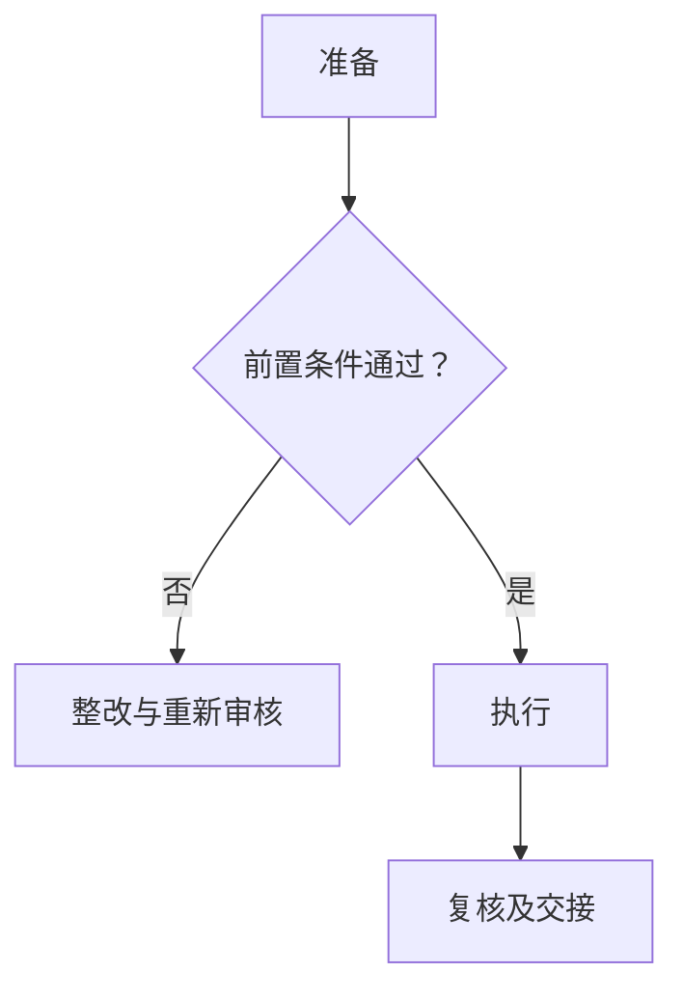

# SOP-XXX 【文件名称】标准作业程序

> **文件编号：SOP-XXX｜版本：V0.1（草案）｜审批状态：未批准｜生效日期：【待确认】**
>
> 本文件用于新建 SOP 的编制。具体业务限值、危险化学品操作条件、设备参数和原始数据应根据经批准的技术文件及适用风险评估填写。

## 编制与审批

| 编制 | 审核 | 安全/质量审核（适用时） | 批准 | 生效日期 |
| --- | --- | --- | --- | --- |
| 【待签】 | 【待签】 | 【待签】 | 【待签】 | 【待确认】 |

## 修订记录

| 版本 | 修订日期 | 修订内容 | 状态 |
| --- | --- | --- | --- |
| V0.1 | 【待确认】 | 初版草案 | 未批准 |

## 一、目的

【待填写：制定本 SOP 的目的和质量/安全目标】

## 二、适用范围

【待填写：适用任务、岗位、设备和不适用活动】

## 三、角色与职责

表 1　角色与职责

| 角色 | 主要职责 | 对应签字 |
| --- | --- | --- |
| 执行人 | 【待确认】 | 执行 |
| 复核人 | 【待确认】 | 复核 |
| 批准人 | 【待确认】 | 批准 |

## 四、术语和定义

术语见附录 C。

## 五、作业流程

### （一）流程总图

### （二）流程节点对照

表 2　流程节点对照

| 节点 | 条款 | 输出 |
| --- | --- | --- |
| 准备 | 五（三） | 【待确认】 |
| 执行 | 五（四） | 【待确认】 |

### （三）准备

【待填写：人员、资源、现场和文件核查】

表 3　资源准备清单

| 类别 | 项目 | 用途 | 结果 |
| --- | --- | --- | --- |
| 【待确认】 | 【待确认】 | 【待确认】 | ○/×/— |

### （四）执行

【待填写：按业务适用性分解工序、检查点、处置与记录】

表 4　过程检查项目

| 检查项 | 依据 | 记录 | 结果 |
| --- | --- | --- | --- |
| 【待确认】 | 【待确认】 | 【待确认】 | ○/×/— |

## 六、关键控制点与工艺参数

表 5　关键控制点

| 关口 | 判定依据 | 不满足时 | 记录 |
| --- | --- | --- | --- |
| 【待确认】 | 【待确认】 | 【待确认】 | 【待确认】 |

## 七、记录要求

### （一）记录表单

【待填写：关联内部或仓库表单】

### （二）填写规则

即时记录，修改留痕，审核权限清晰。

### （三）字段说明

表 6　字段说明

| 字段 | 填写要求 |
| --- | --- |
| 【待确认】 | 【待确认】 |

### （四）归档

【待确认：位置、期限、备份和权限】

## 八、异常与偏差处理

【待填写：发现、控制、报告、复核与关闭】

## 九、安全与环保

【待填写：实际危害、适用法规、应急和保密要求】

## 十、注意事项清单

- 【待填写：常见错误或关键提示】

## 十一、设备维护与报修

【待确认：适用设备或系统；不适用时说明原因】

## 十二、相关文件

【待确认：有效的 SOP、标准、手册与原始依据】

## 十三、附则

本文件未经批准不得作为现场作业依据；重大变更应复审。

## 附录 A　待确认事项清单

| 编号 | 事项 | 责任岗位 |
| --- | --- | --- |
| A1 | 【待确认】 | 【待确认】 |

## 附录 B　流程节点表

| 序号 | 节点 | 条件 |
| --- | --- | --- |
| 1 | 准备 | 【待确认】 |
| 2 | 执行 | 【待确认】 |

## 附录 C　术语和定义对照表

表 7　术语对照

| 术语 | 定义 |
| --- | --- |
| 【待确认】 | 【待确认】 |

## 附录 D　变更对照或专项说明（适用时）

【待填写：旧版条款映射、专项检查或特殊风险说明】
