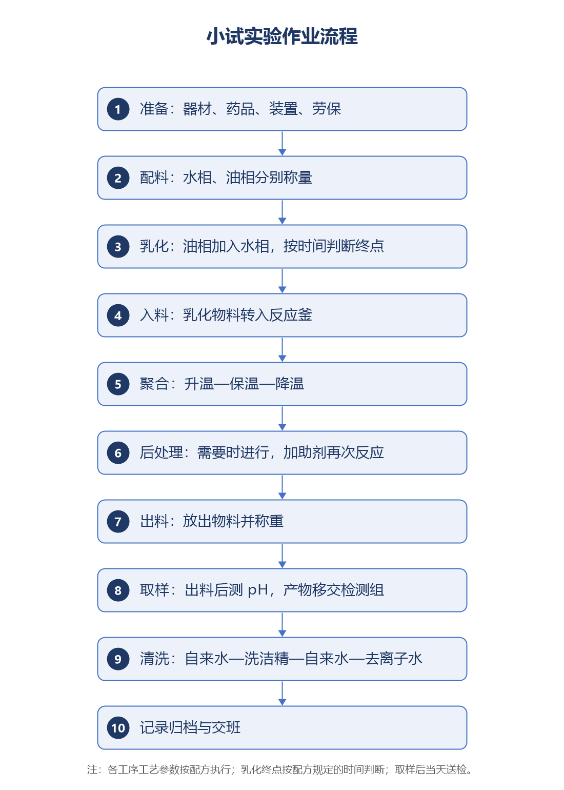

|                                        |                                     |
|----------------------------------------|-------------------------------------|
| 文件编号：JL-RD-SOP-20261029-002-V0.14 | 版　本：V0.14（草案）　　密级：内部 |

# 小试实验操作标准作业程序

（研发部实验组）

## 编制与审批

|          |          |          |                      |
|----------|----------|----------|----------------------|
| **编制** | **审核** | **批准** | **生效日期**         |
|          |          |          | 　　　年　　月　　日 |

## 修订记录

| **版本** | **修订日期** | **修订内容**                                                                                                                                                       | **修订人** |
|----------|--------------|--------------------------------------------------------------------------------------------------------------------------------------------------------------------|------------|
| V0.1     | 2026-11-07   | 首版框架，依《研发部实验组每日工作流程》与《实验流程记录》整理                                                                                                     | AI 拟稿    |
| V0.2     | 2026-11-07   | 补全章节结构、流程节点对照、记录与异常要求，未确认参数以黄底标注                                                                                                   | AI 拟稿    |
| V0.3     | 2026-11-07   | 依问答补入规模、角色职责、乳化与聚合参数来源、取样交检、清洗步骤；流程图改图片版                                                                                   | AI 拟稿    |
| V0.4     | 2026-11-07   | 合并器材与装置为一道准备工序；补器材用途、装置检查、空载测试与实验前校准；补水相／油相称量顺序；修正取样工序位置与流程图显示                                       | AI 拟稿    |
| V0.5     | 2026-11-07   | 配料复核改为称量时进行；表 1 复核人职责、表 5 增称量复核控制点；记录表增配料复核签字栏                                                                             | AI 拟稿    |
| V0.6     | 2026-11-07   | 反应釜归入装置；器材与装置按“领用／检查”重新分界，乳化机、制冷机、冰箱移入表 4；计时器校准列入实验前校准                                                           | AI 拟稿    |
| V0.7     | 2026-11-07   | 补入温控 0.5 ℃、氮气置换与 0.8 MPa、油相 −10 ℃／−1 ℃、硅溶胶 200 目过滤、管路自来水冲洗；校准按说明书与两温度段比对；空载测试定 3 天并配简表；后处理注明需要时进行 | AI 拟稿    |
| V0.8     | 2026-11-07   | 检查表统一改为○正常／×异常标注：表 3 增核对列、表 4 增结果列、表 5 结果列改标注式                                                                                  | AI 拟稿    |
| V0.9     | 2026-11-07   | 适用范围表述修正：主体设备为 2 L 反应釜（原误写为玻璃夹套反应釜），玻璃夹套仅指乳化用烧杯                                                                          | AI 拟稿    |
| V0.10    | 2026-11-07   | 表 2 删除“每日工作流程”列，改为与现行 SOP 目录的两列对照；说明该文件系小试 SOP 草稿，不再作为依据                                                                  | AI 拟稿    |
| V0.11    | 2026-11-07   | 后处理前置到反应结束、出料之前并重排五（七）至（九）；水相／油相、聚合、出料、后处理术语改写；术语表移入附录 C；“放料”统一为“出料”                                 | AI 拟稿    |
| V0.12    | 2026-11-07   | 器材与装置分类修正：药勺、冲洗瓶移出耗材清单，氮气瓶从装置表移出单列气源；容器须洁净干燥；制冷机 −25 ℃、冷冻冰柜 −15 ℃；氮气波动差 0.01 MPa                        | AI 拟稿    |
| V0.13    | 2026-11-07   | 修改一部分细节                                                                                                                                                     | 张嘉和     |
| V0.14    | 2026-11-07   | 以 V0.13 手改稿为母本回填：序号理顺、补全断句、表 2 顺序与表 4 新增行并入、附录 A 重算                                                                             | AI 拟稿    |

## 一、目的

为规范研发部小试实验的作业过程，统一器材准备、配料、乳化、聚合、后处理、出料、取样及清洗的操作方法与记录要求，保证实验过程可追溯、数据真实、结果可复现，并控制人员、设备与环境风险，制定本程序。

## 二、适用范围

（一）适用于研发部实验组小试实验：主体设备为 2 L 反应釜，单批投料量不超过 1.5 L。

（二）超出上述规模的中试实验，执行《中试实验操作》（JL-RD-SOP-003）。

（三）检测、产品固化与量产工艺，不在本程序范围内。

## 三、角色与职责

（一）实验组未作固定岗位划分，下列角色按工作内容划分，由实验组人员共同承担；记录表签字栏以角色为准，同一实验中操作人、复核人、确认人、审核人不得相互替代签字。

表 1　角色与职责

| **角色**           | **工作内容**                                                                                   | **对应签字栏** |
|--------------------|------------------------------------------------------------------------------------------------|----------------|
| **操作人**         | 实际执行配料、乳化、入料、聚合、后处理、出料、取样与交检、清洗等操作                           | 操作人         |
| **复核人**         | 领取原料；称量时全程在场核对操作与数据，发现错误及时提醒纠正；记录实验数据；称取完毕后放回原位 | 复核人         |
| **确认人**         | 将配方转写为具体实验表单（即《小试实验流程记录表》），保证转写与配方一致                       | 确认人         |
| **审核人**         | 审核配方本身是否正确，包括物料、用量与工艺参数                                                 | 审核人         |
| **检测员**         | 由检测组承担，接收样品并按项目检测、反馈数据                                                   | 检测记录       |
| **设备与安全兼管** | 由实验组指定人员兼管设备点检、维保报修与安全监督                                               | 点检记录       |

## 四、术语和定义

本程序所用术语见附录 C《术语和定义对照表》；术语随工艺与配方变化同步更新。

## 五、作业流程

### （一）流程总图

图 1　小试实验作业流程

### （二）流程节点对照

本程序按实验组现有《小试 SOP 目录》的模块顺序编排，对应关系如下。表中条款号按本章中文层级标注，如“五（四）”指本章第（四）节。

表 2　与实验组现行 SOP 目录的对应关系

| **SOP 目录中的模块**         | **本程序条款**   |
|------------------------------|------------------|
| 操作清单                     | 五（一）流程总图 |
| 准备操作                     | 五（三）         |
| 配料操作                     | 五（四）         |
| 乳化操作                     | 五（五）         |
| 入料操作                     | 五（六）1        |
| 聚合操作（升温／保温／降温） | 五（六）2～4     |
| 后处理操作                   | 五（七）         |
| 出料操作                     | 五（八）         |
| 取样操作                     | 五（九）         |
| 清洗操作                     | 五（十）         |
| 注意事项清单                 | 第十章           |
| 设备维修清单                 | 第十一章         |

### （三）实验准备

原料、器材领用与装置检查需在实验前一次完成，逐项勾选《小试实验前检查表》。原料、器材不足或装置带病不得开始实验。

划分口径：容器、耗材、工具、量具属器材，列入表 3 领用核对；反应釜、温控系统、乳化机、制冷机、冰箱等属装置，列入表 4 检查运行状态。

检查与判定结果一律用“○正常／×异常”标注；标×的须在说明栏或异常记录中写明原因与处理。

#### 1. 原料清点

（1）核对配方用量，逐项列出物料清单，注明代码、理论量与称量精度。

（2）核查库存与有效期，判断贮藏时间、颜色、状态是否正常；缺料应提前申购，原料齐全方可开始实验。

（3）冷藏物料（催化剂、引发剂等）单独存放，随称随取。

该项工作不得拖到实验当天，至少提前一天。

#### 2. 器材准备

按表 3 领用器材，核对名称、规格、数量与用途；容器须洁净、干燥、无残留，一次性器材不得重复使用。

表 3　器材清单

| **类别** | **名称与规格**          | **数量**       | **用途**                   | **核对（○／×）** |
|----------|-------------------------|----------------|----------------------------|------------------|
| 容器     | 夹套玻璃烧杯（2 L）     | 1 个           | 水相配液与乳化             |                  |
| 容器     | 抽滤瓶（1000 mL）       | 1 个           | 油相配料、盛放与降温       |                  |
| 容器     | 锥形瓶                  | 若干           | 油相配料备用容器           |                  |
| 容器     | 样品瓶（30 mL）         | 1 个           | 称取液相小料并暂存         |                  |
| 容器     | 量杯                    | 若干           | 称量去离子水、油相有机单体 |                  |
| 耗材     | 称量纸                  | 若干（一次性） | 固体称量                   |                  |
| 耗材     | 纸巾                    | 若干           | 擦拭滴漏、清洁容器口与台面 |                  |
| 耗材     | 塑料或玻璃滴管          | 若干（一次性） | 转移少量液体               |                  |
| 工具     | 漏斗                    | 1 个           | 转移物料、过滤             |                  |
| 工具     | 计时器                  | 1 个           | 控制搅拌、乳化、保温时间   |                  |
| 仪器     | 电子精密天平（0.002 g） | 1 台           | 小料称量                   |                  |
| 仪器     | 电子天平（0.01 g）      | 2 台           | 大料称量                   |                  |
| 仪器     | pH 计（0.01）           | 1 台           | 水相与乳液 pH 测定         |                  |

药勺固定存放于原料处，冲洗瓶常置于配料台，二者均不列入耗材领用；缺失或损坏时另行领用。

要有备用的器材，以便随时更换。

#### 3. 装置检查

装置需逐台检查并记录；检查不合格的装置挂牌停用，并及时报修，修复后方经验证可行后再使用。长时间停机的装置需进行空载测试流程，验证合格后方可使用。

表 4　装置检查项目

| **装置**           | **检查内容**                                         | **判定标准**                                       | **结果（○正常／×异常）** |
|--------------------|------------------------------------------------------|----------------------------------------------------|--------------------------|
| **反应釜（2 L）**  | 釜体洁净、密封件完好、气密性、搅拌转向与声响         | 无渗漏、无异响、转向正确                           |                          |
| **温控系统**       | 设定值与实测值是否一致，加热与冷却切换是否正常       | 偏差不超过 0.5 ℃                                   |                          |
| **水槽**           | 水位、水温、循环是否通畅                             | 无渗漏、循环正常                                   |                          |
| **乳化机**         | 启动是否平稳，搅拌头是否完好，转速能否调节           | 无抖动、无异响、调速正常                           |                          |
| **制冷机**         | 制冷是否正常、冷却液是否充足                         | 设定温度 −25 ℃，实测达到设定值                     |                          |
| **冷冻冰柜**       | 冷冻温度是否达标、门封是否严密、结霜是否影响取放     | 设定温度 −15 ℃                                     |                          |
| **气源（氮气瓶）** | 氮气瓶是否固定牢靠、余量是否充足，减压阀与管路无泄漏 | 固定牢靠，余量充足，减压阀与管路无泄漏             |                          |
| **通风（排气扇）** | <mark>【待确认：通风检查内容】</mark>   | <mark>【待确认：通风判定标准】</mark> |                          |

#### 4. 长时间停机后的空载测试

本节内容拟单独编制为 SOP，形成后本程序改为引用。

（1）装置连续停机超过 3 天后重新开机，须先做空载测试，合格后方可投料；停机不足 3 天的，按日常班前检查执行。

（2）空载测试以装置为对象，覆盖与反应相关的一整套：温控系统升降温与恒温保持、反应釜空转与气密性、水槽加热与循环、乳化机空转与调速、制冷机制冷。

（3）判定：空载运行正常、各项动作到位即可投料，具体指标参照各装置说明书。

（4）测试结果记入表 5，不合格的修复后复测，复测合格方可使用。

表 5　空载测试记录（简化版）

| **装置**     | **测试项目**           | **结果（○正常／×异常）** | **异常处理** |
|--------------|------------------------|--------------------------|--------------|
| **温控系统** | 升温、降温、恒温保持   |                          |              |
| **反应釜**   | 空转、搅拌转向、气密性 |                          |              |
| **水槽**     | 加热、循环             |                          |              |
| **乳化机**   | 空转、调速             |                          |              |
| **制冷机**   | 制冷、冷却液           |                          |              |
| **冷冻冰柜** | 冷冻温度               |                          |              |

#### 5. 计量仪器校准

每次试验前校准；计量器具的要求除下列最低要求外，均按各自说明书执行。说明书名称及对应内容在说明书中的位置，待补齐后填入。

（1）pH 计：按说明书实行两点标定；电极斜率要求按说明书，斜率不合格或漂移明显时更换电极。

（2）反应釜温度计：在 50～70 ℃、70～90 ℃ 两个温度段分别与标准温度计比对，偏差达 0.5 ℃ 时修正；出现急剧波动等异常漂移时及时更换。

（3）其他装置：按各自说明书要求执行。

（4）校准记录：记录标准值、实际值、偏差值，记入《仪器校准记录》；校准不合格的仪器不得用于实验。

#### 6. 人员与现场

（1）实验人员必须穿戴实验服、护目镜、丁腈手套，长发束起；涉及挥发性物料时在通风柜内操作。

（2）配料区、实验区、堆放区、休息室必须清洁整齐，确保安全通道畅通，通风系统运转正常。

### （四）配料

配料除区分大料、小料外，还须按规定顺序加料，需看具体配方而定：顺序错了会导致固体结块、助剂失效或硅溶胶提前凝胶。

#### 1. 称量通则

（1）大料大于 5 g、小料不大于 5 g，分列记录，不得合并。

（2）复核人负责领取原料，操作人确认后方可称取；称取完毕后由复核人放回原位。

（3）冷藏物料（催化剂、引发剂等）随称随取，称完立即放回冰箱，不得在室温久置。

（4）易挥发组分（MA、S53 等）最后称量，称完立即混匀，及时进行乳化操作。

（5）每称完一项立即记录，不得攒到工序结束再补记。

（6）相关实验人员需在清单上签字。

#### 2. 水相配料

（1）按配方要求完成水相原料称量，称量误差不超过 3%。

（2）原料需在搅拌下加入水中。

（3）硅溶胶 S03J 或 S03BT 最后加入，经 200 目过滤网过滤后在搅拌时缓慢加入。

（4）搅拌均匀后，加入 S04，测定并调节 pH 至配方规定值。

（5）调节完 pH，将水相倒入夹套玻璃烧杯，打开冷却循环，降温至<mark>【待确认：水相降温目标温度】</mark>。

#### 3. 油相配料

（1）用样品瓶称取液相小料，称后置于一旁待用。

（2）称取固体助剂：催化剂、引发剂自冰箱随取随称，称完立即放回原处。

（3）固体助剂称好后放入油相容器（锥形瓶或抽滤瓶）。

（4）用量杯称取油相大料（一般为有机单体，用量大）。

（5）用油相大料将样品瓶中的小料润洗并入油相容器。

（6）油相原料在容器内混合均匀后放入冰箱冷藏至 −10 ℃。

#### 4. 配料复核

称量时，复核人全程在场逐项核对物料代码、理论量、实际称取量、天平读数与加料顺序，确认无误后双方签字；顺序与配方不一致的须返工。偏差超出允许范围时按第八章处理。

### （五）乳化

水相与油相的温度都达到要求后，将油相取出，并加入易挥发的原料混合均匀后，立即进行乳化操作。

（1）投料顺序为油相加入水相。

（2）乳化机转速、乳化温度、具体操作按配方规定执行。

（3）乳化终点以时间判断：达到配方规定的乳化时间且体系外观均匀，即视为乳化完成。

（4）转速由低到高逐级调整，避免物料飞溅与气泡卷入；过程中监控温度，偏离配方要求时暂停并上报。

（5）乳化完毕记录实际乳化时间、温度与外观，随即转入入料工序。

### （六）入料与聚合

#### 1. 入料

（1）确认釜内清洁、干燥、无残留，密封件完好。

（2）按配方规定的入料方式与入料量，将乳化物料转入反应釜，用少量去离子水冲洗管路与容器，洗液并入釜内。及时盖上釜盖，按顺序拧紧螺母。

（3）开启搅拌，转速按配方规定执行，确认转向与运转正常。

（4）使用氮气充压至 0.4 MPa → 泄压至 0.3 MPa → 再充至 0.8 MPa；反应期间维持 0.8 MPa，上下波动差不超过 0.01 MPa。

（5）充氮加压后，需检查是否漏气，确保无气体泄漏后，再升温。

#### 2. 反应

（1）按配方设定好水槽和反应釜的温控参数并启动程序。

（2）按相关规定，在值班期间需每隔半小时巡检正在运转的反应装置，并记录水槽和反应釜的温度、压力数据。

（3）还应观察温度曲线，确保温控系统正常运转。

#### 3. 保温与反应

（1）到达目标温度后转入保温，保温时长按配方执行。

（2）观察物料外观、黏度、颜色变化，出现爬杆、结块、凝胶等异常按第八章处置。

（3）保温期间操作人不得离岗，值守范围以能观察到釜体与仪表为准。

（4）反应结束后，温控程序会自动降温，当反应釜达到出料温度时，需要后处理的转入（七）后处理，不需要后处理的直接转入（八）出料。

### （七）后处理（需要时进行）

后处理指特定配方在反应结束后、出料之前，额外添加助剂再次反应的操作；后处理完成后方可出料。

### （八）出料

（1）出料前检查接收容器清洁度，并做好编号；

（2）确认釜温降至配方规定的出料温度，压力泄至常压。关闭搅拌，打开釜盖，观察物料状态并做好相关记录，再进行出料。

（3）物料经过<mark>【待确认：过滤目数或筛网规格】</mark>，接收容器称重并记录。

（4）出料结束后用自来水水管冲洗管路，废液收集不得直排。

### （九）取样与交检

（1）出料后立即取样，小试取的样品即全部产物，实验组先测定样品的 pH。

（2）测定完成后全部移交检测组；

（3）当天出料当天取样，及时送检，不得隔夜；标签注明实验编号、工序、取样日期与取样人。

### （十）清洗与复位

（1）出料后立即清洗。容器、乳化机、反应釜按下列顺序进行：

1）用自来水冲洗，去除残留液 1 次。

2）用洗洁精配合清洗工具去除顽固污渍，直至表面无残留。

3）用自来水冲洗干净 1 次。

4）用去离子水润洗 2 次。

（2）清洗废液分类收集，贴标后交<mark>【待确认：废液处置去向】</mark>处理，不得直排。

（3）器材清洗后倒置晾干、归位；台面、地面清洁，废弃物清出。

（4）设备断电、断气、泄压，阀门复位，安全护罩复位。

（5）填写清洗与交接记录。

## 六、关键控制点与工艺参数

下表汇总各工序的关键控制点。参数为本程序核心内容，需按产品类别分别确认；产品专用参数建议另附《产品工艺参数卡》，本程序只保留通用要求。

表 6　关键控制点与参数

| **工序**   | **控制点**             | **控制标准**                                                                            | **记录要求**    |
|------------|------------------------|-----------------------------------------------------------------------------------------|-----------------|
| **准备**   | 器材洁净与完好         | 无破损、无残留、标记清晰                                                                | 器材清单        |
| **准备**   | 装置检查与气密性       | 按表 4 逐项检查；温控偏差不超过 0.5 ℃                                                   | 班前检查单      |
| **准备**   | 长时间停机后的空载测试 | 停机超过 3 天须做空载测试，运行正常方可投料                                             | 空载测试记录    |
| **准备**   | 实验前校准             | pH 计两点标定；温度计分 50～70 ℃、70～90 ℃ 比对；记录标准值／实际值／偏差值             | 校准记录        |
| **配料**   | 称量精度               | 小料 0.002 g，大料 0.01 g                                                               | 理论量／称取量  |
| **配料**   | 称量复核               | 复核人在称量时逐项核对代码、理论量、称取量、天平读数与加料顺序                          | 双人签字        |
| **配料**   | 大小料分称             | 不大于 5 g 为小料，大于 5 g 为大料，分列记录                                            | 记录表          |
| **配料**   | 易挥发组分             | MA、S53 最后称量，称后立即混匀                                                          | 记录表          |
| **配料**   | 水相加料顺序           | 水—固体—水与液体助剂—硅溶胶 S03J／S03BT（200 目过滤）—搅拌—S04 调 pH                    | 记录表          |
| **配料**   | 油相加料顺序           | 液相小料—固体助剂—油相大料—小料润洗混匀—冷藏                                            | 记录表          |
| **配料**   | 冷藏物料取用           | 随称随取、称完即放回；复核人领料                                                        | 记录表          |
| **配料**   | 水相称量与降温         | 称量误差不超过 3%；调 pH 后降温至<mark>【待确认：水相降温目标温度】</mark> | 称取量、温度    |
| **配料**   | 水相 pH                | 按配方规定                                                                              | pH 值、复核人   |
| **配料**   | 油相降温               | 冷藏至 −10 ℃                                                                            | 温度            |
| **乳化**   | 投料顺序               | 油相加入水相                                                                            | 记录表          |
| **乳化**   | 转速／温度             | 按配方规定                                                                              | 记录表          |
| **乳化**   | 终点判断               | 达到配方规定时间且外观均匀                                                              | 乳化时间与外观  |
| **入料**   | 入料方式与入料量       | 按配方规定                                                                              | 入料记录        |
| **入料**   | 氮气置换               | 充至 0.4 MPa → 泄至 0.3 MPa → 充至 0.8 MPa；反应期间维持 0.8 MPa，波动差不超过 0.01 MPa | 置换记录        |
| **聚合**   | 目标温度与升温速率     | 按配方规定                                                                              | 温度曲线        |
| **聚合**   | 保温时长               | 按配方规定                                                                              | 时间记录        |
| **聚合**   | 值班巡检               | 每半小时巡检并记录水槽与反应釜的温度、压力                                              | 巡检记录        |
| **聚合**   | 釜内压力上限           | <mark>【待确认：聚合釜压上限，由第三方提供】</mark>                        | 压力记录        |
| **聚合**   | 降温终点               | 按配方规定                                                                              | 温度            |
| **后处理** | 是否需要及工艺         | 特定配方反应结束后、出料前加助剂再次反应，处理完毕方可出料                              | 后处理记录      |
| **出料**   | 出料温度与泄压         | 按配方规定；出料前泄至常压                                                              | 温度、称重      |
| **取样**   | 出料后 pH 与交检       | 产物全部交检测组，pH 出料后即时测定                                                     | pH 值、交检记录 |
| **检测**   | 检测项目               | TMA、粒径、光学显微镜、转化率                                                           | 检测记录        |
| **清洗**   | 清洗方式               | 自来水冲洗→洗洁精除污→自来水冲洗→去离子水润洗 2 次                                      | 清洗记录        |

## 七、记录要求

### （一）记录表单

实验过程使用《小试实验流程记录表》，一实验一表，编号与实验编号一致；异常另填《实验异常记录表》。

### （二）填写规则

（1）实时记录，字迹清晰，不得事后补记、不得代签。

（2）使用蓝黑钢笔或签字笔；电子记录应可追溯修改痕迹。

（3）笔误更正采用划改：原数据保留可辨，旁注正确值并签名、注明日期，不得涂改或使用修正液。

（4）数值按有效数字记录，单位与仪器显示一致，不得估读或凑整。

### （三）字段说明

表 7　《小试实验流程记录表》字段说明

| **字段**       | **填写要求**                                     |
|----------------|--------------------------------------------------|
| 实验型号       | 产品代号，如 916；同一产品不同配方另编型号       |
| 实验编号       | 一实验一编号，与归档目录、样品标签一致           |
| 流程           | 水相配料、油相配料、乳化、聚合、出料、取样、清洗 |
| 代码           | 物料代码，与配方单一致                           |
| 理论量         | 按配方计算应加入量                               |
| 称取量         | 实际称取量，保留至天平精度                       |
| 实验现象       | 外观、颜色、黏度、分层、凝胶等，异常须描述清楚   |
| 起始／结束时间 | 记录到分钟                                       |
| 操作人／复核人 | 实际操作与核对人员签名，不得代签                 |
| pH             | 水相调节后、聚合过程中的实测值                   |
| 确认人／审核人 | 确认人为配方转写人，审核人为配方审核人           |

### （四）归档

记录表经审核后按实验编号归档，保存期<mark>【待确认：记录保存年限】</mark>\_\_\_\_ 年，电子版同步备份。

## 八、异常与偏差处理

（一）出现超温、超压、泄漏、异常声响、物料凝胶或分层等情形，操作人立即停止加热或降负荷，必要时泄压、断电，确保人员安全后再排查。

（二）异常发生后<mark>【待确认：异常上报时限】</mark>\_\_\_\_ 小时内报告实验组长；涉及人员伤害、火情、物料外泄的，立即报告部门负责人与安全员。

（三）填写《实验异常记录表》，记录时间、工序、参数、现象、处置措施与结论。

（四）判定为偏差的，由实验组长确定是否作废重做、部分重做或在偏差说明后继续；影响数据的，原实验数据标注失效并说明理由。

（五）异常原因未查明前，不得重复相同操作；重复发生两次以上的，纳入变更管理并修订本程序。

## 九、安全与环保

（一）劳保：实验服、护目镜、丁腈手套为基本配置；接触挥发性、刺激性物料时加戴防毒面具。

（二）化学品：按 MSDS 要求使用与存放；MA、S53 等易挥发物料在通风柜内操作并远离火源；不相容物料分区存放。

（三）高温高压：釜体温度上限<mark>【待确认：釜体温度上限】</mark>\_\_\_\_ ℃；聚合釜压上限由第三方提供，资料到位后填入，超限自动切断加热并报警。

（四）气瓶：氮气瓶直立固定，远离热源，使用后关闭总阀。

（五）废弃物：废液、废料分类收集、贴标，交<mark>【待确认：废弃物处置责任方】</mark>处置，禁止倒入下水道。

（六）应急：泄漏用吸附棉围堵收集；灼伤立即用大量清水冲洗并就医；火情先断电断气、使用就近灭火器材；应急集合点<mark>【待确认：应急集合点位置】</mark>。

## 十、注意事项清单

（一）配料时先固后液、先大料后小料，易挥发组分最后称量并立即混匀。

（二）称量纸一次性使用，药勺按物料专用，取用后立即盖回原容器，防止交叉污染。

（三）乳化先低速润湿再升至工艺转速，避免气泡卷入与物料飞溅。

（四）升温前必须确认气密性与氮气置换到位，升降温速率受控。

（五）聚合过程不得离人；发现压力异常上升立即停止加热。

（六）高温取样与出料须戴隔热手套，阀门缓慢开启。

（七）实验结束清理台面、废液入桶、器材归位、设备断电断气。

（八）<mark>【待确认：设备易损件清单】</mark>需列入清单的易损件与更换周期。

## 十一、设备维护与报修

（一）日常点检：按每日工作流程检查反应釜、温控、压力、搅拌系统，填写点检记录。

（二）校准：天平、pH 计、温度计按周期校准，校准过期或超差不得使用。

（三）报修：发现异常立即停机、挂牌，报设备管理员；维修后由使用人确认功能正常方可恢复实验。

（四）维修记录：故障现象、处理措施、更换部件、维修人、日期一并记录，纳入设备台账。

<mark>【待确认：设备台账与校准周期】</mark>设备台账、点检表的现行编号及校准周期。

## 十二、相关文件

《研发部实验组每日工作流程》

《固体称量规范》

《油相液体称量规范》

《水相液体称量规范》

《小试实验流程记录表》

《实验异常记录表》

《中试实验操作》（JL-RD-SOP-003）

<mark>【待确认：引用文件的正式编号】</mark>上述规范是否已成文、现行编号是什么。

## 十三、附则

（一）本程序由研发部实验组负责编制与修订，经部门负责人审核、公司批准后实施。

（二）本程序自生效之日起执行，每<mark>【待确认：复审周期】</mark>\_\_\_\_ 年复审一次；工艺参数、设备或组织结构发生重大变化时及时修订。

（三）本程序为草案，未经批准不得作为操作依据。

（四）文件编号实行两套并行：系统管理用编号为 JL-RD-SOP-年月日-序号-版本（例 JL-RD-SOP-20261029-002-V1.0）；文件名用简洁编号 JL-RD-SOP-序号＋名称＋版本（例 JL-RD-SOP-002 小试实验操作 V1.0.docx）。两套编号一一对应，版本号同步更新。

## 附录 A　待确认事项清单

下列 15 项在编写过程中无法确定，暂以黄底标注，确认后替换为正式内容即可形成送审稿。每条注明所处条款与原文片段，便于按图索骥。

**五、作业流程（5 项）**

1\. 〔表 4　装置检查项目 · 3. 装置检查〕<mark>【待确认：通风检查内容】</mark>

2\. 〔表 4　装置检查项目 · 3. 装置检查〕<mark>【待确认：通风判定标准】</mark>

3\. 〔五、（四）配料 2. 水相配料〕（5）调节完 pH，将水相倒入夹套玻璃烧杯，打开冷却循环，降温至<mark>【待确认：水相降温目标温度】</mark>

4\. 〔五、（八）出料〕（3）物料经过<mark>【待确认：过滤目数或筛网规格】</mark>，接收容器称重并记录

5\. 〔五、（十）清洗与复位〕（2）清洗废液分类收集，贴标后交<mark>【待确认：废液处置去向】</mark>处理，不得直排

**六、关键控制点与工艺参数（1 项）**

6\. 〔表 6　关键控制点与参数〕<mark>【待确认：聚合釜压上限，由第三方提供】</mark>

**七、记录要求（1 项）**

7\. 〔七、（四）归档〕记录表经审核后按实验编号归档，保存期<mark>【待确认：记录保存年限】</mark>\_\_\_\_ 年，电子版同步备份

**八、异常与偏差处理（1 项）**

8\. 〔八、异常与偏差处理〕（二）异常发生后<mark>【待确认：异常上报时限】</mark>\_\_\_\_ 小时内报告实验组长；涉及人员伤害、火情、物料外泄的，立即报告部门负责人与安全员

**九、安全与环保（3 项）**

9\. 〔九、安全与环保〕（三）高温高压：釜体温度上限<mark>【待确认：釜体温度上限】</mark>\_\_\_\_ ℃；聚合釜压上限由第三方提供，资料到位后填入，超限自动切断加热并报警

10\. 〔九、安全与环保〕（五）废弃物：废液、废料分类收集、贴标，交<mark>【待确认：废弃物处置责任方】</mark>处置，禁止倒入下水道

11\. 〔九、安全与环保〕应急集合点<mark>【待确认：应急集合点位置】</mark>

**十、注意事项清单（1 项）**

12\. 〔十、注意事项清单〕（八）<mark>【待确认：设备易损件清单】</mark>需列入清单的易损件与更换周期

**十一、设备维护与报修（1 项）**

13\. 〔十一、设备维护与报修〕<mark>【待确认：设备台账与校准周期】</mark>设备台账、点检表的现行编号及校准周期

**十二、相关文件（1 项）**

14\. 〔十二、相关文件〕<mark>【待确认：引用文件的正式编号】</mark>上述规范是否已成文、现行编号是什么

**十三、附则（1 项）**

15\. 〔十三、附则〕（二）本程序自生效之日起执行，每<mark>【待确认：复审周期】</mark>\_\_\_\_ 年复审一次；工艺参数、设备或组织结构发生重大变化时及时修订

## 附录 B　流程节点表（表格版，便于修改）

下表与正文图 1 内容一致，供在 Word 中直接增删节点使用；修改时两处须同步。

|                                           |
|-------------------------------------------|
| **准备（器材／药品／装置／劳保）**        |
| ↓                                         |
| **配料（水相、油相分称）**                |
| ↓                                         |
| **乳化（油相加入水相，按时间判断终点）**  |
| ↓                                         |
| **入料（转入反应釜）**                    |
| ↓                                         |
| **聚合（升温—保温—降温）**                |
| ↓                                         |
| **后处理（需要时进行，加助剂再次反应）**  |
| ↓                                         |
| **出料（放出物料并称重）**                |
| ↓                                         |
| **取样（测 pH 并移交检测组）**            |
| ↓                                         |
| **清洗（自来水—洗洁精—自来水—去离子水）** |
| ↓                                         |
| **记录归档与交班**                        |

## 附录 C　术语和定义对照表

本表按工艺顺序排列，供查阅；术语随配方与工艺变化同步更新，修订时须与正文条款一并校对。

表 8　术语和定义

| **术语**       | **定义**                                                                             |
|----------------|--------------------------------------------------------------------------------------|
| **小料**       | 单次称取质量不大于 5 g 的物料。                                                      |
| **大料**       | 单次称取质量大于 5 g 的物料。                                                        |
| **水相**       | 配方中注明的、以去离子水为主体，并需向其中加入其他助剂原料，经混合后形成的物料体系。 |
| **油相**       | 配方中注明的、以有机单体为主体，并需向其中加入其他助剂原料，经混合后形成的物料体系。 |
| **乳化**       | 在剪切作用下将油相分散于水相、形成稳定乳液的工序。                                   |
| **聚合**       | 乳液在控温条件下发生反应的工序。                                                     |
| **入料**       | 将乳化后的物料转入反应釜的操作。                                                     |
| **后处理**     | 特定产品在反应结束后、出料之前，额外添加助剂再次反应的操作；后处理完成后方可出料。   |
| **出料**       | 反应（含需要时的后处理）结束后，将物料从反应釜中放出的操作。                         |
| **取样与交检** | 出料后取样测定 pH，并将产物移交检测组的操作。                                        |
| **清洗**       | 出料后对容器、乳化机、反应釜及管路进行的清洗与复位。                                 |
| **留样**       | 按规定留存的样品。                                                                   |
| **TMA**        | 热机械分析，用于评价样品的热机械性能。                                               |
| **转化率**     | 单体转化为聚合物的比例。                                                             |
| **粒径**       | 乳液或微球颗粒的尺寸及分布。                                                         |
| **空载测试**   | 设备不投料空跑，检查转动、控温、制冷与气密等是否正常的测试。                         |
| **送检**       | 将样品移交检测组进行检测的行为。                                                     |
