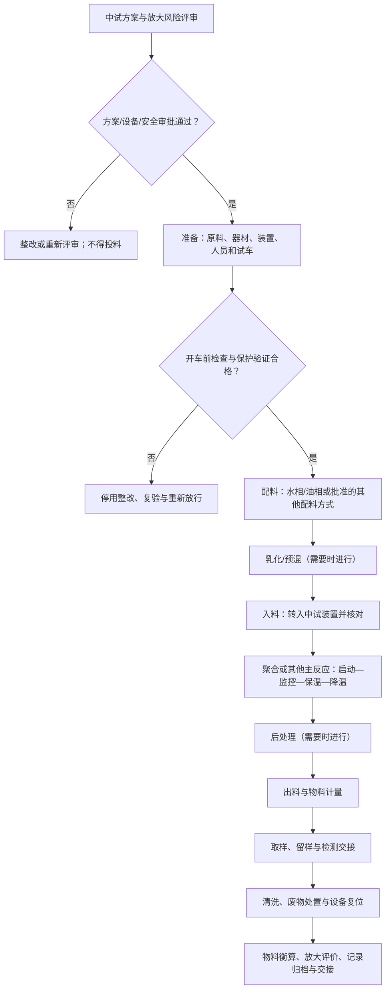

# SOP-003 中试实验操作标准作业程序

> **文件编号：SOP-003｜版本：V0.3（草案）｜公开通用模板｜审批状态：未批准｜生效日期：【待确认】**
>
> 本稿以 [SOP-002《小试实验操作》V0.14](SOP-002_小试实验操作.md) 的**章节组织和管理逻辑**为母版编制，并继承本文件原 V0.2 的放大风险、设备验证、开车许可、物料衡算等内容。**不等于小试工艺参数可以直接放大使用**。中试工艺、设备边界和危险化学品操作条件必须由具体项目的内部受控文件与风险评估确定。
>
> **草案提示：未经技术、设备、安全及授权管理审批，本程序不得用于中试现场作业。** 任何「【待确认】」事项都不是允许自行推断的参数。

## 编制与审批

| 编制 | 技术审核 | 设备/安全审核 | 批准 | 生效日期 |
| --- | --- | --- | --- | --- |
| 【待签】 | 【待签】 | 【待签】 | 【待签】 | 【待确认】 |

## 修订记录

| 版本 | 日期 | 修订内容 | 状态 |
| --- | --- | --- | --- |
| V0.1 | 2026-11-09 | 中试实验操作通用框架 | 草案 |
| V0.2 | 2026-11-09 | 补充放大评审、开车安全、物料衡算、执行证据及参考资料 | 草案 |
| V0.3 | 2026-11-09 | 参照小试 V0.14 的章节体系，完善准备/配料/乳化/入料聚合/后处理/出料/交检/清洗、检查表、控制点与三份附录 | 草案，未批准 |

## 一、目的

为规范研发部中试实验从试验立项与放大评审、器材及装置准备、配料、乳化、入料、聚合、后处理、出料、取样交检、清洗复位到数据归档和总结的全过程，统一岗位职责、检查与复核方式，确保原始数据真实、物料与样品可追溯、人员与设备风险受到管理，并为后续工艺放大决策提供可检验证据，制定本程序。

## 二、适用范围

（一）适用于**经批准的中试放大或工艺验证**活动，具体项目、设备、工作量及批次规模由批准的中试方案确定；本文件不自行定义通用容积、压力、温度或产能上限。

（二）小试实验执行 [SOP-002《小试实验操作》](SOP-002_小试实验操作.md)。在小试有效数据基础上进入中试前，应完成设备适用性、工艺差异、放热与传热、混合/搅拌、原辅材料相容性、泄放和应急能力的专项审查。

（三）本程序用于中试操作管理，不代替设备操作手册、危害评估、应急预案、试验专用工艺参数卡、检验方法及适用法规；不自动授权量产操作。

（四）**与小试的边界：**小试使用的反应釜容积、单批量、称量界限、氮气置换过程、控温精度、乳化转速和冷却方式等均不得直接作为中试设备的设定依据。

## 三、角色与职责

中试参与人员的实际任职按已批准的任务组织表确定；可以兼任非冲突岗位，但配料及关键操作复核、技术审核、开车安全放行等应保持相应独立性，不得自行审核自己未被授权的决定。

表 1　中试角色与职责

| 角色 | 工作内容 | 对应记录或签字栏 |
| --- | --- | --- |
| 中试负责人 | 组织放大评审、资源安排、任务授权、过程状态决策和总结审核 | 负责人／放行人 |
| 工艺编制／确认人 | 将已批准配方及小试验证结果转为中试工艺参数卡、批记录和采样计划，检查版本一致性 | 工艺编制／确认人 |
| 技术审核人 | 独立审查物料、批量、操作顺序、温控与压力边界、风险控制和放大逻辑 | 技术审核人 |
| 操作人 | 实施准备、配料、乳化（适用时）、入料、反应、后处理、出料、清洗；即时填写实际数据 | 操作人 |
| 复核人 | 对物料身份、称量、转移、关键阀位、批记录和重要操作现场核对；不得代签 | 复核人 |
| 设备负责人 | 确认装置、仪表、联锁、泄压与公用工程处于可用状态；组织试运行及报修 | 设备检查／验证人 |
| 安全／环保负责人 | 评估放大风险、个人暴露、通风、废物和紧急处置；参与试运行放行 | 安全确认人 |
| 取样／检测人员 | 按采样计划接收、检测、留样和反馈数据；维护样品链 | 交检／检测记录 |
| 记录管理／归档人 | 汇总批记录、趋势、检查、异常及物料平衡；存档与备份 | 归档确认人 |

## 四、术语和定义

本程序术语见附录 C。工艺和设备的定义如与批准的专用文件不一致，应先启动文件审查或变更，而非直接按本模板操作。

## 五、作业流程

### （一）流程总图

图 1　中试实验作业流程（通用逻辑，具体项目按批准工艺卡执行）

注：非乳液体系可将“水相/油相”和“乳化”工序标为**不适用**；并非必须为所有中试增加此工序。发生异常时按第八章及受控应急程序处理，不能沿图示继续操作。

### （二）流程节点对照

表 2　中试流程模块与本文条款

| 工序模块 | 本程序对应条款 | 主要输出 |
| --- | --- | --- |
| 总体流程与放行 | 五（一）至五（二） | 流程和阶段放行路径 |
| 准备与试运行 | 五（三） | 放大评审、器材及装置检查、开车许可 |
| 配料 | 五（四） | 实际称取/转移量及复核签字 |
| 乳化或预混（适用时） | 五（五） | 乳化状态、过程数据与终点 |
| 入料与反应 | 五（六） | 入料确认、运行曲线及巡检 |
| 后处理（需要时） | 五（七） | 专用工艺卡对应的后处理记录 |
| 出料 | 五（八） | 产物状态、重量和容器标识 |
| 取样与交检 | 五（九） | 样品标签、检测交接和结果关联 |
| 清洗与复位 | 五（十） | 设备复位和废物流向 |
| 物料衡算与中试总结 | 五（十一） | 放大结论、偏差/变更、记录归档 |
| 安全/维护/异常 | 第八至十一章 | 异常与设备处置记录 |

### （三）中试准备

**放行原则：** 中试准备除继承小试的“原料—器材—装置—计量—人员”核对外，必须额外完成“放大评审—安全设施验证—试运行—开车许可”。所有项目应在相关工序启动前形成记录，出现不合格、缺项或批准文件不一致时，不得开始投料。检查结果采用“○合格／×不合格／—不适用”标注，不能以“不适用”绕过必要的保护。

#### 1. 放大方案与风险评审

（1）收集与目标产品相关的小试实验及检测记录、异常记录、配方与参数卡版本，说明哪些结果已重复验证、哪些仍属于单次探索。

（2）编制中试放大方案：明确目标、规模、设备清单、工艺差异、预期数据、取样计划、停机条件、需要的人员及资源。目标规模和批量为**【待确认：项目专用规模】**。

（3）评估规模变化带来的传热、搅拌、传质、反应热、压力、挥发与排放、惰化需求和人员暴露风险；必要时形成专项工程评审。凡缺乏设备设计及风险评价依据的安全边界，均应保持未确认。

（4）确认报警、联锁、泄放、停水停电停气等异常情况下的安全响应已被设计和验证；逐项确认风险控制措施责任人及证据。

（5）方案、工艺卡和试车计划应由技术、设备和安全相关人员审核，经授权负责人批准后，方可进入投料准备。

#### 2. 原料清点

（1）将批准的中试配方转写为物料清单，逐项核对品名或内部代号、理论量、批次、包装规格、称量能力和储存条件；中试配方单仅保存在内部受控系统。

（2）核验库存、标签、有效期、SDS、不相容性与储存环境；短缺、破损、身份不明或受污染的物料不得直接使用。

（3）需冷藏、避光、惰性气氛或特殊保存的物料，按物料 SDS 和批准的工艺卡执行；不得简单照搬小试的冷藏温度或称量顺序。

（4）完成批量计算和独立复核，明确计划损耗、残留、回收与取样量的核算方法；异常批量调整按 SOP-020 处理。

#### 3. 器材准备

容器、量具、工具及耗材按表 3 清点；必须清洁、标识清晰、材质相容，且容量/耐受性符合本批中试要求。表内为类别示例，**不是实际采购或设备配备定额**。

表 3　中试器材领用与用途

| 类别 | 器材及规格（示例） | 数量 | 用途/核对重点 | 结果 |
| --- | --- | --- | --- | --- |
| 容器 | 配液槽/中转罐/接收容器 | 按实际配置 | 相配料、暂存、出料；须确认容积、相容性及标签 | ○/×/— |
| 容器 | 样品瓶、留样瓶、密闭转运容器 | 按采样计划 | 过程采样、交检与留样；需适宜密封和危害标识 | ○/×/— |
| 器具 | 漏斗、过滤件、连接软管、转移接头 | 按设备设计 | 转移与过滤；需核对材质、耐受性和连接方式 | ○/×/— |
| 量具 | 经确认适用的天平、计量容器、流量/质量计 | 按方法配置 | 配料称量、物料衡算和转移计量 | ○/×/— |
| 仪表 | pH计、温度计、压力表及其他专用计量设备 | 按检测方案 | 过程检查与质量监测；状态与校准可追溯 | ○/×/— |
| 工具 | 计时与记录工具、设备专用工具 | 按工序配置 | 过程计时、点检和装置维护；工具专用归位 | ○/×/— |
| 耗材 | 称量纸、滴管、吸附材料、个人防护用品 | 按批准计划 | 取样、擦拭及防污染；一次性物品按规定处置 | ○/×/— |

#### 4. 装置检查

装置逐台检查；检查不合格挂牌停用，修复后按适用的验证程序复验。中试涉及压力和放热风险的设备，不得仅凭外观检查判定可开车。

表 4　装置检查项目

| 装置 | 检查内容 | 放行/判定依据 | 核验责任 |
| --- | --- | --- | --- |
| 中试反应装置（容量与型号待确认） | 釜体、材质、密封、搅拌、支撑及铭牌状态 | 满足已批准适用性与设计资料；无异常泄漏、变形和异响 | 设备点检及放行人 |
| 压力测量、泄放与保护系统 | 压力表/变送器、泄放路径、报警、联锁状态 | 依据制造商及设备设计文件校验，保护功能有测试证据 | 设备／安全 |
| 温控与换热系统 | 加热、冷却、循环、换热介质、传感器及控温逻辑 | 在确认的运行范围内可控，供冷与失控保护可用 | 设备／操作 |
| 搅拌与传动系统 | 搅拌方向、调速、轴封、负荷与异常振动 | 按设备说明书和受控工艺要求验证 | 设备／操作 |
| 乳化或预混设备（适用时） | 转子定子、剪切头、容器容量、机械保护和循环 | 设备能力与拟用物料规模相适应 | 工艺／设备 |
| 计量/转移系统 | 称量、泵、管线、软管、阀门、接头、过滤设施 | 量程、材质及连接方式适用；有防泄漏和防误接措施 | 操作／复核 |
| 冷却/冷藏/暂存设施（适用时） | 库存状态、温控、搁置、密封和容器相容性 | 满足物料 SDS 与受控工艺卡要求 | 操作／设备 |
| 公用工程（水、电、气、通风） | 供给能力、连续性、隔离点、备用方案与异常报警 | 经试车确认不致引起不可控的中断风险 | 设备／安全 |
| 应急与污染防控设施 | 应急停止、消防、洗眼、泄漏围堵、废物暂存 | 通道畅通、设施状态有效、责任明确 | 安全负责人 |

#### 5. 空载测试与试运行

（1）中试装置在首次投用、改造/关键维修后、长期停用后或者风险评估要求时，须按批准的试运行方案开展验证。**触发条件和停机时长由设备制度确定，不直接套用小试的固定天数。**

（2）试车方案按风险覆盖空转、换热、冷却、循环、密闭性、报警/联锁、应急停止、能源中断响应、数据采集及必要的介质模拟试验；哪些试验允许开展、如何执行，以设备设计文件和专业审查为准。

（3）测试有开始结束时间、测试结果、异常处理、复测和开车批准；严禁使用未验证的装置进行带危险物料试车。

表 5　中试试运行记录（简化索引）

| 设备或系统 | 测试项目 | 结果 | 报告/异常记录号 |
| --- | --- | --- | --- |
| 反应装置 | 停机后外观、搅拌、密封与压力控制功能 | □合格 □不合格 □不适用 | 原始测试记录号／处理单号 |
| 温控及公用工程 | 加热、冷却、循环、温度测量及供应中断响应 | □合格 □不合格 □不适用 | 试运行曲线／测试编号 |
| 压力及保护功能 | 压力测量、独立报警联锁、泄放设施检查 | □合格 □不合格 □不适用 | 保护验证记录 |
| 转移/乳化装置 | 空载运转、接口检查、防误接、泄漏风险 | □合格 □不合格 □不适用 | 测试记录号 |
| 计量及控制系统 | 仪器校准有效性、传感器可信度、数据记录链 | □合格 □不合格 □不适用 | 校准或核查编号 |
| 现场及应急系统 | 通风、消防、隔离点、废物收集、人员通讯 | □合格 □不合格 □不适用 | 点检及应急检查编号 |
| 首次/改造后试车 | 经批准的专用验证项目（必要时包括惰性介质或空载试验） | □合格 □不合格 □不适用 | 试车报告及放行签字 |

#### 6. 计量与控制系统核验

（1）核对天平、流量、温度、压力、pH 等测量系统的量程、精度、校准与期间核查有效性；以 SOP-011 和设备说明书为依据。

（2）核对自动控制系统程序版本、报警/联锁启用状态、趋势数据的存储和时间同步；关键安全功能的测试结果应经授权人员确认。

（3）在拟使用工况范围内确认测量可信度，记录标准值、示值、偏差或功能测试结果。**允许偏差由设备及工艺评审确定，不沿用小试仪表的固定数值。**

#### 7. 人员与现场

（1）核对中试操作、设备、值守和应急岗位的培训、授权与监护安排；不得由未经授权人员独立执行高风险操作。

（2）根据 SDS 和风险评估明确实验服、护目、手部、呼吸、热防护和防溅需求；现场通风、消防、洗眼、应急通道及危废收集设施应可用。

（3）确认交接班通讯、报警接收、紧急隔离与疏散方式，明确事故现场负责人和停止作业权。

#### 8. 开车前批准

（1）中试负责人核对技术方案、物料、设备、计量、试运行、风险、环境、人员与应急项目均已通过。

（2）技术审核、设备确认、安全确认与最终开车许可在《中试开车前检查/放行记录》中签署；任何关键项未通过不得放行。

### （四）配料

中试配料延续小试的“水相和油相分别称量、配料过程实时复核”逻辑，**仅在该中试产品涉及水相/油相时适用**。具体物料顺序和条件来自中试专用配方，而不是从小试原文复制。

#### 1. 称量通则

（1）按中试工艺卡计算理论量，核对实际量、容器皮重、称量器具的量程和精度，形成配料记录。

（2）原料由指定人员领用，操作人确认身份与批次；复核人逐项核对配方版本、理论量、实际量和下一步转移路径。

（3）对小量/高风险/易挥发/需冷藏等组分，使用适当的计量和安全控制；**不直接使用小试“大料与小料”的质量阈值**。

（4）按受控工艺顺序配料。每一物料加入时登记时间、实际数量和操作/复核签字，不能事后补造数据。

#### 2. 水相配料（适用时）

（1）根据批准的水相清单和设备能力配制，确认容器清洁、搅拌有效、温控可用。

（2）按批准的加料顺序添加原料；过滤或预分散需求由专用配方确定，任何物料不得在无验证依据时强制“最后添加”。

（3）按批准方案检测 pH、温度、外观与均匀性，并记录添加调节剂的实际数量及操作原因。

（4）按批准的冷却/暂存条件移交下工序；若水相条件未满足，不得与油相合并。

#### 3. 油相配料（适用时）

（1）核对油相原料相容性、挥发性和储存条件，按批准工艺进行称取和混合。

（2）对需低温或特殊储存的组分，按受控条件管理并记录进出库时间。

（3）观察溶解、沉淀、颜色和黏度等变化，异常时立即标识并停下复核。

（4）混合后核查实际容器质量、物料数量、暂存标识及与下工序的交接。

#### 4. 配料复核与偏差

（1）复核人现场核对每项物料的代号、批次、理论量、实称量、器具和顺序；关键配料须按批准的双人复核节点执行。

（2）超出允许称量或混合条件的情况，依第八章评估，不得自行稀释、补料或用其他原料抵消偏差。

### （五）乳化或预混（适用时）

（1）核对准备完成、物料温度、乳化设备状态和中试专用终点判断要求。

（2）按批准的投料次序和设备控制策略开展分散/乳化，不将小试剪切转速、乳化时间或体积比例直接移植至中试。

（3）监控物料状态、设备负荷、温度及泡沫、沉降、分层等现象；出现超出方案限制的异常，按停机与偏差程序处理。

（4）乳化结束记录实际时间、设定与实测条件、外观、样品和终点判定依据；经复核后进入入料工序。

（5）无乳化需求的项目应在工艺卡与批记录中明确标为“不适用”，不能强制套用本节。

### （六）入料与聚合或其他主反应

#### 1. 入料

（1）确认釜体、密封、管路、接口、接收/排放路径、相关阀位和保护装置状态符合已批准的开车前检查。

（2）按批准的转移方式将物料入釜，避免超出设备装载限额；确认转移量、残留量及管路内滞留物料，记录理论值与实测值。

（3）完成搅拌、温控、测量和记录系统启动前核对，必要时由复核人独立检查重要设备状态。

（4）如需惰性化、气体置换或其他气氛控制，依据专项安全评估和设备设计方案执行；不得引用小试的固定充压/泄压数值或程序。

（5）确认关键保护系统可用、无未处置泄漏和异常，获放行后方可进入反应阶段。

#### 2. 升温与反应

（1）根据中试专用工艺卡设置温控、搅拌、压力控制和数据记录系统，记录程序版本和启动时间。

（2）按已批准的监控方式观察物料与设备状态，保存温度、压力、搅拌负荷、换热及公用工程的原始趋势数据。

（3）现场值守安排和巡检间隔依反应风险确定，不直接沿用小试的固定巡检间隔；重要高风险运行环节应设置持续监测和及时报警响应。

（4）出现异常温升、失冷、失搅拌、升压、泄漏、气体系统异常或联锁故障时，执行已验证的停机与应急程序，不得擅自调整保护限值继续生产。

#### 3. 保温、降温与结束

（1）达到工艺卡指定目标后按已批准程序执行保持、结束及冷却，记录实测起止时刻、趋势和异常。

（2）确认冷却能力及残余反应风险，验证下工序所需温度、压力和物料状态符合要求。

（3）到达终点后，需要后处理的转入（七）；不需要后处理的，按（八）要求进行出料准备。**后处理必须在出料前完成，不得因追求效率擅自跳过或后移。**

### （七）后处理（需要时进行）

（1）后处理仅用于批准的产品或批次；明确目的、用料、设备条件、开始/结束判据和安全控制。

（2）若涉及新增或改变物料、温度、搅拌、反应步骤等，应先核实是否属于已批准方案；超出方案的变更按 SOP-020 重新评审。

（3）记录添加物料批次与实际用量、处理时间、设备参数、外观、异常及阶段结束确认。安全和工艺条件满足后方可出料。

### （八）出料

（1）核对接收容器编号、容量、材质、密闭需求、危险标识、转移管线及废物容纳设施。

（2）确认反应完成、残余能量受到控制，并达到批准的安全出料条件；压力设备的隔离、降压及开盖方式必须按设备专用安全程序进行，不允许以“常压”文字替代实测和验证。

（3）依据专用出料方案操作，记录起止时间、产物外观、实际出料量、残留量及必要的过滤/分装记录。过滤规格由工艺卡确定。

（4）转移过程出现泄漏、堵塞、温度/压力异常时停止并按受控程序处理；不得擅自开盖、排放或冲洗受压系统。

### （九）取样与交检

（1）依据中试采样计划设置过程样、出料样、最终样和留样的采样时点与数量，不能直接沿用“小试全部产物交检”的方式。

（2）样品标签注明中试批次/实验编号、样品序号、工序、采样时间、采样人、危险性和保存条件；特殊样品按受控方案运输。

（3）检测组接收时核查样品状态和项目。是否检测 pH、TMA、粒径、显微形貌、转化率及其他项目，由产品专用检验方案决定。

（4）记录交出人、接收人、时间、容器状态、检测任务号和检测结论归档位置；送检后仍应跟踪数据复核和异常处理。

### （十）清洗与复位

（1）出料结束后，按批准的装置清洗方案确认设备已安全停机、隔离、降温/降压且不存在危险残余能量。

（2）根据残留物性质、设备材质和环境要求选择清洗介质及顺序；**不得直接套用小试的自来水、洗涤剂和去离子水冲洗次数**。

（3）记录清洗部位、清洗方法、用液量、残留检查结果、异常、清洗废液/废料类型及实际合规处置去向。

（4）器材清洁、归位，设备阀门及安全保护恢复，交接运行或停机状态；未确认清洁度或设备状态的，不得投入下一批。

### （十一）物料衡算、批次总结与交接

（1）按批准的统计口径核对原料入量、产物出量、残留、取样、回收和废物流量，解释差额及异常。

（2）汇总关键过程曲线、质量结果、转化率或其他专用指标、能耗、公用工程和设备运行表现，判断与小试目标的差异。

（3）逐条关闭偏差、隐患、变更和不符合；未关闭的事项须给出风险控制措施与后续责任。

（4）形成《中试实验总结》：注明目标、设备、工艺版本、验证范围、已证实结论、不确定性、下一轮措施及是否建议进一步放大。一次中试成功不等于量产获批。

（5）完成设备、样品、原始数据、记录和物料交接，由相关审核人确认归档。

## 六、关键控制点与工艺参数

本章对应小试 SOP 的“关键控制点与参数”章节。**表 6 为通用控制清单而非实际设定表**，各控制限值应由产品专用中试工艺卡、设备设计文档、风险评价及适用方法确定，未确认前不得投料。

表 6　中试关键控制点与记录要求

| 工序 | 控制点 | 判定依据或控制要求 | 记录要求 |
| --- | --- | --- | --- |
| 试验启动 | 放大方案、风险评审和开车许可 | 全部必要审批完成，使用最新受控版本 | 方案号、审批与放行记录 |
| 设备适用性 | 设计容量、压力温度、材质和搅拌/传热能力 | 以设备资料及专项风险评估为准；不得照搬小试设定 | 设备适用性审查 |
| 保护装置 | 报警、联锁、泄放、安全停机能力 | 按现场经批准的保护验证程序测试 | 保护试验与异常单 |
| 计量 | 温度、压力、pH、称量与流量测量 | 在有效校准/核查范围内且满足方法要求 | 校准与核查记录 |
| 原料 | 身份、批次、状态、相容性、批量 | 与批准的中试配方及物料清单一致 | 领用与复核记录 |
| 配料 | 称量误差及加料顺序 | 按产品专用中试工艺卡，偏差须停下复核 | 理论/实际量及复核签字 |
| 水相/油相（适用时） | 混合、pH、温度、存放时间 | 按照批准工艺卡，不套用小试温度或分类阈值 | 过程记录 |
| 乳化（适用时） | 预混、分散状态、温度、设备负荷 | 依经验证的中试条件和接受标准 | 趋势、时间和外观记录 |
| 入料 | 容器确认、接口/阀位、转移量及剩余量 | 按批准的转移方案，防误接和泄漏 | 入料清单与计量 |
| 置换或惰化（适用时） | 所用介质、执行方式和检测/判据 | 须有设计和风险评价依据；不复制小试压力置换值 | 专项确认记录 |
| 反应启动 | 温控、搅拌、压力、联锁使能 | 在经批准的中试操作包络内 | 启动核对单 |
| 反应监控 | 温度压力趋势、搅拌负荷、换热及公用工程 | 按风险确定监控频次和偏差触发值 | 连续数据/巡检记录 |
| 保温/降温 | 时间与终点、降温能力、残余反应风险 | 按中试专用工艺卡及风险评估 | 曲线及实测时间 |
| 后处理（适用时） | 增加物料、反应风险、处置条件 | 独立审查后执行，变更按 SOP-020 | 补加工序记录 |
| 出料 | 温度、压力/储能、接收容器和转移路径 | 满足经批准的安全出料条件 | 出料量、外观、容器 |
| 检测交接 | 样品标识、保存稳定性、项目和时间 | 按批准采样计划与测试方法 | 样品链和检验申请 |
| 清洗复位 | 适用清洗介质、残留及废物流向 | 按材质/相容性及受控清洗程序 | 清洗、废物处置记录 |
| 物料衡算 | 投料、出料、残留、损失及废物 | 误差允许范围由专用方案批准 | 物料衡算表 |
| 数据评价 | 批次一致性、放大敏感因素、质量结果 | 区分观察结论与验证结论，不将单次成功视为量产放行 | 中试总结与审核 |
| 关闭归档 | 设备、人员、数据、样品交接 | 无未评估重大异常、批准记录完整 | 关闭及归档签字 |

## 七、记录要求

### （一）记录表单

（一）一批中试建立一套受控批记录，编号与中试批次一致，并关联开车许可、物料清单、设备检查、过程趋势、取样检测、物料衡算、清洗和总结。

（二）本仓库的空白表单可作为字段设计参考：`forms/FM-001`（立项）、`FM-002`（前检查）、`FM-003`（过程）、`FM-004`（异常）、`FM-005`（样品）、`FM-009`（校准）、`FM-017`（中试风险评审）与 `FM-015`（变更）。正式中试批记录应由企业内部另行受控批准。

### （二）填写规则

（一）实测值在发生时记录；使用正确单位、有效数字和对应仪表编号，禁止事后猜测、凑整或代签。

（二）电子记录应保留原始曲线、传感器校准状态、程序版本和审计痕迹；不得仅保留截图或汇总结论。

（三）更正应保留原始记录可辨，注明原因、修订人和日期。纸质记录按内部文件控制制度划改，电子记录保留修订历史。

（四）停机、重启、手动干预、报警及旁路许可（如适用且依法批准）须完整记录；不得将异常期间数据无痕删除。

### （三）字段说明

表 7　《中试实验过程记录》建议字段

| 字段 | 填写要求 |
| --- | --- |
| 项目/产品代号 | 使用经批准的内部标识，不在公开版本记录真实配方 |
| 中试批次/实验编号 | 一批一号，与样品、设备运行及出入库记录一致 |
| 关联小试记录 | 写明关联的小试实验编号及其适用性评审结论 |
| 方案、配方、参数卡版本 | 写明内部受控文件编号、有效版本及审批时间 |
| 装置与计量系统 | 设备/仪器编号、校准/核查状态及试车证据 |
| 物料信息 | 物料名称或内部代码、批次、理论量、实称量、复核签字 |
| 工序和起止时间 | 记录到受控表单要求的时间精度，含暂停和重启 |
| 关键运行数据 | 实际温度/压力/搅拌/换热及控制系统原始曲线引用 |
| 采样与交检 | 采样时点、采样人、保存条件、接收人、检测请求号 |
| 后处理/偏差 | 是否适用、批准依据、实际操作记录、异常事件号 |
| 物料衡算 | 输入、有效产物、残留、废物流、损失与偏差原因 |
| 审批与签字 | 操作、复核、设备、安全、技术审核及最终放行人员 |
| 归档 | 数据存储、版本、访问权限和内部保存期限依据 |

### （四）归档

（一）由授权管理人员核对批记录、检测、运行趋势、异常/变更、设备状态、物料衡算和批准结论完整后归档。

（二）保存期限、备份周期、访问与保密权限为**【待确认：内部记录保存与数据管理规则】**。原始中试配方、工艺曲线、人员实名信息和批号不得进入本公开 GitHub 仓库。

## 八、异常与偏差处理

（一）异常范围包括：超温、异常升压、失冷、失搅拌、失电失气、泄漏、异常振动、物料分层/凝胶、联锁故障、数据中断、样品身份不明和计量超差。

（二）操作人员应依事故应急预案、设备制造商文件和事先验证的停止/隔离程序采取措施；不得把公开文本当作阀门操作或泄压指令。

（三）对于火情、人员伤害、明显失控和危险物料大量泄漏等情形，立即走现场应急及法定报告路径；其他偏差按**【待确认：事件分级与报告时限】**通知授权负责人。

（四）填写《实验异常/偏差记录》，记录发生时间、装置、参数/现象、原始趋势、响应、可能影响、处理和复测证据；事实与推测分开。

（五）恢复生产/继续中试应由授权人员依据根因、风险和验证结果书面批准；未查明重大异常原因不得重复危险操作。

（六）影响批次或数据有效性的偏差，由技术和质量相关人员确认数据/样品处置；对重复事件应开展 CAPA，并按 SOP-006、SOP-016、SOP-020 实施。

## 九、安全与环保

（一）**风险评估：** 中试必须针对实际化学品、放热、压力、密闭、混合、挥发、可燃气氛、窒息、喷溅、储存、设备能量隔离等危险源开展独立评估。

（二）**人员防护：** 根据 SDS、场所评估及设备风险指定眼面、手部、身体、呼吸、听力和热防护，不因与小试相似而省略防护。

（三）**反应装置：** 设计允许温度、压力、装料量、泄放能力、报警与联锁要求必须来自适用的工程设计/制造商文件及验证结果；超出受控范围或保护不可用时不得继续开车。

（四）**供气：** 气源、减压器、管路材质、固定方式、检测与惰化方案均需适配实际介质。惰化并不自动排除过压和窒息风险。

（五）**环保：** 废液、残渣、废包装和清洗液按成分及适用法规分类、收集、标识和交接，不得擅自向排水系统排放。

（六）**应急：** 现场确认报警联络、紧急停机/隔离、消防设施、泄漏响应、人员疏散及应急集合点。未明确的应急资源记录于附录 A 并在试车放行前解决。

## 十、注意事项清单

（一）中试与小试的风险差异重点在热量移除、混合、放大时间尺度、密闭和流体转移，不能仅按配方比例放大。

（二）配料必须核对物料身份与批次，双人复核重要加料与关键转换节点；误配不得现场自行调补。

（三）中试乳化设备的能量输入和分散效果需要确认，不能用相同转速或相同时间推定等效。

（四）装置运行前确认报警、联锁、泄放和应急系统；任何安全保护的状态变更须有正式审批与验证。

（五）值守、采样和操作指令必须明确，监测频次依据反应风险而非简单沿用小试标准。

（六）后处理按批准方案在出料前执行；调整物料或步骤须重新评审。

（七）受压/高温设备的打开、转移和清洗必须先完成安全隔离、残能确认及相应许可。

（八）物料平衡不闭合、检测异常或数据缺失时不得直接宣布放大成功。

（九）中试报告应披露限制条件和未验证事项，不能把一次成功外推为量产稳定性。

（十）设备易损件、试车项目、应急联系人和保养周期均以经核实的现场文件为准。

## 十一、设备维护与报修

（一）**日常点检：** 根据本程序表 4 和 SOP-013 核对反应装置、换热、搅拌、压力测量、保护系统、转移管线及公用工程，记录设备状态。

（二）**校准与验证：** 测量设备按 SOP-011 校准/期间核查；设备维修、改造、长期停用后按风险实施试运行或重新验证。

（三）**报修与停用：** 设备出现泄漏、异响、联锁异常、保护失效等问题时应停用挂牌、隔离并通知设备负责人，禁止未经授权拆解。

（四）**维修后复机：** 维修人提交维修记录和功能试验结果，由设备与使用人按职责确认复机条件；涉及安全关键部件时须履行专项验证。

（五）**台账：** 故障、维修、备件、测试、授权人和日期均纳入设备台账。设备清单、维护周期、报修路径为**【待确认】**。

## 十二、相关文件

1. [SOP-002《小试实验操作》](SOP-002_小试实验操作.md) — **参考章节逻辑与通用流程；具体工艺数值不可直接迁移**。
2. [SOP-001《实验立项与方案审批》](SOP-001_实验立项与方案审批.md)。
3. [SOP-004《实验记录与数据管理》](SOP-004_实验记录与数据管理.md)。
4. [SOP-005《实验物料与样品管理》](SOP-005_实验物料与样品管理.md)。
5. [SOP-006《实验异常与偏差处理》](SOP-006_实验异常与偏差处理.md)。
6. [SOP-011《检测仪器校准与期间核查》](../02_检测/SOP-011_检测仪器校准与期间核查.md)。
7. [SOP-013《设备日常巡检》](../03_巡检/SOP-013_设备日常巡检.md)。
8. [SOP-016《隐患整改闭环》](../03_巡检/SOP-016_隐患整改闭环.md)。
9. [SOP-017《设备维护保养》](../04_设备与安全/SOP-017_设备维护保养.md)。
10. [SOP-018《文件与记录控制》](../05_支撑/SOP-018_文件与记录控制.md)。
11. [SOP-020《变更管理》](../05_支撑/SOP-020_变更管理.md)。
12. 本仓库通用空白记录表：[`FM-017 中试风险评审`](../../forms/FM-017_中试风险评审.md)、[`FM-003 实验过程记录`](../../forms/FM-003_实验过程记录.md)、[`FM-004 异常偏差与 CAPA`](../../forms/FM-004_异常偏差与CAPA.md)。
13. 内部项目专用文件：中试放大方案、工艺参数卡、开车前安全检查/放行表、批记录、样品检测计划、设备及公用工程图纸和应急预案。**【待确认：正式编号与版本】**。

## 十三、附则

（一）本程序由中试相关工艺、设备、安全和文件管理岗位联合编制与修订，须经有权人员审查、批准并明确生效日期后实施。

（二）正式使用前，应以附录 A 为最低核查清单，同时审查具体化学品、设备与项目风险的新增要求；任何尚未核实的安全关键项不得视为可自行填写。

（三）中试方案、设备、物料或安全控制发生重大变化时，应及时启动变更管理并评估是否修订本文件及员工培训。

（四）本文件现为 **V0.3 草案**。公开版只列管理框架，不包含专有配方、真实实验编号、设备保护设定、人员实名或内部原始数据。

（五）正式的内部文件编号、记录保存期限、批准链和复审周期均为**【待确认】**，不得以仓库中的发布日期冒充生效日期。

## 附录 A　待确认事项清单

下列项目为中试从本模板进入现场受控文件前必须确认的事项；保留待确认状态，是为了防止缺乏工程与工艺依据的参数被臆造。

| 序号 | 所在章节 | 待确认事项 | 建议确认部门 |
| --- | --- | --- | --- |
| A01 | 二、适用范围 | 中试规模边界、装置具体编号、试验批次数和产能限制 | 中试负责人/设备负责人 |
| A02 | 三、职责 | 审批权责、独立复核与替班交接规则 | 部门负责人 |
| A03 | 五（三）1 | 放大风险评估方法、证据要求及开车前审核清单 | 工艺/安全负责人 |
| A04 | 五（三）2 | 每类物料储存条件、相容性和放大计算规则 | 工艺/物料管理 |
| A05 | 表3 | 实际中试容器、转移工装规格与数量 | 设备/现场负责人 |
| A06 | 表4 | 装置设计压力、温度、容积、联锁/泄放等设备参数来源 | 设备负责人/制造商 |
| A07 | 五（三）5、表5 | 试运行触发条件、项目、判据及所需记录 | 设备/安全负责人 |
| A08 | 五（三）6 | 各计量仪器校准周期、允许偏差和方法编号 | 计量管理员 |
| A09 | 五（四） | 水相/油相物料顺序、称量精度、温度、酸碱度目标、暂存条件 | 工艺负责人 |
| A10 | 五（五） | 乳化设备、中试剪切能力、乳化终点与温控目标 | 工艺/设备负责人 |
| A11 | 五（六） | 入料、置换/惰化、聚合、搅拌、升温/保温/降温及保护边界 | 工艺/安全/设备负责人 |
| A12 | 五（七） | 后处理适用范围、加料安全和结束判据 | 工艺/安全负责人 |
| A13 | 五（八） | 出料温度/残压/残能、管线、过滤和容器材质要求 | 工艺/设备/安全负责人 |
| A14 | 五（九） | 过程取样方法、项目、频率、数量与样品稳定性 | 检测/工艺负责人 |
| A15 | 五（十） | 清洗方法、相容性、设备残留验收、废液/废物去向 | 设备/EHS负责人 |
| A16 | 五（十一） | 物料平衡可接受差异、放大评价指标和验收结论 | 工艺/质量负责人 |
| A17 | 七、记录要求 | 记录保存年限、审批形式、数据备份与访问权限 | 文件管理员 |
| A18 | 八、异常与偏差 | 异常分级、通知时限、停机/恢复授权和应急路线 | 安全/部门负责人 |
| A19 | 九、安全与环保 | 应急集合点、消防/通风条件、危险废弃物责任与处理路线 | EHS负责人 |
| A20 | 十一、设备维护 | 停机后的再验证要求、易损件与校准周期 | 设备/计量负责人 |
| A21 | 十二、相关文件 | 内部记录表、方法文件及专用参数卡的正式编号 | 文件管理员 |
| A22 | 十三、附则 | 复审周期、版本编号映射及发布程序 | 文件管理员 |

**放行规则：** 若涉及设备设计边界、保护联锁、热安全、应急设施、危害物料或重大环保责任的项目尚未确认，则中试应维持“未获开车许可”状态。

## 附录 B　流程节点表（文字版，便于维护）

| 顺序 | 流程节点 | 阶段放行依据 |
| --- | --- | --- |
| 1 | 中试方案与风险评审 | 技术/设备/安全批准 |
| 2 | 准备（原料、器材、装置、计量、人员） | 开车前清单和试运行记录 |
| 3 | 配料（水相/油相或其他批准方式） | 配料记录及复核 |
| 4 | 乳化或预混（适用时） | 终点及工艺记录 |
| 5 | 入料（转入中试装置） | 阀位、转移量和状态确认 |
| 6 | 主反应（升温—监控—保温—降温） | 批记录和运行趋势 |
| 7 | 后处理（需要时） | 专用工艺卡及操作记录 |
| 8 | 出料、计量及物料状态检查 | 出料条件、重量与容器标识 |
| 9 | 取样、留样与交检 | 样品流转和检测任务 |
| 10 | 清洗、废物处置、装置复位 | 清场确认 |
| 11 | 物料衡算、结果复核与归档 | 中试总结、偏差闭环、审核 |

> 修改本附录流程时，应同步更新正文“五（一）”Mermaid 流程图及“五（二）”节点对照表，避免出现目录与实际操作顺序不一致。

## 附录 C　术语和定义对照表

表 8　术语和定义

| 术语 | 定义 |
| --- | --- |
| 中试 | 介于已验证的小试和正式生产之间的放大试验，用于评估工艺与设备适用性；规模须由项目定义。 |
| 放大方案 | 明确目标规模、设备、工艺差异、风险、验证指标和审批的专项计划。 |
| 工艺参数卡 | 经批准的特定中试产品或批次所用物料、顺序、操作范围和终点判断依据。 |
| 开车前安全审查 | 中试投料前对装置、人员、风险措施、保护和应急条件的综合放行审查。 |
| 水相／油相 | 配方中分别以水性和有机组分为主体的物料体系；仅在有关工艺适用时采用该划分。 |
| 乳化 | 通过适当分散手段形成所需乳液的工序；是否实施及终点由专用工艺卡确定。 |
| 入料 | 将已配好物料按批准路径转入中试反应装置的活动。 |
| 聚合 | 在经确认的温度、时间、压力及搅拌条件下开展的反应阶段。 |
| 后处理 | 在主反应后、出料前按已批准的专项方案增加处理步骤的工序。 |
| 出料 | 达到经批准的安全条件后，将物料转移至接收容器的操作。 |
| 取样与交检 | 依据采样计划采集样品、记录状态并移交检测组的过程。 |
| 物料衡算 | 对物料输入、产出、残留、损失和废物流向的质量或数量核对。 |
| 变更管理 | 对可能影响安全、质量及数据可比性的工艺、设备、物料、程序变化开展审批和验证。 |
| 试运行/空载测试 | 在正式投料前，对适用装置或保护功能进行按批准方案验证的测试。 |
| 偏差 | 实际操作、结果或设备状态与已批准要求不一致的情形。 |
| TMA | 热机械分析，是否作为本中试检测项目由产品专用检验方案确认。 |

## 附录 D　中试放大专项审查提示（补充）

本附录保留现有 V0.2 中试文件的放大特色，区别于小试 SOP。

| 审查方向 | 需要的证据 | 不可代替的判断 |
| --- | --- | --- |
| 放热与传热 | 原始实验趋势、热风险分析、换热能力与异常工况评估 | 不能用体积比例推定放热安全 |
| 混合与乳化 | 设备负荷、搅拌/分散验证、批次外观与质量趋势 | 相同转速不表示相同剪切环境 |
| 装料及压力保护 | 设备设计资料、保护功能测试及安全评估 | 小试釜内压力不等于中试允许压力 |
| 物料相容与转移 | 材料相容、容器/软管确认、物料追溯 | 不能仅凭小试配料容器经验判定 |
| 试验可重复性 | 关键质量数据、重复验证、偏差与物料衡算 | 单批成功不等于可量产 |
| 失效与应急 | 失冷、停电、失搅拌、泄漏等情景评估和演练 | 常规开机检查不能替代风险分析 |

**参考范围说明：** 本程序继承仓库原中试 SOP V0.2 的放大评审框架和 SOP-002 的文档逻辑，但尚未取得具体中试装置资料、完整工艺包、工程安全验证或实际审批记录。凡涉及这些材料的结论均标为“待确认”，不应视为已完成技术论证。
