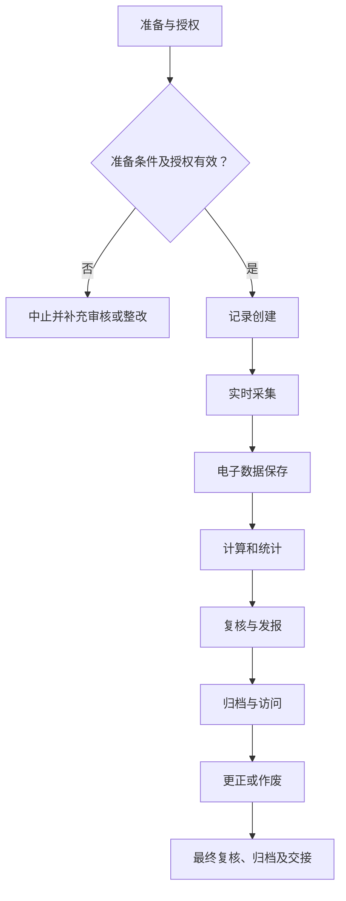

# SOP-004 实验记录与数据管理标准作业程序

> **文件编号：SOP-004｜版本：V0.4（草案）｜审批状态：未批准｜生效日期：待批准后确定**

## 编制与审批

| 编制 | 审核 | 安全/质量复核 | 批准 | 生效日期 |
| --- | --- | --- | --- | --- |
| 【待签】 | 【待签】 | 【待签】 | 【待签】 | 【待确认】 |

## 修订记录

| 版本 | 日期 | 修订内容 | 状态 |
| --- | --- | --- | --- |
| V0.1 | 2026-11-09 | 建立通用工作框架 | 草案 |
| V0.2 | 2026-11-09 | 补充分步检查、记录和参考依据 | 草案 |
| V0.3 | 2026-11-09 | 统一十三章、流程图、表格和附录结构，保留原有业务要求 | 草案 |
| V0.4 | 2026-11-09 | 规范制度用语、职责与记录表述，优化附录结构 | 草案，未批准 |

## 一、目的

规范实验数据的原始记录、采集、计算、复核、更正及归档，保证实验记录真实、完整、准确且可追溯。

## 二、适用范围

（一）适用于本单位经授权开展的本程序所述业务，以及相关准备、检查、审核、交接和归档活动。

（二）涉及的对象、技术方法、人员资格和放行条件，以批准的任务及对应受控文件为准。

（三）相关业务涉及化学品、设备或其他危险源时，应同时遵守适用的安全、环保和职业健康管理要求。

## 三、角色与职责

相关岗位按职责分工开展工作。操作、复核和审批由具备相应权限的人员签署，不得代签。

表 1　角色与职责

| 角色 | 工作内容 | 签署与记录 |
| --- | --- | --- |
| 记录人 | 形成真实的原始数据及观察 | 对应工作记录及签字 |
| 复核人 | 检查数据与计算结果 | 对应工作记录及签字 |
| 数据管理员 | 管理数据权限及备份 | 对应工作记录及签字 |
| 报告审核人 | 审核报告和偏差结论 | 对应工作记录及签字 |

## 四、术语和定义

本文件所用术语及阶段节点定义参见附录 C。专用方法、测量和安全术语以相关受控文件为依据。

## 五、作业流程

### （一）流程总图

图 1　实验记录与数据管理作业流程

各节点的执行条件与记录要求按本程序对应条款执行；涉及专项技术操作时，还须遵守相应的受控规程。

### （二）流程节点对照

表 2　流程节点与条款对应关系

| 节点 | 本文条款 | 应提供的证据 |
| --- | --- | --- |
| 准备 | 五（三） | 有效工作计划及资源检查 |
| 记录创建 | 五（四） | 实验编号在仪器、样品、原始记录间唯一 |
| 实时采集 | 五（五） | 可识别原始数据而非事后重绘曲线 |
| 电子数据保存 | 五（六） | 有不可无痕改写的历史或受控审计痕迹 |
| 计算和统计 | 五（七） | 任何人依据相同输入可复算 |
| 复核与发报 | 五（八） | 审核记录可证明独立复核 |
| 归档与访问 | 五（九） | 访问和备份受控，保存年限已有合法依据 |
| 更正或作废 | 五（十） | 可追踪原值、修改值和批准结论 |
| 归档 | 五（十一） | 异常结论、记录审核与交接 |

### （三）作业准备

（一）核对任务申请、工作方案及相关受控文件的编号、版本与审批状态。
（二）核对岗位授权、仪器和作业资源，确认现场条件及必要的安全措施满足要求。
（三）核查任务、样品、设备与记录编号的对应关系；存在身份或状态疑问时暂停相关工作。

（四）核查结果按“○合格／×异常／—不适用”填写。异常项目须说明原因、处置措施及复核情况，关键检查项未通过不得放行。

表 3　资料及器材准备清单

| 类别 | 准备项目 | 用途 | 检查结果 |
| --- | --- | --- | --- |
| 资料 | 任务书与批准方法 | 核对任务范围、版本及审批 | ○/×/— |
| 人员 | 培训和岗位授权 | 确认操作与复核资格 | ○/×/— |
| 设施与仪器 | 受控设备及系统（适用时） | 检查校准/维护与风险状态 | ○/×/— |
| 记录 | 原始记录、台账及异常表 | 确保记录可追溯 | ○/×/— |

表 4　工作检查项目

| 工作节点 | 检查内容 | 通过依据 | 结果 |
| --- | --- | --- | --- |
| 记录创建 | 在实验启动前确认唯一编号、有效方案版本、样品命名和记录模板 | 实验编号在仪器、样品、原始记录间唯一 | ○/×/— |
| 实时采集 | 每个测量节点登记实际时刻、仪表或软件版本、操作者、单位与读数 | 可识别原始数据而非事后重绘曲线 | ○/×/— |
| 电子数据保存 | 保留原始仪器输出、参数文件、数据处理脚本、软件版本及处理结果 | 有不可无痕改写的历史或受控审计痕迹 | ○/×/— |
| 计算和统计 | 列出公式、数据筛选规则、缺失值处置、有效数字和异常点判断依据 | 任何人依据相同输入可复算 | ○/×/— |
| 复核与发报 | 复核实验目标、计算链、图表对应、异常、批准限制与数据来源 | 审核记录可证明独立复核 | ○/×/— |
| 归档与访问 | 将批准文本、原始记录、仪器数据、异常单和报告关联受控存储 | 访问和备份受控，保存年限已有合法依据 | ○/×/— |
| 更正或作废 | 错误数据保留历史、修订原因、责任人、日期及受影响报告列表 | 可追踪原值、修改值和批准结论 | ○/×/— |

### （四）记录创建

**1. 执行要求**

（一）在实验启动前确认唯一编号、有效方案版本、样品命名和记录模板。

（二）每项实验使用唯一标识，将方案、原料批号、仪器、原始记录、样品和检测报告关联。

**2. 检查与终点判定**

实验编号在仪器、样品、原始记录间唯一。检查结果须经授权人员按受控标准复核。

**3. 异常及交接**

禁止多试验共用无法区分的编号。偏差处置与岗位交接应形成记录；涉及重大风险或结果有效性的异常按第八章执行。

### （五）实时采集

**1. 执行要求**

（一）每个测量节点登记实际时刻、仪表或软件版本、操作者、单位与读数。

（二）原始数据在产生时记录，包括时间、仪器、人员、单位、实测值与观察结果。

**2. 检查与终点判定**

可识别原始数据而非事后重绘曲线。检查结果须经授权人员按受控标准复核。

**3. 异常及交接**

补录须标识为补录并说明原因。偏差处置与岗位交接应形成记录；涉及重大风险或结果有效性的异常按第八章执行。

### （六）电子数据保存

**1. 执行要求**

（一）保留原始仪器输出、参数文件、数据处理脚本、软件版本及处理结果。

（二）采用纸质记录时保留原记录可辨；更正采用可追踪的划改、签名、日期及原因。

**2. 检查与终点判定**

有不可无痕改写的历史或受控审计痕迹。检查结果须经授权人员按受控标准复核。

**3. 异常及交接**

立即隔离无法保证真实性的数据。偏差处置与岗位交接应形成记录；涉及重大风险或结果有效性的异常按第八章执行。

### （七）计算和统计

**1. 执行要求**

（一）列出公式、数据筛选规则、缺失值处置、有效数字和异常点判断依据。

（二）采用电子记录时开启版本和操作日志，不允许无痕覆盖原始文件。

**2. 检查与终点判定**

任何人依据相同输入可复算。检查结果须经授权人员按受控标准复核。

**3. 异常及交接**

不得在没有记录的情况下剔除不利点。偏差处置与岗位交接应形成记录；涉及重大风险或结果有效性的异常按第八章执行。

### （八）复核与发报

**1. 执行要求**

（一）复核实验目标、计算链、图表对应、异常、批准限制与数据来源。

（二）审核时检查记录完整性、计算过程、异常、签名及样品对应关系。

**2. 检查与终点判定**

审核记录可证明独立复核。检查结果须经授权人员按受控标准复核。

**3. 异常及交接**

退回更正，保留修改记录。偏差处置与岗位交接应形成记录；涉及重大风险或结果有效性的异常按第八章执行。

### （九）归档与访问

**1. 执行要求**

（一）将批准文本、原始记录、仪器数据、异常单和报告关联受控存储。

（二）对关键计算实施独立复核，报告中区分原始观测、计算指标与解释判断。

**2. 检查与终点判定**

访问和备份受控，保存年限已有合法依据。检查结果须经授权人员按受控标准复核。

**3. 异常及交接**

不得将原始数据提交公开GitHub。偏差处置与岗位交接应形成记录；涉及重大风险或结果有效性的异常按第八章执行。

### （十）更正或作废

**1. 执行要求**

（一）错误数据保留历史、修订原因、责任人、日期及受影响报告列表。

（二）按受控权限进行备份、借阅、归档和到期处置，禁止将敏感研发数据同步至公开仓库。

**2. 检查与终点判定**

可追踪原值、修改值和批准结论。检查结果须经授权人员按受控标准复核。

**3. 异常及交接**

触发影响评估并必要时更正已发报告。偏差处置与岗位交接应形成记录；涉及重大风险或结果有效性的异常按第八章执行。

### （十一）结束、审核与交接

完成全部适用阶段后，应核查原始记录、结果、待办、异常与变更，并按授权完成复核和归档。未关闭的关键安全或质量问题不得视为自动放行。

## 六、关键控制点与工艺参数

各流程节点的控制标准、判定要求及记录项目见表 5。涉及具体技术指标或安全限值时，应引用已批准的适用文件。

表 5　关键控制点与记录

| 工作阶段 | 判定标准 | 异常处理 | 记录 |
| --- | --- | --- | --- |
| 记录创建 | 实验编号在仪器、样品、原始记录间唯一 | 禁止多试验共用无法区分的编号 | 检查记录/异常单 |
| 实时采集 | 可识别原始数据而非事后重绘曲线 | 补录须标识为补录并说明原因 | 检查记录/异常单 |
| 电子数据保存 | 有不可无痕改写的历史或受控审计痕迹 | 立即隔离无法保证真实性的数据 | 检查记录/异常单 |
| 计算和统计 | 任何人依据相同输入可复算 | 不得在没有记录的情况下剔除不利点 | 检查记录/异常单 |
| 复核与发报 | 审核记录可证明独立复核 | 退回更正，保留修改记录 | 检查记录/异常单 |
| 归档与访问 | 访问和备份受控，保存年限已有合法依据 | 不得将原始数据提交公开GitHub | 检查记录/异常单 |
| 更正或作废 | 可追踪原值、修改值和批准结论 | 触发影响评估并必要时更正已发报告 | 检查记录/异常单 |

**补充控制要求：**

- [ ] 禁止事后补造数据
- [ ] 每次更正保留原值与操作者
- [ ] 原始数据和报告版本须能回溯
- [ ] 实际记录已由经授权人员复核，相关异常、偏差及变更均有处置结论。
- [ ] 技术限值、保存时限和安全要求已核对适用的批准文件。

## 七、记录要求

### （一）记录表单

- 记录表单：FM-003、FM-016（详见 `forms/` 目录；具体字段可按受控场景扩展）。
- 通用关联：SOP-004 实验记录与数据管理、SOP-018 文件与记录控制、SOP-020 变更管理。
- 记录应保持真实、完整、可追溯，不在公开仓库录入实际生产或研发数据。

### （二）填写规则

原始数据在产生时记录，纸质更正需保留原值、日期和签字；电子数据保存修改痕迹，严禁代签与无痕覆盖。

### （三）字段说明

表 6　原始记录要求

| 记录项目 | 填写内容及依据 |
| --- | --- |
| 实验及数据标识 | 实验目的、方案与操作者、日期及现场条件 |
| 仪器与采样信息 | 实际投料批次和装置编号（仅内部填） |
| 计算与处理 | 原始测量文件路径、仪器软件和数据处理版本 |
| 更正与复核 | 公式、计算表、图片或曲线与版本 |
| 归档记录 | 更正历史、复核人和归档校验记录 |

### （四）归档

按照任务、样品或设备编号关联原始记录、批准文件、异常和结论，保存期限及备份权限【待确认】。

## 八、异常与偏差处理

出现危及人员安全、设备完整性或数据可信度的情形，应立即停止相关操作并执行经批准的现场应急或隔离程序，报告授权责任人；不得绕过防护措施、擅自恢复运行或删除异常记录。按 SOP-006 和 SOP-016 处理调查与整改。

发生影响安全、设备或数据有效性的异常时，应记录事实、时间、受影响范围、临时措施、根因与关闭结论。未完成必要验证不得擅自恢复。

## 九、安全与环保

（一）涉及实验、危化品、设备与能源系统的任务，应执行现场风险评估、SDS、设备说明书、个人防护及应急预案。

（二）涉及文档、人员及数据的活动，应执行保密、个人信息和数据授权要求。

（三）废液/废料按成分与适用法规收集交接，不得未经许可排放。安全关键操作不以本模板推断参数。

## 十、注意事项清单

- 原始记录与总结报告分离保管。
- 失败、异常和不满足预期的结果同样必须保存。
- 仅保留截图而无原始仪器数据不满足可复核目标。

**复核要求：** 各控制点须有判定依据、对应记录、复核岗位及异常处置要求。

技术限值、检查周期和检测机构认可范围均应核对实际有效的批准依据。

## 十一、设备维护与报修

（一）涉及设备、仪器或信息系统时，核查维护、校准、停用和复用状态；不涉及的项目可标“不适用”。

（二）遇故障先停止相关工作，提交工单并按风险等级进行隔离和报告。

（三）维修后验证功能、数据与安全状态，由授权人员确认后复用，维护周期及责任【待确认】。

## 十二、相关文件

**引用资料：**

- [阿拉巴马大学实验记录本实务](https://www.uah.edu/otc/for-uah-innovators/laboratory-notebooks-best-practices) — 仅参考其公开管理原则与模板结构，非表示本实验室已获得相应认可或符合认证。
- [OECD 良好实验室规范简介](https://www.oecd.org/en/topics/sub-issues/testing-of-chemicals/good-laboratory-practice-and-compliance-monitoring.html) — 仅参考其公开管理原则与模板结构，非表示本实验室已获得相应认可或符合认证。
- [WHO 实验室质量手册和配套表单模板](https://www.who.int/publications/m/item/laboratory-quality-manual) — 仅参考其公开管理原则与模板结构，非表示本实验室已获得相应认可或符合认证。

本节所列公开资料作为编制参考。涉及的具体要求及适用性，须由本单位授权人员结合现行标准、业务范围及适用法规核实。

本程序涉及的内部管理文件、检测方法、合同及记录表单应使用有效受控版本；未确定的编号在文件台账中确认。

## 十三、附则

本程序为 V0.4 草案，经授权审核批准并确定生效日期后实施。方法、设备、岗位权限或风险条件发生重大变化时，应按变更管理程序复审；复审周期【待确认】。

## 附录 A　待确认事项清单

| 编号 | 待确认事项 | 状态 |
| --- | --- | --- |
| 1 | 记录保存年限 | 未确认 |
| 2 | 备份周期 | 未确认 |
| 3 | 访问权限 | 未确认 |
| 4 | 数据完整性审核标准 | 未确认 |
| 5 | 技术负责人、安全负责人和文件批准人确认适用性、法律法规与设备制造商要求。 | 未确认 |
| 6 | 实际启用日期、适用岗位、培训与版本控制经正式批准。 | 未确认 |
| 7 | 适用方法、责任岗位、实际限值及保存期限 | 未确认 |

## 附录 B　流程节点表（表格版）

| 编号 | 流程节点 | 完成依据 |
| --- | --- | --- |
| 1 | 记录创建 | 实验编号在仪器、样品、原始记录间唯一 |
| 2 | 实时采集 | 可识别原始数据而非事后重绘曲线 |
| 3 | 电子数据保存 | 有不可无痕改写的历史或受控审计痕迹 |
| 4 | 计算和统计 | 任何人依据相同输入可复算 |
| 5 | 复核与发报 | 审核记录可证明独立复核 |
| 6 | 归档与访问 | 访问和备份受控，保存年限已有合法依据 |
| 7 | 更正或作废 | 可追踪原值、修改值和批准结论 |

流程节点调整时，应同步修订第五章流程图、流程节点对照表及第六章控制要求。

## 附录 C　术语和定义对照表

表 7　术语定义

| 术语 | 说明 |
| --- | --- |
| 受控文件 | 经批准且有有效版本、适用范围和权限的文件 |
| 原始记录 | 直接产生的观测、执行或测量记录 |
| 独立复核 | 按权限对数据和工作结论进行独立核实 |
| 偏差 | 实际状态与已批准标准不一致 |
| 记录创建 | 在实验启动前确认唯一编号、有效方案版本、样品命名和记录模板；执行及核查要求见第五章。 |
| 实时采集 | 每个测量节点登记实际时刻、仪表或软件版本、操作者、单位与读数；执行及核查要求见第五章。 |
| 电子数据保存 | 保留原始仪器输出、参数文件、数据处理脚本、软件版本及处理结果；执行及核查要求见第五章。 |
| 计算和统计 | 列出公式、数据筛选规则、缺失值处置、有效数字和异常点判断依据；执行及核查要求见第五章。 |
| 复核与发报 | 复核实验目标、计算链、图表对应、异常、批准限制与数据来源；执行及核查要求见第五章。 |
| 归档与访问 | 将批准文本、原始记录、仪器数据、异常单和报告关联受控存储；执行及核查要求见第五章。 |
| 更正或作废 | 错误数据保留历史、修订原因、责任人、日期及受影响报告列表；执行及核查要求见第五章。 |

## 附录 D　关联记录及文件索引

| 记录类别 | 主要内容 | 管理要求 |
| --- | --- | --- |
| 任务与审批文件 | 业务申请、方案及审批记录 | 按任务编号及有效版本管理 |
| 执行与核查记录 | 阶段检查、原始数据与相应复核记录 | 责任人员签字确认 |
| 异常与纠正记录 | 偏差、临时措施、整改、验证及关闭结论 | 与相关任务双向关联 |
| 报告及归档资料 | 结论报告、交接与附件 | 按批准的保存期限及权限归档 |
