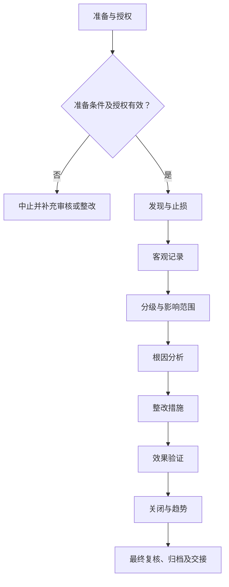

# SOP-006 实验异常与偏差处理标准作业程序

> **文件编号：SOP-006｜版本：V0.4（草案）｜审批状态：未批准｜生效日期：待批准后确定**

## 编制与审批

| 编制 | 审核 | 安全/质量复核 | 批准 | 生效日期 |
| --- | --- | --- | --- | --- |
| 【待签】 | 【待签】 | 【待签】 | 【待签】 | 【待确认】 |

## 修订记录

| 版本 | 日期 | 修订内容 | 状态 |
| --- | --- | --- | --- |
| V0.1 | 2026-11-09 | 建立通用工作框架 | 草案 |
| V0.2 | 2026-11-09 | 补充分步检查、记录和参考依据 | 草案 |
| V0.3 | 2026-11-09 | 统一十三章、流程图、表格和附录结构，保留原有业务要求 | 草案 |
| V0.4 | 2026-11-09 | 规范制度用语、职责与记录表述，优化附录结构 | 草案，未批准 |

## 一、目的

规范实验异常与偏差的发现、报告、隔离、调查、纠正预防及关闭验证，降低安全、质量和数据风险。

## 二、适用范围

（一）适用于本单位经授权开展的本程序所述业务，以及相关准备、检查、审核、交接和归档活动。

（二）涉及的对象、技术方法、人员资格和放行条件，以批准的任务及对应受控文件为准。

（三）相关业务涉及化学品、设备或其他危险源时，应同时遵守适用的安全、环保和职业健康管理要求。

## 三、角色与职责

相关岗位按职责分工开展工作。操作、复核和审批由具备相应权限的人员签署，不得代签。

表 1　角色与职责

| 角色 | 工作内容 | 签署与记录 |
| --- | --- | --- |
| 发现人 | 报告异常并采取初步控制 | 对应工作记录及签字 |
| 现场负责人 | 组织分级和隔离 | 对应工作记录及签字 |
| 调查负责人 | 开展原因调查 | 对应工作记录及签字 |
| 整改责任人 | 执行纠正预防措施 | 对应工作记录及签字 |
| 复核人 | 验证措施有效性并审核关闭 | 对应工作记录及签字 |

## 四、术语和定义

本文件所用术语及阶段节点定义参见附录 C。专用方法、测量和安全术语以相关受控文件为依据。

## 五、作业流程

### （一）流程总图

图 1　实验异常与偏差处理作业流程

各节点的执行条件与记录要求按本程序对应条款执行；涉及专项技术操作时，还须遵守相应的受控规程。

### （二）流程节点对照

表 2　流程节点与条款对应关系

| 节点 | 本文条款 | 应提供的证据 |
| --- | --- | --- |
| 准备 | 五（三） | 有效工作计划及资源检查 |
| 发现与止损 | 五（四） | 现场风险已被控制且事件时间线清楚 |
| 客观记录 | 五（五） | 事实与假设分栏，数据不得补造 |
| 分级与影响范围 | 五（六） | 识别受影响批次、报告、设备及人员 |
| 根因分析 | 五（七） | 主因与促成因素有证据支撑 |
| 整改措施 | 五（八） | 措施与根因有逻辑对应且可验证 |
| 效果验证 | 五（九） | 恢复条件全部满足，剩余风险可接受 |
| 关闭与趋势 | 五（十） | 关闭不等于删除历史，重复问题得到系统改进 |
| 归档 | 五（十一） | 异常结论、记录审核与交接 |

### （三）作业准备

（一）核对任务申请、工作方案及相关受控文件的编号、版本与审批状态。
（二）核对岗位授权、仪器和作业资源，确认现场条件及必要的安全措施满足要求。
（三）核查任务、样品、设备与记录编号的对应关系；存在身份或状态疑问时暂停相关工作。

（四）核查结果按“○合格／×异常／—不适用”填写。异常项目须说明原因、处置措施及复核情况，关键检查项未通过不得放行。

表 3　资料及器材准备清单

| 类别 | 准备项目 | 用途 | 检查结果 |
| --- | --- | --- | --- |
| 资料 | 任务书与批准方法 | 核对任务范围、版本及审批 | ○/×/— |
| 人员 | 培训和岗位授权 | 确认操作与复核资格 | ○/×/— |
| 设施与仪器 | 受控设备及系统（适用时） | 检查校准/维护与风险状态 | ○/×/— |
| 记录 | 原始记录、台账及异常表 | 确保记录可追溯 | ○/×/— |

表 4　工作检查项目

| 工作节点 | 检查内容 | 通过依据 | 结果 |
| --- | --- | --- | --- |
| 发现与止损 | 第一发现人确认人员安全；按危险等级执行隔离、停止作业、报告与现场保护 | 现场风险已被控制且事件时间线清楚 | ○/×/— |
| 客观记录 | 记录原始仪表值、照片/图像索引、报警、涉及样品和见证人，不推测原因 | 事实与假设分栏，数据不得补造 | ○/×/— |
| 分级与影响范围 | 区分安全事件、设备故障、检验不符合、数据问题和管理偏差 | 识别受影响批次、报告、设备及人员 | ○/×/— |
| 根因分析 | 运用事件时间线、5 Why或鱼骨图提出可证实原因并核对证据 | 主因与促成因素有证据支撑 | ○/×/— |
| 整改措施 | 分别明确即时纠正、系统性预防、责任人、截止时间和资源 | 措施与根因有逻辑对应且可验证 | ○/×/— |
| 效果验证 | 由独立人员复核现场、校准/培训记录或重复实验的必要证据 | 恢复条件全部满足，剩余风险可接受 | ○/×/— |
| 关闭与趋势 | 保留批准记录并统计重复事件，联动SOP和培训更新 | 关闭不等于删除历史，重复问题得到系统改进 | ○/×/— |

### （四）发现与止损

**1. 执行要求**

（一）第一发现人确认人员安全；按危险等级执行隔离、停止作业、报告与现场保护。

（二）发现仪表异常、设备故障、物料异常、质量偏差或记录缺陷时先控制现场风险。

**2. 检查与终点判定**

现场风险已被控制且事件时间线清楚。检查结果须经授权人员按受控标准复核。

**3. 异常及交接**

升级现场应急响应。偏差处置与岗位交接应形成记录；涉及重大风险或结果有效性的异常按第八章执行。

### （五）客观记录

**1. 执行要求**

（一）记录原始仪表值、照片/图像索引、报警、涉及样品和见证人，不推测原因。

（二）按预先定义的级别判断是否应急停机、隔离样品、停止检测或中止数据使用。

**2. 检查与终点判定**

事实与假设分栏，数据不得补造。检查结果须经授权人员按受控标准复核。

**3. 异常及交接**

缺口标注不可用而非虚构。偏差处置与岗位交接应形成记录；涉及重大风险或结果有效性的异常按第八章执行。

### （六）分级与影响范围

**1. 执行要求**

（一）区分安全事件、设备故障、检验不符合、数据问题和管理偏差。

（二）记录发生时间、地点、关联实验、事实、实测值、影响范围与临时处置。

**2. 检查与终点判定**

识别受影响批次、报告、设备及人员。检查结果须经授权人员按受控标准复核。

**3. 异常及交接**

扩大隔离范围。偏差处置与岗位交接应形成记录；涉及重大风险或结果有效性的异常按第八章执行。

### （七）根因分析

**1. 执行要求**

（一）运用事件时间线、5 Why或鱼骨图提出可证实原因并核对证据。

（二）涉及人身危险或重大设备事故时优先依现场应急预案和法定报告路径执行。

**2. 检查与终点判定**

主因与促成因素有证据支撑。检查结果须经授权人员按受控标准复核。

**3. 异常及交接**

证据不足标为待查。偏差处置与岗位交接应形成记录；涉及重大风险或结果有效性的异常按第八章执行。

### （八）整改措施

**1. 执行要求**

（一）分别明确即时纠正、系统性预防、责任人、截止时间和资源。

（二）由独立于事件执行人的审核者分析根因，区分直接原因、系统性缺陷及待验证假设。

**2. 检查与终点判定**

措施与根因有逻辑对应且可验证。检查结果须经授权人员按受控标准复核。

**3. 异常及交接**

退回无可验证标准的整改。偏差处置与岗位交接应形成记录；涉及重大风险或结果有效性的异常按第八章执行。

### （九）效果验证

**1. 执行要求**

（一）由独立人员复核现场、校准/培训记录或重复实验的必要证据。

（二）制定纠正与预防措施，明确责任、期限和验证证据，整改后复核有效性。

**2. 检查与终点判定**

恢复条件全部满足，剩余风险可接受。检查结果须经授权人员按受控标准复核。

**3. 异常及交接**

延长隔离并升级。偏差处置与岗位交接应形成记录；涉及重大风险或结果有效性的异常按第八章执行。

### （十）关闭与趋势

**1. 执行要求**

（一）保留批准记录并统计重复事件，联动SOP和培训更新。

（二）对受影响数据、样品和已发报告给出正式处置结论，必要时触发变更与再培训。

**2. 检查与终点判定**

关闭不等于删除历史，重复问题得到系统改进。检查结果须经授权人员按受控标准复核。

**3. 异常及交接**

重新开启CAPA。偏差处置与岗位交接应形成记录；涉及重大风险或结果有效性的异常按第八章执行。

### （十一）结束、审核与交接

完成全部适用阶段后，应核查原始记录、结果、待办、异常与变更，并按授权完成复核和归档。未关闭的关键安全或质量问题不得视为自动放行。

## 六、关键控制点与工艺参数

各流程节点的控制标准、判定要求及记录项目见表 5。涉及具体技术指标或安全限值时，应引用已批准的适用文件。

表 5　关键控制点与记录

| 工作阶段 | 判定标准 | 异常处理 | 记录 |
| --- | --- | --- | --- |
| 发现与止损 | 现场风险已被控制且事件时间线清楚 | 升级现场应急响应 | 检查记录/异常单 |
| 客观记录 | 事实与假设分栏，数据不得补造 | 缺口标注不可用而非虚构 | 检查记录/异常单 |
| 分级与影响范围 | 识别受影响批次、报告、设备及人员 | 扩大隔离范围 | 检查记录/异常单 |
| 根因分析 | 主因与促成因素有证据支撑 | 证据不足标为待查 | 检查记录/异常单 |
| 整改措施 | 措施与根因有逻辑对应且可验证 | 退回无可验证标准的整改 | 检查记录/异常单 |
| 效果验证 | 恢复条件全部满足，剩余风险可接受 | 延长隔离并升级 | 检查记录/异常单 |
| 关闭与趋势 | 关闭不等于删除历史，重复问题得到系统改进 | 重新开启CAPA | 检查记录/异常单 |

**补充控制要求：**

- [ ] 不明原因未排除不得重复危险操作
- [ ] 纠正措施必须验证有效
- [ ] 关闭需有审核签字
- [ ] 实际记录已由经授权人员复核，相关异常、偏差及变更均有处置结论。
- [ ] 技术限值、保存时限和安全要求已核对适用的批准文件。

## 七、记录要求

### （一）记录表单

- 记录表单：FM-004（详见 `forms/` 目录；具体字段可按受控场景扩展）。
- 通用关联：SOP-004 实验记录与数据管理、SOP-018 文件与记录控制、SOP-020 变更管理。
- 记录应保持真实、完整、可追溯，不在公开仓库录入实际生产或研发数据。

### （二）填写规则

原始数据在产生时记录，纸质更正需保留原值、日期和签字；电子数据保存修改痕迹，严禁代签与无痕覆盖。

### （三）字段说明

表 6　原始记录要求

| 记录项目 | 填写内容及依据 |
| --- | --- |
| 异常发生 | 事件编号、时间线、地点和暴露对象 |
| 风险控制 | 即时控制和风险分级依据 |
| 影响分析 | 受影响物料/数据/报告清单 |
| 原因调查 | 根因分析的证据与待查事项 |
| 纠正预防 | CAPA行动、复核、最终关闭结论 |

### （四）归档

按照任务、样品或设备编号关联原始记录、批准文件、异常和结论，保存期限及备份权限【待确认】。

## 八、异常与偏差处理

出现危及人员安全、设备完整性或数据可信度的情形，应立即停止相关操作并执行经批准的现场应急或隔离程序，报告授权责任人；不得绕过防护措施、擅自恢复运行或删除异常记录。按 SOP-006 和 SOP-016 处理调查与整改。

发生影响安全、设备或数据有效性的异常时，应记录事实、时间、受影响范围、临时措施、根因与关闭结论。未完成必要验证不得擅自恢复。

## 九、安全与环保

（一）涉及实验、危化品、设备与能源系统的任务，应执行现场风险评估、SDS、设备说明书、个人防护及应急预案。

（二）涉及文档、人员及数据的活动，应执行保密、个人信息和数据授权要求。

（三）废液/废料按成分与适用法规收集交接，不得未经许可排放。安全关键操作不以本模板推断参数。

## 十、注意事项清单

- 任何人员伤害、火情、明显失控优先执行现场应急计划。
- 偏差关闭需有人独立验证。
- 真实危害事件的对外报告按当地法规及主管机构规定。

**复核要求：** 各控制点须有判定依据、对应记录、复核岗位及异常处置要求。

技术限值、检查周期和检测机构认可范围均应核对实际有效的批准依据。

## 十一、设备维护与报修

（一）涉及设备、仪器或信息系统时，核查维护、校准、停用和复用状态；不涉及的项目可标“不适用”。

（二）遇故障先停止相关工作，提交工单并按风险等级进行隔离和报告。

（三）维修后验证功能、数据与安全状态，由授权人员确认后复用，维护周期及责任【待确认】。

## 十二、相关文件

**引用资料：**

- [WHO 实验室质量手册和配套表单模板](https://www.who.int/publications/m/item/laboratory-quality-manual) — 仅参考其公开管理原则与模板结构，非表示本实验室已获得相应认可或符合认证。
- [OSHA 实验室化学卫生计划及风险管理](https://www.osha.gov/laws-regs/regulations/standardnumber/1910/1910.1450) — 仅参考其公开管理原则与模板结构，非表示本实验室已获得相应认可或符合认证。
- [OSHA 实验室化学卫生指南附录](https://www.osha.gov/laws-regs/regulations/standardnumber/1910/1910.1450AppA) — 仅参考其公开管理原则与模板结构，非表示本实验室已获得相应认可或符合认证。

本节所列公开资料作为编制参考。涉及的具体要求及适用性，须由本单位授权人员结合现行标准、业务范围及适用法规核实。

本程序涉及的内部管理文件、检测方法、合同及记录表单应使用有效受控版本；未确定的编号在文件台账中确认。

## 十三、附则

本程序为 V0.4 草案，经授权审核批准并确定生效日期后实施。方法、设备、岗位权限或风险条件发生重大变化时，应按变更管理程序复审；复审周期【待确认】。

## 附录 A　待确认事项清单

| 编号 | 待确认事项 | 状态 |
| --- | --- | --- |
| 1 | 异常分级 | 未确认 |
| 2 | 强制上报时限 | 未确认 |
| 3 | 停机权限与外部报告要求 | 未确认 |
| 4 | 技术负责人、安全负责人和文件批准人确认适用性、法律法规与设备制造商要求。 | 未确认 |
| 5 | 实际启用日期、适用岗位、培训与版本控制经正式批准。 | 未确认 |
| 6 | 适用方法、责任岗位、实际限值及保存期限 | 未确认 |

## 附录 B　流程节点表（表格版）

| 编号 | 流程节点 | 完成依据 |
| --- | --- | --- |
| 1 | 发现与止损 | 现场风险已被控制且事件时间线清楚 |
| 2 | 客观记录 | 事实与假设分栏，数据不得补造 |
| 3 | 分级与影响范围 | 识别受影响批次、报告、设备及人员 |
| 4 | 根因分析 | 主因与促成因素有证据支撑 |
| 5 | 整改措施 | 措施与根因有逻辑对应且可验证 |
| 6 | 效果验证 | 恢复条件全部满足，剩余风险可接受 |
| 7 | 关闭与趋势 | 关闭不等于删除历史，重复问题得到系统改进 |

流程节点调整时，应同步修订第五章流程图、流程节点对照表及第六章控制要求。

## 附录 C　术语和定义对照表

表 7　术语定义

| 术语 | 说明 |
| --- | --- |
| 受控文件 | 经批准且有有效版本、适用范围和权限的文件 |
| 原始记录 | 直接产生的观测、执行或测量记录 |
| 独立复核 | 按权限对数据和工作结论进行独立核实 |
| 偏差 | 实际状态与已批准标准不一致 |
| 发现与止损 | 第一发现人确认人员安全；按危险等级执行隔离、停止作业、报告与现场保护；执行及核查要求见第五章。 |
| 客观记录 | 记录原始仪表值、照片/图像索引、报警、涉及样品和见证人，不推测原因；执行及核查要求见第五章。 |
| 分级与影响范围 | 区分安全事件、设备故障、检验不符合、数据问题和管理偏差；执行及核查要求见第五章。 |
| 根因分析 | 运用事件时间线、5 Why或鱼骨图提出可证实原因并核对证据；执行及核查要求见第五章。 |
| 整改措施 | 分别明确即时纠正、系统性预防、责任人、截止时间和资源；执行及核查要求见第五章。 |
| 效果验证 | 由独立人员复核现场、校准/培训记录或重复实验的必要证据；执行及核查要求见第五章。 |
| 关闭与趋势 | 保留批准记录并统计重复事件，联动SOP和培训更新；执行及核查要求见第五章。 |

## 附录 D　关联记录及文件索引

| 记录类别 | 主要内容 | 管理要求 |
| --- | --- | --- |
| 任务与审批文件 | 业务申请、方案及审批记录 | 按任务编号及有效版本管理 |
| 执行与核查记录 | 阶段检查、原始数据与相应复核记录 | 责任人员签字确认 |
| 异常与纠正记录 | 偏差、临时措施、整改、验证及关闭结论 | 与相关任务双向关联 |
| 报告及归档资料 | 结论报告、交接与附件 | 按批准的保存期限及权限归档 |
