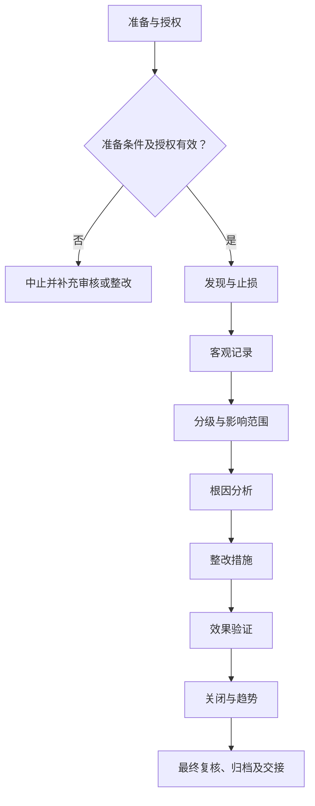

# SOP-006 实验异常与偏差处理标准作业程序

> **版本：V0.3（草案）｜未审核、未批准｜生效日期：【待确认】**
>
> 参照 SOP-002 和 SOP-003 的章节风格整理；实际作业标准、具体设备界限、人员信息与原始记录应在受控系统中确认。公开模板不得直接作为现场操作依据。

## 编制与审批

| 编制 | 审核 | 安全/质量复核 | 批准 | 生效日期 |
| --- | --- | --- | --- | --- |
| 【待签】 | 【待签】 | 【待签】 | 【待签】 | 【待确认】 |

## 修订记录

| 版本 | 日期 | 修订内容 | 状态 |
| --- | --- | --- | --- |
| V0.1 | 2026-11-09 | 建立通用工作框架 | 草案 |
| V0.2 | 2026-11-09 | 补充分步检查、记录和参考依据 | 草案 |
| V0.3 | 2026-11-09 | 统一十三章、流程图、表格和附录结构，保留原有业务要求 | 草案 |

## 一、目的

建立发现、报告、隔离、调查、纠正和预防的闭环。适用于经组织授权、符合现行法律法规和设备制造商要求的相关实验室活动；不替代具体工艺卡、设备说明书、SDS 与应急预案。

## 二、适用范围

（一）适用于经授权的实验异常与偏差处理工作，具体对象、方法、所用设备、风险范围与人员职责以批准的制度为准。

（二）不适用的实验反应、检测或现场操作不得机械套入；与本业务无关的环节须标记为“不适用”。

（三）本文件不替代受控工艺卡、检测方法、设备手册、SDS及适用法律法规。

## 三、角色与职责

以实际岗位职责组织作业，执行、独立复核和批准人员须按授权分离，不得代签。

表 1　角色与职责

| 角色 | 主要职责 | 签署/记录 |
| --- | --- | --- |
| 执行人 | 实施当前工作、记录实际情况及原始数据 | 执行签字 |
| 复核人 | 独立检查编号、证据、数据与结论 | 复核签字 |
| 技术/业务审核人 | 检查方法适用性、偏差与处理是否合理 | 审核结论 |
| 授权批准人 | 决定放行、恢复或不符合项关闭 | 批准记录 |

**原 V0.2 具体角色要求：**

发现人、现场负责人、技术审核人、安全负责人按岗位授权和职责分离原则分工；实际操作者填写原始记录，复核或审批人员独立签署。组织未确定的岗位由内部文件另行指定，公开文件不含个人名单。

## 四、术语和定义

本文件所用术语及阶段节点定义参见附录 C。专用方法、测量和安全术语以相关受控文件为依据。

## 五、作业流程

### （一）流程总图

图 1　实验异常与偏差处理作业流程

该图表示作业关口，不代替具体工艺、设备、检验方法或紧急处置指令。

### （二）流程节点对照

表 2　流程节点与条款对应关系

| 节点 | 本文条款 | 应提供的证据 |
| --- | --- | --- |
| 准备 | 五（三） | 有效工作计划及资源检查 |
| 发现与止损 | 五（四） | 现场风险已被控制且事件时间线清楚 |
| 客观记录 | 五（五） | 事实与假设分栏，数据不得补造 |
| 分级与影响范围 | 五（六） | 识别受影响批次、报告、设备及人员 |
| 根因分析 | 五（七） | 主因与促成因素有证据支撑 |
| 整改措施 | 五（八） | 措施与根因有逻辑对应且可验证 |
| 效果验证 | 五（九） | 恢复条件全部满足，剩余风险可接受 |
| 关闭与趋势 | 五（十） | 关闭不等于删除历史，重复问题得到系统改进 |
| 归档 | 五（十一） | 异常结论、记录审核与交接 |

### （三）实验/工作准备

- 已取得适用的受控方案、工艺卡或检验方法版本，并确认当前有效。
- 人员能力、场所安全、仪器状态、原辅材料和必要的应急资源符合要求。
- 核查批次、设备、样品及记录编号对应关系；发现不明确事项时暂停开展相关步骤。

（一）检查任务有效性、授权、方法版本、现场条件和工作资源。核对结果采用“○合格／×异常／—不适用”，异常不得空白放行。

表 3　资料及器材准备清单

| 类别 | 准备项目 | 用途 | 检查结果 |
| --- | --- | --- | --- |
| 资料 | 任务书与批准方法 | 核对任务范围、版本及审批 | ○/×/— |
| 人员 | 培训和岗位授权 | 确认操作与复核资格 | ○/×/— |
| 设施与仪器 | 受控设备及系统（适用时） | 检查校准/维护与风险状态 | ○/×/— |
| 记录 | 原始记录、台账及异常表 | 确保记录可追溯 | ○/×/— |

表 4　工作检查项目

| 工作节点 | 检查内容 | 通过依据 | 结果 |
| --- | --- | --- | --- |
| 发现与止损 | 第一发现人确认人员安全；按危险等级执行隔离、停止作业、报告与现场保护 | 现场风险已被控制且事件时间线清楚 | ○/×/— |
| 客观记录 | 记录原始仪表值、照片/图像索引、报警、涉及样品和见证人，不推测原因 | 事实与假设分栏，数据不得补造 | ○/×/— |
| 分级与影响范围 | 区分安全事件、设备故障、检验不符合、数据问题和管理偏差 | 识别受影响批次、报告、设备及人员 | ○/×/— |
| 根因分析 | 运用事件时间线、5 Why或鱼骨图提出可证实原因并核对证据 | 主因与促成因素有证据支撑 | ○/×/— |
| 整改措施 | 分别明确即时纠正、系统性预防、责任人、截止时间和资源 | 措施与根因有逻辑对应且可验证 | ○/×/— |
| 效果验证 | 由独立人员复核现场、校准/培训记录或重复实验的必要证据 | 恢复条件全部满足，剩余风险可接受 | ○/×/— |
| 关闭与趋势 | 保留批准记录并统计重复事件，联动SOP和培训更新 | 关闭不等于删除历史，重复问题得到系统改进 | ○/×/— |

### （四）发现与止损

**1. 执行要求**

第一发现人确认人员安全；按危险等级执行隔离、停止作业、报告与现场保护。

**原 V0.2 操作步骤：** 发现仪表异常、设备故障、物料异常、质量偏差或记录缺陷时先控制现场风险。

**2. 检查与终点判定**

现场风险已被控制且事件时间线清楚。依据实际受控标准复核，不允许自行推断定量限值或审批结论。

**3. 异常及交接**

升级现场应急响应。发生偏差时暂停受影响活动并保留原始证据、处置单及责任岗位。

### （五）客观记录

**1. 执行要求**

记录原始仪表值、照片/图像索引、报警、涉及样品和见证人，不推测原因。

**原 V0.2 操作步骤：** 按预先定义的级别判断是否应急停机、隔离样品、停止检测或中止数据使用。

**2. 检查与终点判定**

事实与假设分栏，数据不得补造。依据实际受控标准复核，不允许自行推断定量限值或审批结论。

**3. 异常及交接**

缺口标注不可用而非虚构。发生偏差时暂停受影响活动并保留原始证据、处置单及责任岗位。

### （六）分级与影响范围

**1. 执行要求**

区分安全事件、设备故障、检验不符合、数据问题和管理偏差。

**原 V0.2 操作步骤：** 记录发生时间、地点、关联实验、事实、实测值、影响范围与临时处置。

**2. 检查与终点判定**

识别受影响批次、报告、设备及人员。依据实际受控标准复核，不允许自行推断定量限值或审批结论。

**3. 异常及交接**

扩大隔离范围。发生偏差时暂停受影响活动并保留原始证据、处置单及责任岗位。

### （七）根因分析

**1. 执行要求**

运用事件时间线、5 Why或鱼骨图提出可证实原因并核对证据。

**原 V0.2 操作步骤：** 涉及人身危险或重大设备事故时优先依现场应急预案和法定报告路径执行。

**2. 检查与终点判定**

主因与促成因素有证据支撑。依据实际受控标准复核，不允许自行推断定量限值或审批结论。

**3. 异常及交接**

证据不足标为待查。发生偏差时暂停受影响活动并保留原始证据、处置单及责任岗位。

### （八）整改措施

**1. 执行要求**

分别明确即时纠正、系统性预防、责任人、截止时间和资源。

**原 V0.2 操作步骤：** 由独立于事件执行人的审核者分析根因，区分直接原因、系统性缺陷及待验证假设。

**2. 检查与终点判定**

措施与根因有逻辑对应且可验证。依据实际受控标准复核，不允许自行推断定量限值或审批结论。

**3. 异常及交接**

退回无可验证标准的整改。发生偏差时暂停受影响活动并保留原始证据、处置单及责任岗位。

### （九）效果验证

**1. 执行要求**

由独立人员复核现场、校准/培训记录或重复实验的必要证据。

**原 V0.2 操作步骤：** 制定纠正与预防措施，明确责任、期限和验证证据，整改后复核有效性。

**2. 检查与终点判定**

恢复条件全部满足，剩余风险可接受。依据实际受控标准复核，不允许自行推断定量限值或审批结论。

**3. 异常及交接**

延长隔离并升级。发生偏差时暂停受影响活动并保留原始证据、处置单及责任岗位。

### （十）关闭与趋势

**1. 执行要求**

保留批准记录并统计重复事件，联动SOP和培训更新。

**原 V0.2 操作步骤：** 对受影响数据、样品和已发报告给出正式处置结论，必要时触发变更与再培训。

**2. 检查与终点判定**

关闭不等于删除历史，重复问题得到系统改进。依据实际受控标准复核，不允许自行推断定量限值或审批结论。

**3. 异常及交接**

重新开启CAPA。发生偏差时暂停受影响活动并保留原始证据、处置单及责任岗位。

### （十一）结束、审核与交接

完成全部适用阶段后，应核查原始记录、结果、待办、异常与变更，并按授权完成复核和归档。未关闭的关键安全或质量问题不得视为自动放行。

## 六、关键控制点与工艺参数

此处的“参数”泛指业务标准与判定要求；对于非工艺类 SOP，并非必须设置反应条件。

表 5　关键控制点与记录

| 工作阶段 | 判定标准 | 异常处理 | 记录 |
| --- | --- | --- | --- |
| 发现与止损 | 现场风险已被控制且事件时间线清楚 | 升级现场应急响应 | 检查记录/异常单 |
| 客观记录 | 事实与假设分栏，数据不得补造 | 缺口标注不可用而非虚构 | 检查记录/异常单 |
| 分级与影响范围 | 识别受影响批次、报告、设备及人员 | 扩大隔离范围 | 检查记录/异常单 |
| 根因分析 | 主因与促成因素有证据支撑 | 证据不足标为待查 | 检查记录/异常单 |
| 整改措施 | 措施与根因有逻辑对应且可验证 | 退回无可验证标准的整改 | 检查记录/异常单 |
| 效果验证 | 恢复条件全部满足，剩余风险可接受 | 延长隔离并升级 | 检查记录/异常单 |
| 关闭与趋势 | 关闭不等于删除历史，重复问题得到系统改进 | 重新开启CAPA | 检查记录/异常单 |

**原 V0.2 关键控制要求：**

- [ ] 不明原因未排除不得重复危险操作
- [ ] 纠正措施必须验证有效
- [ ] 关闭需有审核签字
- [ ] 实际记录已由经授权人员复核，相关异常、偏差及变更均有处置结论。
- [ ] 涉及定量阈值、保存时限或安全联锁时，只引用已批准的内部标准，禁止根据本示例自行推定。

## 七、记录要求

### （一）记录表单

- 记录表单：FM-004（详见 `forms/` 目录；具体字段可按受控场景扩展）。
- 通用关联：SOP-004 实验记录与数据管理、SOP-018 文件与记录控制、SOP-020 变更管理。
- 记录应保持真实、完整、可追溯，不在公开仓库录入实际生产或研发数据。

### （二）填写规则

原始数据在产生时记录，纸质更正需保留原值、日期和签字；电子数据保存修改痕迹，严禁代签与无痕覆盖。

### （三）字段说明

表 6　原始记录要求

| 记录项目 | 填写内容及依据 |
| --- | --- |
| 记录项目 1 | 事件编号、时间线、地点和暴露对象 |
| 记录项目 2 | 即时控制和风险分级依据 |
| 记录项目 3 | 受影响物料/数据/报告清单 |
| 记录项目 4 | 根因分析的证据与待查事项 |
| 记录项目 5 | CAPA行动、复核、最终关闭结论 |

### （四）归档

按照任务、样品或设备编号关联原始记录、批准文件、异常和结论，保存期限及备份权限【待确认】。

## 八、异常与偏差处理

出现危及人员安全、设备完整性或数据可信度的情形，应立即停止相关操作并执行经批准的现场应急或隔离程序，报告授权责任人；不得绕过防护措施、擅自恢复运行或删除异常记录。按 SOP-006 和 SOP-016 处理调查与整改。

发生影响安全、设备或数据有效性的异常时，应记录事实、时间、受影响范围、临时措施、根因与关闭结论。未完成必要验证不得擅自恢复。

## 九、安全与环保

（一）涉及实验、危化品、设备与能源系统的任务，应执行现场风险评估、SDS、设备说明书、个人防护及应急预案。

（二）涉及文档、人员及数据的活动，应执行保密、个人信息和数据授权要求。

（三）废液/废料按成分与适用法规收集交接，不得未经许可排放。安全关键操作不以本模板推断参数。

## 十、注意事项清单

典型错漏与复核要点

- **关注：**任何人员伤害、火情、明显失控优先执行现场应急计划。
- **关注：**偏差关闭需有人独立验证。
- **关注：**真实危害事件的对外报告按当地法规及主管机构规定。

**复核关口：** 对本SOP每一项关键控制，应有核验依据、记录位置、核验角色及发现问题后的处置；没有依据的定量限值不得从其他实验室直接移植。

工作限值、时间周期或认可结论应有实际受控依据，不直接搬用其他机构资料。

## 十一、设备维护与报修

（一）涉及设备、仪器或信息系统时，核查维护、校准、停用和复用状态；不涉及的项目可标“不适用”。

（二）遇故障先停止相关工作，提交工单并按风险等级进行隔离和报告。

（三）维修后验证功能、数据与安全状态，由授权人员确认后复用，维护周期及责任【待确认】。

## 十二、相关文件

**保留原 V0.2 的公开参考及适用性说明：**

编写依据与适用性说明

- [WHO 实验室质量手册和配套表单模板](https://www.who.int/publications/m/item/laboratory-quality-manual) — 仅参考其公开管理原则与模板结构，非表示本实验室已获得相应认可或符合认证。
- [OSHA 实验室化学卫生计划及风险管理](https://www.osha.gov/laws-regs/regulations/standardnumber/1910/1910.1450) — 仅参考其公开管理原则与模板结构，非表示本实验室已获得相应认可或符合认证。
- [OSHA 实验室化学卫生指南附录](https://www.osha.gov/laws-regs/regulations/standardnumber/1910/1910.1450AppA) — 仅参考其公开管理原则与模板结构，非表示本实验室已获得相应认可或符合认证。

本节为结合上述机构公开资料编制的**本项目通用建议**，不是来源机构的原文，也不等同于中华人民共和国企业实验室必须执行的法定条款。适用性由有资格的内部审核人确认。

配套记录与企业内部文件的正式编号、版本【待确认】。

## 十三、附则

本程序属于 V0.3 草案，经有权人员审核批准并确定生效日期后方可执行。方法、设备、人员权限或风险条件变化时应开展变更评估。复审周期【待确认】。

## 附录 A　待确认事项清单

| 编号 | 待确认事项 | 状态 |
| --- | --- | --- |
| 1 | 异常分级 | 未确认 |
| 2 | 强制上报时限 | 未确认 |
| 3 | 停机权限与外部报告要求 | 未确认 |
| 4 | 技术负责人、安全负责人和文件批准人确认适用性、法律法规与设备制造商要求。 | 未确认 |
| 5 | 实际启用日期、适用岗位、培训与版本控制经正式批准。 | 未确认 |
| 6 | 适用方法、责任岗位、实际限值及保存期限 | 未确认 |

## 附录 B　流程节点表（表格版）

| 编号 | 流程节点 | 完成依据 |
| --- | --- | --- |
| 1 | 发现与止损 | 现场风险已被控制且事件时间线清楚 |
| 2 | 客观记录 | 事实与假设分栏，数据不得补造 |
| 3 | 分级与影响范围 | 识别受影响批次、报告、设备及人员 |
| 4 | 根因分析 | 主因与促成因素有证据支撑 |
| 5 | 整改措施 | 措施与根因有逻辑对应且可验证 |
| 6 | 效果验证 | 恢复条件全部满足，剩余风险可接受 |
| 7 | 关闭与趋势 | 关闭不等于删除历史，重复问题得到系统改进 |

调整节点时同时修订第五章的 Mermaid 图与第六章关键控制表。

## 附录 C　术语和定义对照表

表 7　术语定义

| 术语 | 说明 |
| --- | --- |
| 受控文件 | 经批准且有有效版本、适用范围和权限的文件 |
| 原始记录 | 直接产生的观测、执行或测量记录 |
| 独立复核 | 按权限对数据和工作结论进行独立核实 |
| 偏差 | 实际状态与已批准标准不一致 |
| 发现与止损 | 本文件第五章对应节点；具体要求按受控标准判定 |
| 客观记录 | 本文件第五章对应节点；具体要求按受控标准判定 |
| 分级与影响范围 | 本文件第五章对应节点；具体要求按受控标准判定 |
| 根因分析 | 本文件第五章对应节点；具体要求按受控标准判定 |
| 整改措施 | 本文件第五章对应节点；具体要求按受控标准判定 |
| 效果验证 | 本文件第五章对应节点；具体要求按受控标准判定 |
| 关闭与趋势 | 本文件第五章对应节点；具体要求按受控标准判定 |

## 附录 D　原 V0.2 内容迁移对照

| 原 V0.2 项目 | 本文件位置 |
| --- | --- |
| 目的与范围、角色 | 第一至三章 |
| 工作前提、标准程序、分步检查 | 第五章 |
| 关键控制 | 第六章 |
| 记录字段与证据 | 第七章 |
| 异常及安全要求 | 第八、九章 |
| 典型错漏 | 第十章 |
| 引用依据 | 第十二章 |
| 待确认事项 | 附录 A |
| 修订记录 | 文档首页 |
