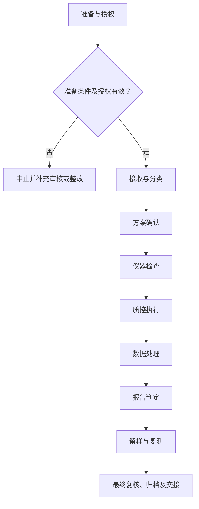

# SOP-009 成品与留样检测标准作业程序

> **版本：V0.3（草案）｜未审核、未批准｜生效日期：【待确认】**
>
> 参照 SOP-002 和 SOP-003 的章节风格整理；实际作业标准、具体设备界限、人员信息与原始记录应在受控系统中确认。公开模板不得直接作为现场操作依据。

## 编制与审批

| 编制 | 审核 | 安全/质量复核 | 批准 | 生效日期 |
| --- | --- | --- | --- | --- |
| 【待签】 | 【待签】 | 【待签】 | 【待签】 | 【待确认】 |

## 修订记录

| 版本 | 日期 | 修订内容 | 状态 |
| --- | --- | --- | --- |
| V0.1 | 2026-11-09 | 建立通用工作框架 | 草案 |
| V0.2 | 2026-11-09 | 补充分步检查、记录和参考依据 | 草案 |
| V0.3 | 2026-11-09 | 统一十三章、流程图、表格和附录结构，保留原有业务要求 | 草案 |

## 一、目的

规范批次最终质量评价、留样管理和复测。适用于经组织授权、符合现行法律法规和设备制造商要求的相关实验室活动；不替代具体工艺卡、设备说明书、SDS 与应急预案。

## 二、适用范围

（一）适用于经授权的成品与留样检测工作，具体对象、方法、所用设备、风险范围与人员职责以批准的制度为准。

（二）不适用的实验反应、检测或现场操作不得机械套入；与本业务无关的环节须标记为“不适用”。

（三）本文件不替代受控工艺卡、检测方法、设备手册、SDS及适用法律法规。

## 三、角色与职责

以实际岗位职责组织作业，执行、独立复核和批准人员须按授权分离，不得代签。

表 1　角色与职责

| 角色 | 主要职责 | 签署/记录 |
| --- | --- | --- |
| 执行人 | 实施当前工作、记录实际情况及原始数据 | 执行签字 |
| 复核人 | 独立检查编号、证据、数据与结论 | 复核签字 |
| 技术/业务审核人 | 检查方法适用性、偏差与处理是否合理 | 审核结论 |
| 授权批准人 | 决定放行、恢复或不符合项关闭 | 批准记录 |

**原 V0.2 具体角色要求：**

检测员、结果审核人、样品管理员按岗位授权和职责分离原则分工；实际操作者填写原始记录，复核或审批人员独立签署。组织未确定的岗位由内部文件另行指定，公开文件不含个人名单。

## 四、术语和定义

本文件所用术语及阶段节点定义参见附录 C。专用方法、测量和安全术语以相关受控文件为依据。

## 五、作业流程

### （一）流程总图

图 1　成品与留样检测作业流程

该图表示作业关口，不代替具体工艺、设备、检验方法或紧急处置指令。

### （二）流程节点对照

表 2　流程节点与条款对应关系

| 节点 | 本文条款 | 应提供的证据 |
| --- | --- | --- |
| 准备 | 五（三） | 有效工作计划及资源检查 |
| 接收与分类 | 五（四） | 样品身份与检验任务匹配 |
| 方案确认 | 五（五） | 逐项说明指标定义、方法版本和单位 |
| 仪器检查 | 五（六） | 测试方法与设备状态在有效期内 |
| 质控执行 | 五（七） | 质控与原始结果均保存 |
| 数据处理 | 五（八） | 指标名称与计算方法可复算，避免只报数值无方法 |
| 报告判定 | 五（九） | 未经批准的合格限不自行设定 |
| 留样与复测 | 五（十） | 原结果与复测结果均保留 |
| 归档 | 五（十一） | 异常结论、记录审核与交接 |

### （三）实验/工作准备

- 已取得适用的受控方案、工艺卡或检验方法版本，并确认当前有效。
- 人员能力、场所安全、仪器状态、原辅材料和必要的应急资源符合要求。
- 核查批次、设备、样品及记录编号对应关系；发现不明确事项时暂停开展相关步骤。

（一）检查任务有效性、授权、方法版本、现场条件和工作资源。核对结果采用“○合格／×异常／—不适用”，异常不得空白放行。

表 3　资料及器材准备清单

| 类别 | 准备项目 | 用途 | 检查结果 |
| --- | --- | --- | --- |
| 资料 | 任务书与批准方法 | 核对任务范围、版本及审批 | ○/×/— |
| 人员 | 培训和岗位授权 | 确认操作与复核资格 | ○/×/— |
| 设施与仪器 | 受控设备及系统（适用时） | 检查校准/维护与风险状态 | ○/×/— |
| 记录 | 原始记录、台账及异常表 | 确保记录可追溯 | ○/×/— |

表 4　工作检查项目

| 工作节点 | 检查内容 | 通过依据 | 结果 |
| --- | --- | --- | --- |
| 接收与分类 | 核对成品样品对应实验/批次、采样代表性及留样状态 | 样品身份与检验任务匹配 | ○/×/— |
| 方案确认 | 根据产品用途选用受控检测项目与判定依据，例如粒径分布、热机械分析、显微观察及转化率等（是否适用由项目确认） | 逐项说明指标定义、方法版本和单位 | ○/×/— |
| 仪器检查 | 确认粒度仪测量分散条件、TMA校准状态、显微镜倍率/标尺与计算软件版本等 | 测试方法与设备状态在有效期内 | ○/×/— |
| 质控执行 | 按方法执行平行测试、对照品/空白或系统适用性确认 | 质控与原始结果均保存 | ○/×/— |
| 数据处理 | 记录D10/D50/D90、分布指标的定义与算法；热曲线的测试程序引用；显微照片倍率与尺度；转化率计算依据 | 指标名称与计算方法可复算，避免只报数值无方法 | ○/×/— |
| 报告判定 | 将结果分为实测值、趋势分析及是否符合已批准指标 | 未经批准的合格限不自行设定 | ○/×/— |
| 留样与复测 | 按批准条件封存或转移，并记录复测原因及前后差异 | 原结果与复测结果均保留 | ○/×/— |

### （四）接收与分类

**1. 执行要求**

核对成品样品对应实验/批次、采样代表性及留样状态。

**原 V0.2 操作步骤：** 接收成品样品，核对编号、批次、容器状态、采样方式和送检项目。

**2. 检查与终点判定**

样品身份与检验任务匹配。依据实际受控标准复核，不允许自行推断定量限值或审批结论。

**3. 异常及交接**

不明样品隔离。发生偏差时暂停受影响活动并保留原始证据、处置单及责任岗位。

### （五）方案确认

**1. 执行要求**

根据产品用途选用受控检测项目与判定依据，例如粒径分布、热机械分析、显微观察及转化率等（是否适用由项目确认）。

**原 V0.2 操作步骤：** 根据已批准的产品检验计划确认测试方法、设备状态、平行样和质量控制要求。

**2. 检查与终点判定**

逐项说明指标定义、方法版本和单位。依据实际受控标准复核，不允许自行推断定量限值或审批结论。

**3. 异常及交接**

未经验证的方法只报告探索性结果。发生偏差时暂停受影响活动并保留原始证据、处置单及责任岗位。

### （六）仪器检查

**1. 执行要求**

确认粒度仪测量分散条件、TMA校准状态、显微镜倍率/标尺与计算软件版本等。

**原 V0.2 操作步骤：** 保存所有原始测试文件、图像、计算过程和试样处理信息。

**2. 检查与终点判定**

测试方法与设备状态在有效期内。依据实际受控标准复核，不允许自行推断定量限值或审批结论。

**3. 异常及交接**

设备异常停止测试。发生偏差时暂停受影响活动并保留原始证据、处置单及责任岗位。

### （七）质控执行

**1. 执行要求**

按方法执行平行测试、对照品/空白或系统适用性确认。

**原 V0.2 操作步骤：** 按批准判定规则出具符合、待复核或不符合结论；无标准时仅报告实测值。

**2. 检查与终点判定**

质控与原始结果均保存。依据实际受控标准复核，不允许自行推断定量限值或审批结论。

**3. 异常及交接**

失败质控先调查，不补改结果。发生偏差时暂停受影响活动并保留原始证据、处置单及责任岗位。

### （八）数据处理

**1. 执行要求**

记录D10/D50/D90、分布指标的定义与算法；热曲线的测试程序引用；显微照片倍率与尺度；转化率计算依据。

**原 V0.2 操作步骤：** 留样登记保存位置、期限、容器、条件和检出风险，定期检查状态。

**2. 检查与终点判定**

指标名称与计算方法可复算，避免只报数值无方法。依据实际受控标准复核，不允许自行推断定量限值或审批结论。

**3. 异常及交接**

缺方法时结果仅供参考。发生偏差时暂停受影响活动并保留原始证据、处置单及责任岗位。

### （九）报告判定

**1. 执行要求**

将结果分为实测值、趋势分析及是否符合已批准指标。

**原 V0.2 操作步骤：** 需要复测或委外确认时保留首次结果并说明复测理由与差异。

**2. 检查与终点判定**

未经批准的合格限不自行设定。依据实际受控标准复核，不允许自行推断定量限值或审批结论。

**3. 异常及交接**

未定义规格不写合格。发生偏差时暂停受影响活动并保留原始证据、处置单及责任岗位。

### （十）留样与复测

**1. 执行要求**

按批准条件封存或转移，并记录复测原因及前后差异。

**原 V0.2 操作步骤：** 出具报告、审核签字并与批次记录归档。

**2. 检查与终点判定**

原结果与复测结果均保留。依据实际受控标准复核，不允许自行推断定量限值或审批结论。

**3. 异常及交接**

不得以复测覆盖不利结果。发生偏差时暂停受影响活动并保留原始证据、处置单及责任岗位。

### （十一）结束、审核与交接

完成全部适用阶段后，应核查原始记录、结果、待办、异常与变更，并按授权完成复核和归档。未关闭的关键安全或质量问题不得视为自动放行。

## 六、关键控制点与工艺参数

此处的“参数”泛指业务标准与判定要求；对于非工艺类 SOP，并非必须设置反应条件。

表 5　关键控制点与记录

| 工作阶段 | 判定标准 | 异常处理 | 记录 |
| --- | --- | --- | --- |
| 接收与分类 | 样品身份与检验任务匹配 | 不明样品隔离 | 检查记录/异常单 |
| 方案确认 | 逐项说明指标定义、方法版本和单位 | 未经验证的方法只报告探索性结果 | 检查记录/异常单 |
| 仪器检查 | 测试方法与设备状态在有效期内 | 设备异常停止测试 | 检查记录/异常单 |
| 质控执行 | 质控与原始结果均保存 | 失败质控先调查，不补改结果 | 检查记录/异常单 |
| 数据处理 | 指标名称与计算方法可复算，避免只报数值无方法 | 缺方法时结果仅供参考 | 检查记录/异常单 |
| 报告判定 | 未经批准的合格限不自行设定 | 未定义规格不写合格 | 检查记录/异常单 |
| 留样与复测 | 原结果与复测结果均保留 | 不得以复测覆盖不利结果 | 检查记录/异常单 |

**原 V0.2 关键控制要求：**

- [ ] 不得使用未经确认的合格限值
- [ ] 报告应区分实测与判定
- [ ] 留样到期处置可追溯
- [ ] 实际记录已由经授权人员复核，相关异常、偏差及变更均有处置结论。
- [ ] 涉及定量阈值、保存时限或安全联锁时，只引用已批准的内部标准，禁止根据本示例自行推定。

## 七、记录要求

### （一）记录表单

- 记录表单：FM-007、FM-018（详见 `forms/` 目录；具体字段可按受控场景扩展）。
- 通用关联：SOP-004 实验记录与数据管理、SOP-018 文件与记录控制、SOP-020 变更管理。
- 记录应保持真实、完整、可追溯，不在公开仓库录入实际生产或研发数据。

### （二）填写规则

原始数据在产生时记录，纸质更正需保留原值、日期和签字；电子数据保存修改痕迹，严禁代签与无痕覆盖。

### （三）字段说明

表 6　原始记录要求

| 记录项目 | 填写内容及依据 |
| --- | --- |
| 记录项目 1 | 检验方法和设备状态 |
| 记录项目 2 | 样品预处理、分散与测试程序引用 |
| 记录项目 3 | 粒径指标定义与热分析曲线归档路径 |
| 记录项目 4 | 显微图像标尺、取景及观察结论 |
| 记录项目 5 | 计算表、质控、复测与报告审核 |

### （四）归档

按照任务、样品或设备编号关联原始记录、批准文件、异常和结论，保存期限及备份权限【待确认】。

## 八、异常与偏差处理

出现危及人员安全、设备完整性或数据可信度的情形，应立即停止相关操作并执行经批准的现场应急或隔离程序，报告授权责任人；不得绕过防护措施、擅自恢复运行或删除异常记录。按 SOP-006 和 SOP-016 处理调查与整改。

发生影响安全、设备或数据有效性的异常时，应记录事实、时间、受影响范围、临时措施、根因与关闭结论。未完成必要验证不得擅自恢复。

## 九、安全与环保

（一）涉及实验、危化品、设备与能源系统的任务，应执行现场风险评估、SDS、设备说明书、个人防护及应急预案。

（二）涉及文档、人员及数据的活动，应执行保密、个人信息和数据授权要求。

（三）废液/废料按成分与适用法规收集交接，不得未经许可排放。安全关键操作不以本模板推断参数。

## 十、注意事项清单

典型错漏与复核要点

- **关注：**粒径与热分析条件改变时必须评估跨批可比性。
- **关注：**显微图像要给尺度和采样方式。
- **关注：**转化率及粒径判定需要明确方法而非仅固定阈值。

**复核关口：** 对本SOP每一项关键控制，应有核验依据、记录位置、核验角色及发现问题后的处置；没有依据的定量限值不得从其他实验室直接移植。

工作限值、时间周期或认可结论应有实际受控依据，不直接搬用其他机构资料。

## 十一、设备维护与报修

（一）涉及设备、仪器或信息系统时，核查维护、校准、停用和复用状态；不涉及的项目可标“不适用”。

（二）遇故障先停止相关工作，提交工单并按风险等级进行隔离和报告。

（三）维修后验证功能、数据与安全状态，由授权人员确认后复用，维护周期及责任【待确认】。

## 十二、相关文件

**保留原 V0.2 的公开参考及适用性说明：**

编写依据与适用性说明

- [ISO/IEC 17025:2017 标准介绍](https://www.iso.org/standard/66912.html) — 仅参考其公开管理原则与模板结构，非表示本实验室已获得相应认可或符合认证。
- [CNAS 实验室认可准则目录](https://www.cnas.org.cn/rkgf/sysrk/) — 仅参考其公开管理原则与模板结构，非表示本实验室已获得相应认可或符合认证。
- [阿拉巴马大学实验记录本实务](https://www.uah.edu/otc/for-uah-innovators/laboratory-notebooks-best-practices) — 仅参考其公开管理原则与模板结构，非表示本实验室已获得相应认可或符合认证。

本节为结合上述机构公开资料编制的**本项目通用建议**，不是来源机构的原文，也不等同于中华人民共和国企业实验室必须执行的法定条款。适用性由有资格的内部审核人确认。

配套记录与企业内部文件的正式编号、版本【待确认】。

## 十三、附则

本程序属于 V0.3 草案，经有权人员审核批准并确定生效日期后方可执行。方法、设备、人员权限或风险条件变化时应开展变更评估。复审周期【待确认】。

## 附录 A　待确认事项清单

| 编号 | 待确认事项 | 状态 |
| --- | --- | --- |
| 1 | 产品标准 | 未确认 |
| 2 | 留样周期 | 未确认 |
| 3 | 复检规则 | 未确认 |
| 4 | 样品处置 | 未确认 |
| 5 | 技术负责人、安全负责人和文件批准人确认适用性、法律法规与设备制造商要求。 | 未确认 |
| 6 | 实际启用日期、适用岗位、培训与版本控制经正式批准。 | 未确认 |
| 7 | 适用方法、责任岗位、实际限值及保存期限 | 未确认 |

## 附录 B　流程节点表（表格版）

| 编号 | 流程节点 | 完成依据 |
| --- | --- | --- |
| 1 | 接收与分类 | 样品身份与检验任务匹配 |
| 2 | 方案确认 | 逐项说明指标定义、方法版本和单位 |
| 3 | 仪器检查 | 测试方法与设备状态在有效期内 |
| 4 | 质控执行 | 质控与原始结果均保存 |
| 5 | 数据处理 | 指标名称与计算方法可复算，避免只报数值无方法 |
| 6 | 报告判定 | 未经批准的合格限不自行设定 |
| 7 | 留样与复测 | 原结果与复测结果均保留 |

调整节点时同时修订第五章的 Mermaid 图与第六章关键控制表。

## 附录 C　术语和定义对照表

表 7　术语定义

| 术语 | 说明 |
| --- | --- |
| 受控文件 | 经批准且有有效版本、适用范围和权限的文件 |
| 原始记录 | 直接产生的观测、执行或测量记录 |
| 独立复核 | 按权限对数据和工作结论进行独立核实 |
| 偏差 | 实际状态与已批准标准不一致 |
| 接收与分类 | 本文件第五章对应节点；具体要求按受控标准判定 |
| 方案确认 | 本文件第五章对应节点；具体要求按受控标准判定 |
| 仪器检查 | 本文件第五章对应节点；具体要求按受控标准判定 |
| 质控执行 | 本文件第五章对应节点；具体要求按受控标准判定 |
| 数据处理 | 本文件第五章对应节点；具体要求按受控标准判定 |
| 报告判定 | 本文件第五章对应节点；具体要求按受控标准判定 |
| 留样与复测 | 本文件第五章对应节点；具体要求按受控标准判定 |

## 附录 D　原 V0.2 内容迁移对照

| 原 V0.2 项目 | 本文件位置 |
| --- | --- |
| 目的与范围、角色 | 第一至三章 |
| 工作前提、标准程序、分步检查 | 第五章 |
| 关键控制 | 第六章 |
| 记录字段与证据 | 第七章 |
| 异常及安全要求 | 第八、九章 |
| 典型错漏 | 第十章 |
| 引用依据 | 第十二章 |
| 待确认事项 | 附录 A |
| 修订记录 | 文档首页 |
