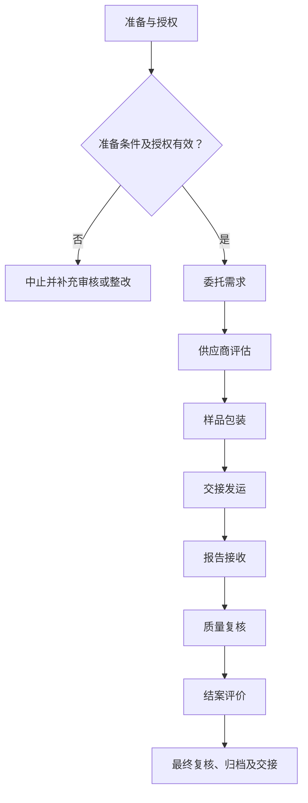

# SOP-010 委外检测送检标准作业程序

> **文件编号：SOP-010｜版本：V0.4（草案）｜审批状态：未批准｜生效日期：待批准后确定**

## 编制与审批

| 编制 | 审核 | 安全/质量复核 | 批准 | 生效日期 |
| --- | --- | --- | --- | --- |
| 【待签】 | 【待签】 | 【待签】 | 【待签】 | 【待确认】 |

## 修订记录

| 版本 | 日期 | 修订内容 | 状态 |
| --- | --- | --- | --- |
| V0.1 | 2026-11-09 | 建立通用工作框架 | 草案 |
| V0.2 | 2026-11-09 | 补充分步检查、记录和参考依据 | 草案 |
| V0.3 | 2026-11-09 | 统一十三章、流程图、表格和附录结构，保留原有业务要求 | 草案 |
| V0.4 | 2026-11-09 | 规范制度用语、职责与记录表述，优化附录结构 | 草案，未批准 |

## 一、目的

规范委外检测申请、检测机构评估、样品送检、报告接收、结果复核和结案管理，确保委外检测活动安全、合规、可追溯。

## 二、适用范围

（一）适用于本单位需委托外部检测机构完成的检测、分析、复检及相关技术评价活动。

（二）涵盖申请、机构选择、合同与保密审核、样品包装运输、报告接收、技术复核及结案归档。

（三）样品危险信息、运输要求、检测方法及报告判定应执行适用法规、合同和经批准的管理文件。

## 三、角色与职责

相关岗位按职责分工开展工作。操作、复核和审批由具备相应权限的人员签署，不得代签。

表 1　角色与职责

| 角色 | 工作内容 | 签署与记录 |
| --- | --- | --- |
| 委托申请人 | 编制检测需求、项目和交付要求 | 对应工作记录及签字 |
| 样品管理员 | 负责样品编号、包装、发运与交接 | 对应工作记录及签字 |
| 外协负责人 | 评估检测机构能力、合同和保密条款 | 对应工作记录及签字 |
| 技术审核人 | 复核委外检测报告及技术结论 | 对应工作记录及签字 |
| 批准人 | 批准委外任务、异常处置和结案 | 对应工作记录及签字 |

## 四、术语和定义

本文件所用术语及阶段节点定义参见附录 C。专用方法、测量和安全术语以相关受控文件为依据。

## 五、作业流程

### （一）流程总图

图 1　委外检测送检作业流程

各节点的执行条件与记录要求按本程序对应条款执行；涉及专项技术操作时，还须遵守相应的受控规程。

### （二）流程节点对照

表 2　流程节点与条款对应关系

| 节点 | 本文条款 | 应提供的证据 |
| --- | --- | --- |
| 准备 | 五（三） | 有效工作计划及资源检查 |
| 委托需求 | 五（四） | 委托项目、技术要求、交付条件明确，并具备相应的能力及费用评估依据 |
| 供应商评估 | 五（五） | 检测机构的资质或技术能力范围覆盖委托项目 |
| 样品包装 | 五（六） | 运输安全信息不能因保密而删除 |
| 交接发运 | 五（七） | 样品交接记录完整、连续且可追溯 |
| 报告接收 | 五（八） | 报告项目、样品编号、检测方法与委托要求一致 |
| 质量复核 | 五（九） | 检测结果与内部数据的差异分析有证据支持并经技术审核 |
| 结案评价 | 五（十） | 技术报告及商务资料分类归档，并按权限管理 |
| 归档 | 五（十一） | 异常结论、记录审核与交接 |

### （三）作业准备

（一）核对任务申请、工作方案及相关受控文件的编号、版本与审批状态。
（二）核对岗位授权、仪器和作业资源，确认现场条件及必要的安全措施满足要求。
（三）核查任务、样品、设备与记录编号的对应关系；存在身份或状态疑问时暂停相关工作。

（四）核查结果按“○合格／×异常／—不适用”填写。异常项目须说明原因、处置措施及复核情况，关键检查项未通过不得放行。

表 3　资料及器材准备清单

| 类别 | 准备项目 | 用途 | 检查结果 |
| --- | --- | --- | --- |
| 资料 | 任务书与批准方法 | 核对任务范围、版本及审批 | ○/×/— |
| 人员 | 培训和岗位授权 | 确认操作与复核资格 | ○/×/— |
| 设施与仪器 | 受控设备及系统（适用时） | 检查校准/维护与风险状态 | ○/×/— |
| 记录 | 原始记录、台账及异常表 | 确保记录可追溯 | ○/×/— |

表 4　工作检查项目

| 工作节点 | 检查内容 | 通过依据 | 结果 |
| --- | --- | --- | --- |
| 委托需求 | 定义待测属性、目的、样品基质、检测方法、检出与报告需求 | 委托项目、技术要求、交付条件明确，并具备相应的能力及费用评估依据 | ○/×/— |
| 供应商评估 | 核查机构资质适用范围、方法能力、独立性、保密及样品处置 | 检测机构的资质或技术能力范围覆盖委托项目 | ○/×/— |
| 样品包装 | 提供必须的危险特性和运输限制；业务代号脱敏，记录完整内部对应关系 | 运输安全信息不能因保密而删除 | ○/×/— |
| 交接发运 | 登记取样方、承运方式、交付数量、封口状况和保管条件 | 样品交接记录完整、连续且可追溯 | ○/×/— |
| 报告接收 | 核对委托号、样品号、方法、有效日期、单位、是否带认可标识等 | 报告项目、样品编号、检测方法与委托要求一致 | ○/×/— |
| 质量复核 | 分析结果的重复性、检出限、测量不确定度（适用时）及方法差异 | 检测结果与内部数据的差异分析有证据支持并经技术审核 | ○/×/— |
| 结案评价 | 对报告质量、时效、异常沟通、费用及保密行为形成评价 | 技术报告及商务资料分类归档，并按权限管理 | ○/×/— |

### （四）委托需求

**1. 执行要求**

（一）定义待测属性、目的、样品基质、检测方法、检出与报告需求。

（二）明确委外目的、检测项目、检测方法、检出范围、样品需求和报告交付要求。

**2. 检查与终点判定**

委托项目、技术要求、交付条件明确，并具备相应的能力及费用评估依据。检查结果须经授权人员按受控标准复核。

**3. 异常及交接**

委托要求不完整时退回申请并补充必要信息。偏差处置与岗位交接应形成记录；涉及重大风险或结果有效性的异常按第八章执行。

### （五）供应商评估

**1. 执行要求**

（一）核查机构资质适用范围、方法能力、独立性、保密及样品处置。

（二）评估检测机构能力、认可范围和利益冲突，确认保密与知识产权要求。

**2. 检查与终点判定**

检测机构的资质或技术能力范围覆盖委托项目。检查结果须经授权人员按受控标准复核。

**3. 异常及交接**

必要时增设比对或改选。偏差处置与岗位交接应形成记录；涉及重大风险或结果有效性的异常按第八章执行。

### （六）样品包装

**1. 执行要求**

（一）提供必须的危险特性和运输限制；业务代号脱敏，记录完整内部对应关系。

（二）对需送检样品作脱敏编号，避免在委托单暴露未公开配方或工艺资料。

**2. 检查与终点判定**

运输安全信息不能因保密而删除。检查结果须经授权人员按受控标准复核。

**3. 异常及交接**

危险特性及运输条件不明确时暂停发运。偏差处置与岗位交接应形成记录；涉及重大风险或结果有效性的异常按第八章执行。

### （七）交接发运

**1. 执行要求**

（一）登记取样方、承运方式、交付数量、封口状况和保管条件。

（二）记录包装、危险信息、交付条件、物流凭证和接收确认。

**2. 检查与终点判定**

样品交接记录完整、连续且可追溯。检查结果须经授权人员按受控标准复核。

**3. 异常及交接**

发生样品遗失或破损时立即报告并按异常程序处置。偏差处置与岗位交接应形成记录；涉及重大风险或结果有效性的异常按第八章执行。

### （八）报告接收

**1. 执行要求**

（一）核对委托号、样品号、方法、有效日期、单位、是否带认可标识等。

（二）收到报告后核对样品编号、方法、单位、原始信息和异常声明。

**2. 检查与终点判定**

报告项目、样品编号、检测方法与委托要求一致。检查结果须经授权人员按受控标准复核。

**3. 异常及交接**

向检测机构提出书面澄清要求并保存往来证据。偏差处置与岗位交接应形成记录；涉及重大风险或结果有效性的异常按第八章执行。

### （九）质量复核

**1. 执行要求**

（一）分析结果的重复性、检出限、测量不确定度（适用时）及方法差异。

（二）对结论可疑或有争议的报告开展技术复核，并保存往来证据。

**2. 检查与终点判定**

检测结果与内部数据的差异分析有证据支持并经技术审核。检查结果须经授权人员按受控标准复核。

**3. 异常及交接**

根据技术审核意见安排复测或比对验证。偏差处置与岗位交接应形成记录；涉及重大风险或结果有效性的异常按第八章执行。

### （十）结案评价

**1. 执行要求**

（一）对报告质量、时效、异常沟通、费用及保密行为形成评价。

（二）按委托编号归档合同、送检单、报告、费用和复验记录。

**2. 检查与终点判定**

技术报告及商务资料分类归档，并按权限管理。检查结果须经授权人员按受控标准复核。

**3. 异常及交接**

依据评估结论采取限期整改、暂停或终止委托等措施。偏差处置与岗位交接应形成记录；涉及重大风险或结果有效性的异常按第八章执行。

### （十一）结束、审核与交接

完成全部适用阶段后，应核查原始记录、结果、待办、异常与变更，并按授权完成复核和归档。未关闭的关键安全或质量问题不得视为自动放行。

## 六、关键控制点与工艺参数

各流程节点的控制标准、判定要求及记录项目见表 5。涉及具体技术指标或安全限值时，应引用已批准的适用文件。

表 5　关键控制点与记录

| 工作阶段 | 判定标准 | 异常处理 | 记录 |
| --- | --- | --- | --- |
| 委托需求 | 委托项目、技术要求、交付条件明确，并具备相应的能力及费用评估依据 | 委托要求不完整时退回申请并补充必要信息 | 检查记录/异常单 |
| 供应商评估 | 检测机构的资质或技术能力范围覆盖委托项目 | 必要时增设比对或改选 | 检查记录/异常单 |
| 样品包装 | 运输安全信息不能因保密而删除 | 危险特性及运输条件不明确时暂停发运 | 检查记录/异常单 |
| 交接发运 | 样品交接记录完整、连续且可追溯 | 发生样品遗失或破损时立即报告并按异常程序处置 | 检查记录/异常单 |
| 报告接收 | 报告项目、样品编号、检测方法与委托要求一致 | 向检测机构提出书面澄清要求并保存往来证据 | 检查记录/异常单 |
| 质量复核 | 检测结果与内部数据的差异分析有证据支持并经技术审核 | 根据技术审核意见安排复测或比对验证 | 检查记录/异常单 |
| 结案评价 | 技术报告及商务资料分类归档，并按权限管理 | 依据评估结论采取限期整改、暂停或终止委托等措施 | 检查记录/异常单 |

**补充控制要求：**

- [ ] 委托信息最小化
- [ ] 按法规传递必要危害信息
- [ ] 报告不得绕过技术审核直接用于结论
- [ ] 实际记录已由经授权人员复核，相关异常、偏差及变更均有处置结论。
- [ ] 技术限值、保存时限和安全要求已核对适用的批准文件。

## 七、记录要求

### （一）记录表单

- 记录表单：FM-008（详见 `forms/` 目录；具体字段可按受控场景扩展）。
- 通用关联：SOP-004 实验记录与数据管理、SOP-018 文件与记录控制、SOP-020 变更管理。
- 记录应保持真实、完整、可追溯，不在公开仓库录入实际生产或研发数据。

### （二）填写规则

原始数据在产生时记录，纸质更正需保留原值、日期和签字；电子数据保存修改痕迹，严禁代签与无痕覆盖。

### （三）字段说明

表 6　原始记录要求

| 记录项目 | 填写内容及依据 |
| --- | --- |
| 机构能力评估 | 机构资质或能力证明与评估结论 |
| 委托项目与合同 | 委托项目与方法版本、合同与保密约定 |
| 样品包装运输 | 样品包装、危害信息、运输交接记录 |
| 报告接收复核 | 报告收件、差异沟通及复核 |
| 复测与归档 | 复检、数据采信和归档结论 |

### （四）归档

按照任务、样品或设备编号关联原始记录、批准文件、异常和结论，保存期限及备份权限【待确认】。

## 八、异常与偏差处理

出现危及人员安全、设备完整性或数据可信度的情形，应立即停止相关操作并执行经批准的现场应急或隔离程序，报告授权责任人；不得绕过防护措施、擅自恢复运行或删除异常记录。按 SOP-006 和 SOP-016 处理调查与整改。

发生影响安全、设备或数据有效性的异常时，应记录事实、时间、受影响范围、临时措施、根因与关闭结论。未完成必要验证不得擅自恢复。

## 九、安全与环保

（一）涉及实验、危化品、设备与能源系统的任务，应执行现场风险评估、SDS、设备说明书、个人防护及应急预案。

（二）涉及文档、人员及数据的活动，应执行保密、个人信息和数据授权要求。

（三）废液/废料按成分与适用法规收集交接，不得未经许可排放。安全关键操作不以本模板推断参数。

## 十、注意事项清单

- CNAS标识须核实具体认可范围，不自动覆盖所有项目。
- 委外数据不能代替内部技术解释。
- 样品脱敏不得损害安全运输义务。

**复核要求：** 各控制点须有判定依据、对应记录、复核岗位及异常处置要求。

技术限值、检查周期和检测机构认可范围均应核对实际有效的批准依据。

## 十一、设备维护与报修

（一）涉及设备、仪器或信息系统时，核查维护、校准、停用和复用状态；不涉及的项目可标“不适用”。

（二）遇故障先停止相关工作，提交工单并按风险等级进行隔离和报告。

（三）维修后验证功能、数据与安全状态，由授权人员确认后复用，维护周期及责任【待确认】。

## 十二、相关文件

**引用资料：**

- [CNAS 实验室认可准则目录](https://www.cnas.org.cn/rkgf/sysrk/) — 仅参考其公开管理原则与模板结构，非表示本实验室已获得相应认可或符合认证。
- [ISO/IEC 17025:2017 标准介绍](https://www.iso.org/standard/66912.html) — 仅参考其公开管理原则与模板结构，非表示本实验室已获得相应认可或符合认证。
- [WHO 实验室质量手册和配套表单模板](https://www.who.int/publications/m/item/laboratory-quality-manual) — 仅参考其公开管理原则与模板结构，非表示本实验室已获得相应认可或符合认证。

本节所列公开资料作为编制参考。涉及的具体要求及适用性，须由本单位授权人员结合现行标准、业务范围及适用法规核实。

本程序涉及的内部管理文件、检测方法、合同及记录表单应使用有效受控版本；未确定的编号在文件台账中确认。

## 十三、附则

本程序为 V0.4 草案，经授权审核批准并确定生效日期后实施。方法、设备、岗位权限或风险条件发生重大变化时，应按变更管理程序复审；复审周期【待确认】。

## 附录 A　待确认事项清单

| 编号 | 待确认事项 | 状态 |
| --- | --- | --- |
| 1 | 合格机构名单 | 未确认 |
| 2 | 送检合同模板 | 未确认 |
| 3 | 样品运输规定 | 未确认 |
| 4 | 技术负责人、安全负责人和文件批准人确认适用性、法律法规与设备制造商要求。 | 未确认 |
| 5 | 实际启用日期、适用岗位、培训与版本控制经正式批准。 | 未确认 |
| 6 | 适用方法、责任岗位、实际限值及保存期限 | 未确认 |

## 附录 B　流程节点表（表格版）

| 编号 | 流程节点 | 完成依据 |
| --- | --- | --- |
| 1 | 委托需求 | 委托项目、技术要求、交付条件明确，并具备相应的能力及费用评估依据 |
| 2 | 供应商评估 | 检测机构的资质或技术能力范围覆盖委托项目 |
| 3 | 样品包装 | 运输安全信息不能因保密而删除 |
| 4 | 交接发运 | 样品交接记录完整、连续且可追溯 |
| 5 | 报告接收 | 报告项目、样品编号、检测方法与委托要求一致 |
| 6 | 质量复核 | 检测结果与内部数据的差异分析有证据支持并经技术审核 |
| 7 | 结案评价 | 技术报告及商务资料分类归档，并按权限管理 |

流程节点调整时，应同步修订第五章流程图、流程节点对照表及第六章控制要求。

## 附录 C　术语和定义对照表

表 7　术语定义

| 术语 | 说明 |
| --- | --- |
| 受控文件 | 经批准且有有效版本、适用范围和权限的文件 |
| 原始记录 | 直接产生的观测、执行或测量记录 |
| 独立复核 | 按权限对数据和工作结论进行独立核实 |
| 偏差 | 实际状态与已批准标准不一致 |
| 委托需求 | 定义待测属性、目的、样品基质、检测方法、检出与报告需求；执行及核查要求见第五章。 |
| 供应商评估 | 核查机构资质适用范围、方法能力、独立性、保密及样品处置；执行及核查要求见第五章。 |
| 样品包装 | 提供必须的危险特性和运输限制；业务代号脱敏，记录完整内部对应关系；执行及核查要求见第五章。 |
| 交接发运 | 登记取样方、承运方式、交付数量、封口状况和保管条件；执行及核查要求见第五章。 |
| 报告接收 | 核对委托号、样品号、方法、有效日期、单位、是否带认可标识等；执行及核查要求见第五章。 |
| 质量复核 | 分析结果的重复性、检出限、测量不确定度（适用时）及方法差异；执行及核查要求见第五章。 |
| 结案评价 | 对报告质量、时效、异常沟通、费用及保密行为形成评价；执行及核查要求见第五章。 |

## 附录 D　关联记录及文件索引

| 记录类别 | 主要内容 | 管理要求 |
| --- | --- | --- |
| 任务与审批文件 | 业务申请、方案及审批记录 | 按任务编号及有效版本管理 |
| 执行与核查记录 | 阶段检查、原始数据与相应复核记录 | 责任人员签字确认 |
| 异常与纠正记录 | 偏差、临时措施、整改、验证及关闭结论 | 与相关任务双向关联 |
| 报告及归档资料 | 结论报告、交接与附件 | 按批准的保存期限及权限归档 |
