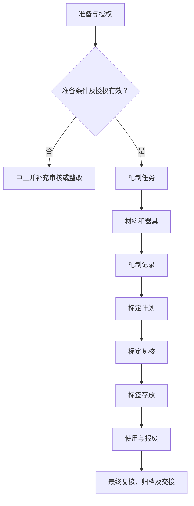

# SOP-012 试剂与标准溶液管理标准作业程序

> **文件编号：SOP-012｜版本：V0.4（草案）｜审批状态：未批准｜生效日期：待批准后确定**

## 编制与审批

| 编制 | 审核 | 安全/质量复核 | 批准 | 生效日期 |
| --- | --- | --- | --- | --- |
| 【待签】 | 【待签】 | 【待签】 | 【待签】 | 【待确认】 |

## 修订记录

| 版本 | 日期 | 修订内容 | 状态 |
| --- | --- | --- | --- |
| V0.1 | 2026-11-09 | 建立通用工作框架 | 草案 |
| V0.2 | 2026-11-09 | 补充分步检查、记录和参考依据 | 草案 |
| V0.3 | 2026-11-09 | 统一十三章、流程图、表格和附录结构，保留原有业务要求 | 草案 |
| V0.4 | 2026-11-09 | 规范制度用语、职责与记录表述，优化附录结构 | 草案，未批准 |

## 一、目的

规范试剂和标准溶液的接收、配制、标定、储存、复标和处置，确保浓度结果可靠、标识清晰。

## 二、适用范围

（一）适用于本单位经授权开展的本程序所述业务，以及相关准备、检查、审核、交接和归档活动。

（二）涉及的对象、技术方法、人员资格和放行条件，以批准的任务及对应受控文件为准。

（三）相关业务涉及化学品、设备或其他危险源时，应同时遵守适用的安全、环保和职业健康管理要求。

## 三、角色与职责

相关岗位按职责分工开展工作。操作、复核和审批由具备相应权限的人员签署，不得代签。

表 1　角色与职责

| 角色 | 工作内容 | 签署与记录 |
| --- | --- | --- |
| 配制人 | 按受控方法配制溶液 | 对应工作记录及签字 |
| 复核人 | 复核计算与称量数据 | 对应工作记录及签字 |
| 标定人员 | 实施标定与复标 | 对应工作记录及签字 |
| 试剂管理员 | 控制储存、标签和废弃物 | 对应工作记录及签字 |
| 方法负责人 | 确认方法和接受标准 | 对应工作记录及签字 |

## 四、术语和定义

本文件所用术语及阶段节点定义参见附录 C。专用方法、测量和安全术语以相关受控文件为依据。

## 五、作业流程

### （一）流程总图

图 1　试剂与标准溶液管理作业流程

各节点的执行条件与记录要求按本程序对应条款执行；涉及专项技术操作时，还须遵守相应的受控规程。

### （二）流程节点对照

表 2　流程节点与条款对应关系

| 节点 | 本文条款 | 应提供的证据 |
| --- | --- | --- |
| 准备 | 五（三） | 有效工作计划及资源检查 |
| 配制任务 | 五（四） | 计算经独立复核 |
| 材料和器具 | 五（五） | 量值可靠且容器相容 |
| 配制记录 | 五（六） | 保留原始读数和异常 |
| 标定计划 | 五（七） | 标定方案获批准 |
| 标定复核 | 五（八） | 复核人可独立复算 |
| 标签存放 | 五（九） | 标签与保存条件完整 |
| 使用与报废 | 五（十） | 有使用及废物去向记录 |
| 归档 | 五（十一） | 异常结论、记录审核与交接 |

### （三）作业准备

（一）核对任务申请、工作方案及相关受控文件的编号、版本与审批状态。
（二）核对岗位授权、仪器和作业资源，确认现场条件及必要的安全措施满足要求。
（三）核查任务、样品、设备与记录编号的对应关系；存在身份或状态疑问时暂停相关工作。

（四）核查结果按“○合格／×异常／—不适用”填写。异常项目须说明原因、处置措施及复核情况，关键检查项未通过不得放行。

表 3　资料及器材准备清单

| 类别 | 准备项目 | 用途 | 检查结果 |
| --- | --- | --- | --- |
| 资料 | 任务书与批准方法 | 核对任务范围、版本及审批 | ○/×/— |
| 人员 | 培训和岗位授权 | 确认操作与复核资格 | ○/×/— |
| 设施与仪器 | 受控设备及系统（适用时） | 检查校准/维护与风险状态 | ○/×/— |
| 记录 | 原始记录、台账及异常表 | 确保记录可追溯 | ○/×/— |

表 4　工作检查项目

| 工作节点 | 检查内容 | 通过依据 | 结果 |
| --- | --- | --- | --- |
| 配制任务 | 核对已批准的目标浓度、用途、化学品危害和方法版本 | 计算经独立复核 | ○/×/— |
| 材料和器具 | 核对原料纯度、批次、标准物质、天平和容量器具有效状态 | 量值可靠且容器相容 | ○/×/— |
| 配制记录 | 按受控方法操作并记录实际称量、定容和环境 | 保留原始读数和异常 | ○/×/— |
| 标定计划 | 事先确定基准物、方法、重复要求和判据 | 标定方案获批准 | ○/×/— |
| 标定复核 | 核算每次测定结果、离散度、公式和有效数字 | 复核人可独立复算 | ○/×/— |
| 标签存放 | 登记溶液名称、浓度或标定值、危害、配制及失效信息 | 标签与保存条件完整 | ○/×/— |
| 使用与报废 | 使用前检查外观、稳定期、复标要求、剩余量 | 有使用及废物去向记录 | ○/×/— |

### （四）配制任务

**1. 执行要求**

（一）核对已批准的目标浓度、用途、化学品危害和方法版本。

（二）接收试剂时核查等级、批号、有效期、SDS与储存条件。

**2. 检查与终点判定**

计算经独立复核。检查结果须经授权人员按受控标准复核。

**3. 异常及交接**

要求不明停止配制。偏差处置与岗位交接应形成记录；涉及重大风险或结果有效性的异常按第八章执行。

### （五）材料和器具

**1. 执行要求**

（一）核对原料纯度、批次、标准物质、天平和容量器具有效状态。

（二）按检测方法和经批准的配制说明准备器具，核对计算及所需纯度。

**2. 检查与终点判定**

量值可靠且容器相容。检查结果须经授权人员按受控标准复核。

**3. 异常及交接**

不合格器具停用。偏差处置与岗位交接应形成记录；涉及重大风险或结果有效性的异常按第八章执行。

### （六）配制记录

**1. 执行要求**

（一）按受控方法操作并记录实际称量、定容和环境。

（二）配置溶液时记录原料批号、实际称取与定容信息、时间、环境与配制人。

**2. 检查与终点判定**

保留原始读数和异常。检查结果须经授权人员按受控标准复核。

**3. 异常及交接**

无法验证不作标准溶液使用。偏差处置与岗位交接应形成记录；涉及重大风险或结果有效性的异常按第八章执行。

### （七）标定计划

**1. 执行要求**

（一）事先确定基准物、方法、重复要求和判据。

（二）需要标定的溶液按受控方法完成独立标定、复核计算和确认，不以理论浓度代替实测浓度。

**2. 检查与终点判定**

标定方案获批准。检查结果须经授权人员按受控标准复核。

**3. 异常及交接**

不能用理论值冒充实测值。偏差处置与岗位交接应形成记录；涉及重大风险或结果有效性的异常按第八章执行。

### （八）标定复核

**1. 执行要求**

（一）核算每次测定结果、离散度、公式和有效数字。

（二）标签注明溶液名称、浓度或标定值、配制/标定日期、失效日期与危害警示。

**2. 检查与终点判定**

复核人可独立复算。检查结果须经授权人员按受控标准复核。

**3. 异常及交接**

排查异常并复标。偏差处置与岗位交接应形成记录；涉及重大风险或结果有效性的异常按第八章执行。

### （九）标签存放

**1. 执行要求**

（一）登记溶液名称、浓度或标定值、危害、配制及失效信息。

（二）规定储存、复标、使用前检查及异常弃用条件；不能确认稳定性的溶液不得长期使用。

**2. 检查与终点判定**

标签与保存条件完整。检查结果须经授权人员按受控标准复核。

**3. 异常及交接**

身份不明时隔离。偏差处置与岗位交接应形成记录；涉及重大风险或结果有效性的异常按第八章执行。

### （十）使用与报废

**1. 执行要求**

（一）使用前检查外观、稳定期、复标要求、剩余量。

（二）集中记录领用、复标、报废与化学废物去向。

**2. 检查与终点判定**

有使用及废物去向记录。检查结果须经授权人员按受控标准复核。

**3. 异常及交接**

过期或变质停止使用。偏差处置与岗位交接应形成记录；涉及重大风险或结果有效性的异常按第八章执行。

### （十一）结束、审核与交接

完成全部适用阶段后，应核查原始记录、结果、待办、异常与变更，并按授权完成复核和归档。未关闭的关键安全或质量问题不得视为自动放行。

## 六、关键控制点与工艺参数

各流程节点的控制标准、判定要求及记录项目见表 5。涉及具体技术指标或安全限值时，应引用已批准的适用文件。

表 5　关键控制点与记录

| 工作阶段 | 判定标准 | 异常处理 | 记录 |
| --- | --- | --- | --- |
| 配制任务 | 计算经独立复核 | 要求不明停止配制 | 检查记录/异常单 |
| 材料和器具 | 量值可靠且容器相容 | 不合格器具停用 | 检查记录/异常单 |
| 配制记录 | 保留原始读数和异常 | 无法验证不作标准溶液使用 | 检查记录/异常单 |
| 标定计划 | 标定方案获批准 | 不能用理论值冒充实测值 | 检查记录/异常单 |
| 标定复核 | 复核人可独立复算 | 排查异常并复标 | 检查记录/异常单 |
| 标签存放 | 标签与保存条件完整 | 身份不明时隔离 | 检查记录/异常单 |
| 使用与报废 | 有使用及废物去向记录 | 过期或变质停止使用 | 检查记录/异常单 |

**补充控制要求：**

- [ ] 标定结果必须保留原始数据
- [ ] 稳定期及容器相容性要验证
- [ ] 无标签溶液不得使用
- [ ] 实际记录已由经授权人员复核，相关异常、偏差及变更均有处置结论。
- [ ] 技术限值、保存时限和安全要求已核对适用的批准文件。

## 七、记录要求

### （一）记录表单

- 记录表单：FM-010（详见 `forms/` 目录；具体字段可按受控场景扩展）。
- 通用关联：SOP-004 实验记录与数据管理、SOP-018 文件与记录控制、SOP-020 变更管理。
- 记录应保持真实、完整、可追溯，不在公开仓库录入实际生产或研发数据。

### （二）填写规则

原始数据在产生时记录，纸质更正需保留原值、日期和签字；电子数据保存修改痕迹，严禁代签与无痕覆盖。

### （三）字段说明

表 6　原始记录要求

| 记录项目 | 填写内容及依据 |
| --- | --- |
| 配制与计算 | 配制计算书和审核签字 |
| 原料和标准物 | 原料及标准物质批次、计量器具 |
| 标定数据 | 标定原始读数、结果和离散度 |
| 结果和有效期 | 保存稳定性、复标和处置依据 |

### （四）归档

按照任务、样品或设备编号关联原始记录、批准文件、异常和结论，保存期限及备份权限【待确认】。

## 八、异常与偏差处理

出现危及人员安全、设备完整性或数据可信度的情形，应立即停止相关操作并执行经批准的现场应急或隔离程序，报告授权责任人；不得绕过防护措施、擅自恢复运行或删除异常记录。按 SOP-006 和 SOP-016 处理调查与整改。

发生影响安全、设备或数据有效性的异常时，应记录事实、时间、受影响范围、临时措施、根因与关闭结论。未完成必要验证不得擅自恢复。

## 九、安全与环保

（一）涉及实验、危化品、设备与能源系统的任务，应执行现场风险评估、SDS、设备说明书、个人防护及应急预案。

（二）涉及文档、人员及数据的活动，应执行保密、个人信息和数据授权要求。

（三）废液/废料按成分与适用法规收集交接，不得未经许可排放。安全关键操作不以本模板推断参数。

## 十、注意事项清单

常见错漏及审核关注点

- **检查：**理论浓度与标定浓度分列。
- **检查：**容器相容性和保存期需有依据。
- **检查：**配制方法必须满足安全和检测用途。

**复核要求：** 不能把其他实验室的设备边界、药品参数或审批周期直接视为本实验室有效标准；每个审核结果均应有记录位置和处置授权。

技术限值、检查周期和检测机构认可范围均应核对实际有效的批准依据。

## 十一、设备维护与报修

（一）涉及设备、仪器或信息系统时，核查维护、校准、停用和复用状态；不涉及的项目可标“不适用”。

（二）遇故障先停止相关工作，提交工单并按风险等级进行隔离和报告。

（三）维修后验证功能、数据与安全状态，由授权人员确认后复用，维护周期及责任【待确认】。

## 十二、相关文件

**引用资料：**

- [CNAS 实验室认可准则](https://www.cnas.org.cn/rkgf/sysrk/) — 仅参考公开流程思路，具体适用性须经本单位确认。
- [NIST 计量溯源要求解读](https://www.nist.gov/metrology/metrological-traceability) — 仅参考公开流程思路，具体适用性须经本单位确认。
- [OSHA 实验室安全及化学卫生计划](https://www.osha.gov/laws-regs/regulations/standardnumber/1910/1910.1450) — 仅参考公开流程思路，具体适用性须经本单位确认。

引用资料用于文件编制时的管理参考。相关标准的适用性和符合性要求，须由授权人员结合实际业务及现行法规核实。

本程序涉及的内部管理文件、检测方法、合同及记录表单应使用有效受控版本；未确定的编号在文件台账中确认。

## 十三、附则

本程序为 V0.4 草案，经授权审核批准并确定生效日期后实施。方法、设备、岗位权限或风险条件发生重大变化时，应按变更管理程序复审；复审周期【待确认】。

## 附录 A　待确认事项清单

| 编号 | 待确认事项 | 状态 |
| --- | --- | --- |
| 1 | 溶液稳定性 | 未确认 |
| 2 | 标定频次 | 未确认 |
| 3 | 分析纯度 | 未确认 |
| 4 | 试剂相容性 | 未确认 |
| 5 | 技术负责人、安全负责人和文件批准人确认适用性、法律法规与设备制造商要求。 | 未确认 |
| 6 | 实际启用日期、适用岗位、培训与版本控制经正式批准。 | 未确认 |
| 7 | 适用方法、责任岗位、实际限值及保存期限 | 未确认 |

## 附录 B　流程节点表（表格版）

| 编号 | 流程节点 | 完成依据 |
| --- | --- | --- |
| 1 | 配制任务 | 计算经独立复核 |
| 2 | 材料和器具 | 量值可靠且容器相容 |
| 3 | 配制记录 | 保留原始读数和异常 |
| 4 | 标定计划 | 标定方案获批准 |
| 5 | 标定复核 | 复核人可独立复算 |
| 6 | 标签存放 | 标签与保存条件完整 |
| 7 | 使用与报废 | 有使用及废物去向记录 |

流程节点调整时，应同步修订第五章流程图、流程节点对照表及第六章控制要求。

## 附录 C　术语和定义对照表

表 7　术语定义

| 术语 | 说明 |
| --- | --- |
| 受控文件 | 经批准且有有效版本、适用范围和权限的文件 |
| 原始记录 | 直接产生的观测、执行或测量记录 |
| 独立复核 | 按权限对数据和工作结论进行独立核实 |
| 偏差 | 实际状态与已批准标准不一致 |
| 配制任务 | 核对已批准的目标浓度、用途、化学品危害和方法版本；执行及核查要求见第五章。 |
| 材料和器具 | 核对原料纯度、批次、标准物质、天平和容量器具有效状态；执行及核查要求见第五章。 |
| 配制记录 | 按受控方法操作并记录实际称量、定容和环境；执行及核查要求见第五章。 |
| 标定计划 | 事先确定基准物、方法、重复要求和判据；执行及核查要求见第五章。 |
| 标定复核 | 核算每次测定结果、离散度、公式和有效数字；执行及核查要求见第五章。 |
| 标签存放 | 登记溶液名称、浓度或标定值、危害、配制及失效信息；执行及核查要求见第五章。 |
| 使用与报废 | 使用前检查外观、稳定期、复标要求、剩余量；执行及核查要求见第五章。 |

## 附录 D　关联记录及文件索引

| 记录类别 | 主要内容 | 管理要求 |
| --- | --- | --- |
| 任务与审批文件 | 业务申请、方案及审批记录 | 按任务编号及有效版本管理 |
| 执行与核查记录 | 阶段检查、原始数据与相应复核记录 | 责任人员签字确认 |
| 异常与纠正记录 | 偏差、临时措施、整改、验证及关闭结论 | 与相关任务双向关联 |
| 报告及归档资料 | 结论报告、交接与附件 | 按批准的保存期限及权限归档 |
