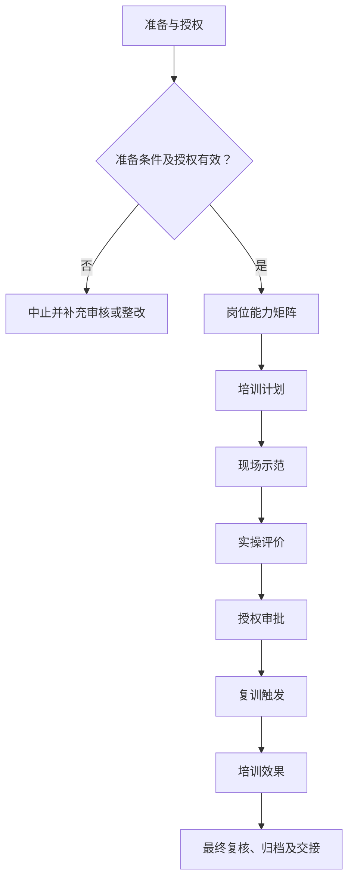

# SOP-019 人员培训与考核标准作业程序

> **版本：V0.3（草案）｜未审核、未批准｜生效日期：【待确认】**
>
> 参照 SOP-002 和 SOP-003 的章节风格整理；实际作业标准、具体设备界限、人员信息与原始记录应在受控系统中确认。公开模板不得直接作为现场操作依据。

## 编制与审批

| 编制 | 审核 | 安全/质量复核 | 批准 | 生效日期 |
| --- | --- | --- | --- | --- |
| 【待签】 | 【待签】 | 【待签】 | 【待签】 | 【待确认】 |

## 修订记录

| 版本 | 日期 | 修订内容 | 状态 |
| --- | --- | --- | --- |
| V0.1 | 2026-11-09 | 建立通用工作框架 | 草案 |
| V0.2 | 2026-11-09 | 补充分步检查、记录和参考依据 | 草案 |
| V0.3 | 2026-11-09 | 统一十三章、流程图、表格和附录结构，保留原有业务要求 | 草案 |

## 一、目的

确保人员具备从事相关实验、检测与设备操作的资格。适用于经组织授权、符合现行法律法规和设备制造商要求的相关实验室活动；不替代具体工艺卡、设备说明书、SDS 与应急预案。

## 二、适用范围

（一）适用于经授权的人员培训与考核工作，具体对象、方法、所用设备、风险范围与人员职责以批准的制度为准。

（二）不适用的实验反应、检测或现场操作不得机械套入；与本业务无关的环节须标记为“不适用”。

（三）本文件不替代受控工艺卡、检测方法、设备手册、SDS及适用法律法规。

## 三、角色与职责

以实际岗位职责组织作业，执行、独立复核和批准人员须按授权分离，不得代签。

表 1　角色与职责

| 角色 | 主要职责 | 签署/记录 |
| --- | --- | --- |
| 执行人 | 实施当前工作、记录实际情况及原始数据 | 执行签字 |
| 复核人 | 独立检查编号、证据、数据与结论 | 复核签字 |
| 技术/业务审核人 | 检查方法适用性、偏差与处理是否合理 | 审核结论 |
| 授权批准人 | 决定放行、恢复或不符合项关闭 | 批准记录 |

**原 V0.2 具体角色要求：**

培训组织人、岗位负责人、受训人、考核人按岗位授权和职责分离原则分工；实际操作者填写原始记录，复核或审批人员独立签署。组织未确定的岗位由内部文件另行指定，公开文件不含个人名单。

## 四、术语和定义

本文件所用术语及阶段节点定义参见附录 C。专用方法、测量和安全术语以相关受控文件为依据。

## 五、作业流程

### （一）流程总图

图 1　人员培训与考核作业流程

该图表示作业关口，不代替具体工艺、设备、检验方法或紧急处置指令。

### （二）流程节点对照

表 2　流程节点与条款对应关系

| 节点 | 本文条款 | 应提供的证据 |
| --- | --- | --- |
| 准备 | 五（三） | 有效工作计划及资源检查 |
| 岗位能力矩阵 | 五（四） | 能力要求与风险相符 |
| 培训计划 | 五（五） | 教材与SOP版本对应 |
| 现场示范 | 五（六） | 受训人理解停止条件 |
| 实操评价 | 五（七） | 有客观评分和评估人 |
| 授权审批 | 五（八） | 岗位负责人签署授权范围 |
| 复训触发 | 五（九） | 对应能力重新通过 |
| 培训效果 | 五（十） | 培训计划根据反馈改进 |
| 归档 | 五（十一） | 异常结论、记录审核与交接 |

### （三）实验/工作准备

- 已取得适用的受控方案、工艺卡或检验方法版本，并确认当前有效。
- 人员能力、场所安全、仪器状态、原辅材料和必要的应急资源符合要求。
- 核查批次、设备、样品及记录编号对应关系；发现不明确事项时暂停开展相关步骤。

（一）检查任务有效性、授权、方法版本、现场条件和工作资源。核对结果采用“○合格／×异常／—不适用”，异常不得空白放行。

表 3　资料及器材准备清单

| 类别 | 准备项目 | 用途 | 检查结果 |
| --- | --- | --- | --- |
| 资料 | 任务书与批准方法 | 核对任务范围、版本及审批 | ○/×/— |
| 人员 | 培训和岗位授权 | 确认操作与复核资格 | ○/×/— |
| 设施与仪器 | 受控设备及系统（适用时） | 检查校准/维护与风险状态 | ○/×/— |
| 记录 | 原始记录、台账及异常表 | 确保记录可追溯 | ○/×/— |

表 4　工作检查项目

| 工作节点 | 检查内容 | 通过依据 | 结果 |
| --- | --- | --- | --- |
| 岗位能力矩阵 | 把各岗位设备、试剂、安全、检测和应急能力逐项映射 | 能力要求与风险相符 | ○/×/— |
| 培训计划 | 新员工、转岗、程序更新、风险变化的培训条件具体化 | 教材与SOP版本对应 | ○/×/— |
| 现场示范 | 讲解准备、执行、异常、应急和原始记录方法 | 受训人理解停止条件 | ○/×/— |
| 实操评价 | 在适当监护下让受训人演示任务并评价关键节点 | 有客观评分和评估人 | ○/×/— |
| 授权审批 | 按考核记录限定可独立执行的设备与活动 | 岗位负责人签署授权范围 | ○/×/— |
| 复训触发 | 新危险物、设备改造、事故或停岗后进行再评估 | 对应能力重新通过 | ○/×/— |
| 培训效果 | 观察偏差、重复错误和岗位变更趋势 | 培训计划根据反馈改进 | ○/×/— |

### （四）岗位能力矩阵

**1. 执行要求**

把各岗位设备、试剂、安全、检测和应急能力逐项映射。

**原 V0.2 操作步骤：** 依据岗位风险、操作复杂度与法规编制岗位能力矩阵和培训清单。

**2. 检查与终点判定**

能力要求与风险相符。依据实际受控标准复核，不允许自行推断定量限值或审批结论。

**3. 异常及交接**

缺资格不得独立操作。发生偏差时暂停受影响活动并保留原始证据、处置单及责任岗位。

### （五）培训计划

**1. 执行要求**

新员工、转岗、程序更新、风险变化的培训条件具体化。

**原 V0.2 操作步骤：** 新员工、转岗人员及相关外协人员先培训后授权，未通过者不得独立操作。

**2. 检查与终点判定**

教材与SOP版本对应。依据实际受控标准复核，不允许自行推断定量限值或审批结论。

**3. 异常及交接**

计划不完整补齐。发生偏差时暂停受影响活动并保留原始证据、处置单及责任岗位。

### （六）现场示范

**1. 执行要求**

讲解准备、执行、异常、应急和原始记录方法。

**原 V0.2 操作步骤：** 培训覆盖适用 SOP、风险识别、个人防护、应急响应、记录规范及设备要求。

**2. 检查与终点判定**

受训人理解停止条件。依据实际受控标准复核，不允许自行推断定量限值或审批结论。

**3. 异常及交接**

安排额外辅导。发生偏差时暂停受影响活动并保留原始证据、处置单及责任岗位。

### （七）实操评价

**1. 执行要求**

在适当监护下让受训人演示任务并评价关键节点。

**原 V0.2 操作步骤：** 采用理论问答、现场实操、观察或模拟异常处理进行能力评估。

**2. 检查与终点判定**

有客观评分和评估人。依据实际受控标准复核，不允许自行推断定量限值或审批结论。

**3. 异常及交接**

不达标重新培训。发生偏差时暂停受影响活动并保留原始证据、处置单及责任岗位。

### （八）授权审批

**1. 执行要求**

按考核记录限定可独立执行的设备与活动。

**原 V0.2 操作步骤：** 培训记录包括材料版本、日期、参与人员、考核依据及授权决定。

**2. 检查与终点判定**

岗位负责人签署授权范围。依据实际受控标准复核，不允许自行推断定量限值或审批结论。

**3. 异常及交接**

没有授权不能独立值守。发生偏差时暂停受影响活动并保留原始证据、处置单及责任岗位。

### （九）复训触发

**1. 执行要求**

新危险物、设备改造、事故或停岗后进行再评估。

**原 V0.2 操作步骤：** 工艺、设备、风险或文件更新后按影响范围组织再培训并验证效果。

**2. 检查与终点判定**

对应能力重新通过。依据实际受控标准复核，不允许自行推断定量限值或审批结论。

**3. 异常及交接**

暂停相关授权。发生偏差时暂停受影响活动并保留原始证据、处置单及责任岗位。

### （十）培训效果

**1. 执行要求**

观察偏差、重复错误和岗位变更趋势。

**原 V0.2 操作步骤：** 定期复评资格，暂停不满足能力要求人员的独立操作权限。

**2. 检查与终点判定**

培训计划根据反馈改进。依据实际受控标准复核，不允许自行推断定量限值或审批结论。

**3. 异常及交接**

纳入安全管理评审。发生偏差时暂停受影响活动并保留原始证据、处置单及责任岗位。

### （十一）结束、审核与交接

完成全部适用阶段后，应核查原始记录、结果、待办、异常与变更，并按授权完成复核和归档。未关闭的关键安全或质量问题不得视为自动放行。

## 六、关键控制点与工艺参数

此处的“参数”泛指业务标准与判定要求；对于非工艺类 SOP，并非必须设置反应条件。

表 5　关键控制点与记录

| 工作阶段 | 判定标准 | 异常处理 | 记录 |
| --- | --- | --- | --- |
| 岗位能力矩阵 | 能力要求与风险相符 | 缺资格不得独立操作 | 检查记录/异常单 |
| 培训计划 | 教材与SOP版本对应 | 计划不完整补齐 | 检查记录/异常单 |
| 现场示范 | 受训人理解停止条件 | 安排额外辅导 | 检查记录/异常单 |
| 实操评价 | 有客观评分和评估人 | 不达标重新培训 | 检查记录/异常单 |
| 授权审批 | 岗位负责人签署授权范围 | 没有授权不能独立值守 | 检查记录/异常单 |
| 复训触发 | 对应能力重新通过 | 暂停相关授权 | 检查记录/异常单 |
| 培训效果 | 培训计划根据反馈改进 | 纳入安全管理评审 | 检查记录/异常单 |

**原 V0.2 关键控制要求：**

- [ ] 完成培训不等于自动授权
- [ ] 重要岗位需实操验证
- [ ] 授权状态应与文件版本绑定
- [ ] 实际记录已由经授权人员复核，相关异常、偏差及变更均有处置结论。
- [ ] 涉及定量阈值、保存时限或安全联锁时，只引用已批准的内部标准，禁止根据本示例自行推定。

## 七、记录要求

### （一）记录表单

- 记录表单：FM-014（详见 `forms/` 目录；具体字段可按受控场景扩展）。
- 通用关联：SOP-004 实验记录与数据管理、SOP-018 文件与记录控制、SOP-020 变更管理。
- 记录应保持真实、完整、可追溯，不在公开仓库录入实际生产或研发数据。

### （二）填写规则

原始数据在产生时记录，纸质更正需保留原值、日期和签字；电子数据保存修改痕迹，严禁代签与无痕覆盖。

### （三）字段说明

表 6　原始记录要求

| 记录项目 | 填写内容及依据 |
| --- | --- |
| 记录项目 1 | 岗位能力矩阵、培训教材版本 |
| 记录项目 2 | 现场实操考核及不合格项 |
| 记录项目 3 | 授权范围、签字和有效条件 |
| 记录项目 4 | 再培训和能力复评证据 |

### （四）归档

按照任务、样品或设备编号关联原始记录、批准文件、异常和结论，保存期限及备份权限【待确认】。

## 八、异常与偏差处理

出现危及人员安全、设备完整性或数据可信度的情形，应立即停止相关操作并执行经批准的现场应急或隔离程序，报告授权责任人；不得绕过防护措施、擅自恢复运行或删除异常记录。按 SOP-006 和 SOP-016 处理调查与整改。

发生影响安全、设备或数据有效性的异常时，应记录事实、时间、受影响范围、临时措施、根因与关闭结论。未完成必要验证不得擅自恢复。

## 九、安全与环保

（一）涉及实验、危化品、设备与能源系统的任务，应执行现场风险评估、SDS、设备说明书、个人防护及应急预案。

（二）涉及文档、人员及数据的活动，应执行保密、个人信息和数据授权要求。

（三）废液/废料按成分与适用法规收集交接，不得未经许可排放。安全关键操作不以本模板推断参数。

## 十、注意事项清单

常见错漏及审核关注点

- **检查：**培训签到不等于具备操作资格。
- **检查：**资格不自动跨设备有效。
- **检查：**关键危险操作需单独核准。

**复核要求：** 不能把其他实验室的设备边界、药品参数或审批周期直接视为本实验室有效标准；每个审核结果均应有记录位置和处置授权。

工作限值、时间周期或认可结论应有实际受控依据，不直接搬用其他机构资料。

## 十一、设备维护与报修

（一）涉及设备、仪器或信息系统时，核查维护、校准、停用和复用状态；不涉及的项目可标“不适用”。

（二）遇故障先停止相关工作，提交工单并按风险等级进行隔离和报告。

（三）维修后验证功能、数据与安全状态，由授权人员确认后复用，维护周期及责任【待确认】。

## 十二、相关文件

**保留原 V0.2 的公开参考及适用性说明：**

公开参考资料和适用性

- [伯克利实验室 SOP 培训管理](https://ehs.berkeley.edu/node/436) — 仅参考公开流程思路，具体适用性须经本单位确认。
- [MIT 化学卫生计划与专用 SOP](https://ehs.mit.edu/chemical-safety-program/chemical-hygiene/) — 仅参考公开流程思路，具体适用性须经本单位确认。
- [OSHA 实验室安全及化学卫生计划](https://www.osha.gov/laws-regs/regulations/standardnumber/1910/1910.1450) — 仅参考公开流程思路，具体适用性须经本单位确认。
- [WHO 实验室质量管理模板](https://www.who.int/publications/m/item/laboratory-quality-manual) — 仅参考公开流程思路，具体适用性须经本单位确认。

以上细则为本项目根据公开经验归纳的通用建议，不是其他机构的操作规程原文，也不表示本组织已获得任何认证、认可或满足适用法律的结论。

配套记录与企业内部文件的正式编号、版本【待确认】。

## 十三、附则

本程序属于 V0.3 草案，经有权人员审核批准并确定生效日期后方可执行。方法、设备、人员权限或风险条件变化时应开展变更评估。复审周期【待确认】。

## 附录 A　待确认事项清单

| 编号 | 待确认事项 | 状态 |
| --- | --- | --- |
| 1 | 岗位矩阵 | 未确认 |
| 2 | 考核标准 | 未确认 |
| 3 | 复训周期 | 未确认 |
| 4 | 授权审批 | 未确认 |
| 5 | 技术负责人、安全负责人和文件批准人确认适用性、法律法规与设备制造商要求。 | 未确认 |
| 6 | 实际启用日期、适用岗位、培训与版本控制经正式批准。 | 未确认 |
| 7 | 适用方法、责任岗位、实际限值及保存期限 | 未确认 |

## 附录 B　流程节点表（表格版）

| 编号 | 流程节点 | 完成依据 |
| --- | --- | --- |
| 1 | 岗位能力矩阵 | 能力要求与风险相符 |
| 2 | 培训计划 | 教材与SOP版本对应 |
| 3 | 现场示范 | 受训人理解停止条件 |
| 4 | 实操评价 | 有客观评分和评估人 |
| 5 | 授权审批 | 岗位负责人签署授权范围 |
| 6 | 复训触发 | 对应能力重新通过 |
| 7 | 培训效果 | 培训计划根据反馈改进 |

调整节点时同时修订第五章的 Mermaid 图与第六章关键控制表。

## 附录 C　术语和定义对照表

表 7　术语定义

| 术语 | 说明 |
| --- | --- |
| 受控文件 | 经批准且有有效版本、适用范围和权限的文件 |
| 原始记录 | 直接产生的观测、执行或测量记录 |
| 独立复核 | 按权限对数据和工作结论进行独立核实 |
| 偏差 | 实际状态与已批准标准不一致 |
| 岗位能力矩阵 | 本文件第五章对应节点；具体要求按受控标准判定 |
| 培训计划 | 本文件第五章对应节点；具体要求按受控标准判定 |
| 现场示范 | 本文件第五章对应节点；具体要求按受控标准判定 |
| 实操评价 | 本文件第五章对应节点；具体要求按受控标准判定 |
| 授权审批 | 本文件第五章对应节点；具体要求按受控标准判定 |
| 复训触发 | 本文件第五章对应节点；具体要求按受控标准判定 |
| 培训效果 | 本文件第五章对应节点；具体要求按受控标准判定 |

## 附录 D　原 V0.2 内容迁移对照

| 原 V0.2 项目 | 本文件位置 |
| --- | --- |
| 目的与范围、角色 | 第一至三章 |
| 工作前提、标准程序、分步检查 | 第五章 |
| 关键控制 | 第六章 |
| 记录字段与证据 | 第七章 |
| 异常及安全要求 | 第八、九章 |
| 典型错漏 | 第十章 |
| 引用依据 | 第十二章 |
| 待确认事项 | 附录 A |
| 修订记录 | 文档首页 |
