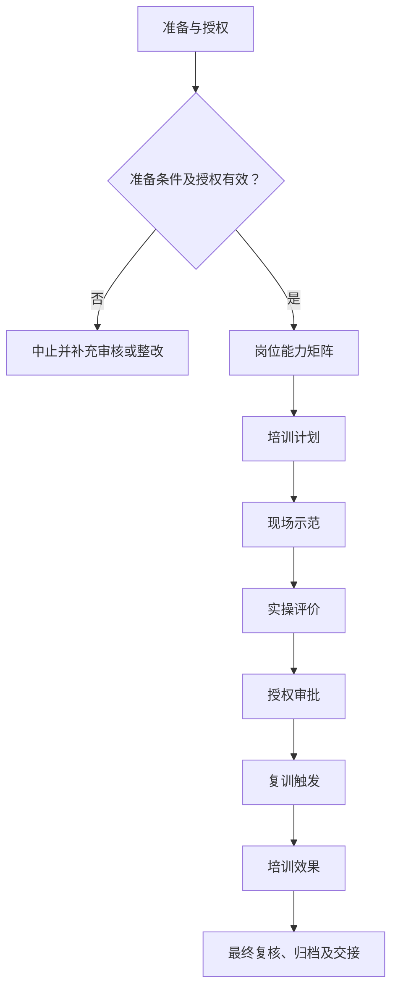

# SOP-019 人员培训与考核标准作业程序

> **文件编号：SOP-019｜版本：V0.4（草案）｜审批状态：未批准｜生效日期：待批准后确定**

## 编制与审批

| 编制 | 审核 | 安全/质量复核 | 批准 | 生效日期 |
| --- | --- | --- | --- | --- |
| 【待签】 | 【待签】 | 【待签】 | 【待签】 | 【待确认】 |

## 修订记录

| 版本 | 日期 | 修订内容 | 状态 |
| --- | --- | --- | --- |
| V0.1 | 2026-11-09 | 建立通用工作框架 | 草案 |
| V0.2 | 2026-11-09 | 补充分步检查、记录和参考依据 | 草案 |
| V0.3 | 2026-11-09 | 统一十三章、流程图、表格和附录结构，保留原有业务要求 | 草案 |
| V0.4 | 2026-11-09 | 规范制度用语、职责与记录表述，优化附录结构 | 草案，未批准 |

## 一、目的

规范岗位能力要求、培训计划、实操评价、岗位授权和复训，保证人员具备相应业务能力。

## 二、适用范围

（一）适用于本单位经授权开展的本程序所述业务，以及相关准备、检查、审核、交接和归档活动。

（二）涉及的对象、技术方法、人员资格和放行条件，以批准的任务及对应受控文件为准。

（三）相关业务涉及化学品、设备或其他危险源时，应同时遵守适用的安全、环保和职业健康管理要求。

## 三、角色与职责

相关岗位按职责分工开展工作。操作、复核和审批由具备相应权限的人员签署，不得代签。

表 1　角色与职责

| 角色 | 工作内容 | 签署与记录 |
| --- | --- | --- |
| 培训负责人 | 制定培训计划 | 对应工作记录及签字 |
| 岗位导师 | 实施示范指导 | 对应工作记录及签字 |
| 考核人 | 评价理论及实操能力 | 对应工作记录及签字 |
| 受训人 | 完成培训与考核 | 对应工作记录及签字 |
| 岗位批准人 | 确认授权范围与复训 | 对应工作记录及签字 |

## 四、术语和定义

本文件所用术语及阶段节点定义参见附录 C。专用方法、测量和安全术语以相关受控文件为依据。

## 五、作业流程

### （一）流程总图

图 1　人员培训与考核作业流程

各节点的执行条件与记录要求按本程序对应条款执行；涉及专项技术操作时，还须遵守相应的受控规程。

### （二）流程节点对照

表 2　流程节点与条款对应关系

| 节点 | 本文条款 | 应提供的证据 |
| --- | --- | --- |
| 准备 | 五（三） | 有效工作计划及资源检查 |
| 岗位能力矩阵 | 五（四） | 能力要求与风险相符 |
| 培训计划 | 五（五） | 教材与SOP版本对应 |
| 现场示范 | 五（六） | 受训人理解停止条件 |
| 实操评价 | 五（七） | 有客观评分和评估人 |
| 授权审批 | 五（八） | 岗位负责人签署授权范围 |
| 复训触发 | 五（九） | 对应能力重新通过 |
| 培训效果 | 五（十） | 培训计划根据反馈改进 |
| 归档 | 五（十一） | 异常结论、记录审核与交接 |

### （三）作业准备

（一）核对任务申请、工作方案及相关受控文件的编号、版本与审批状态。
（二）核对岗位授权、仪器和作业资源，确认现场条件及必要的安全措施满足要求。
（三）核查任务、样品、设备与记录编号的对应关系；存在身份或状态疑问时暂停相关工作。

（四）核查结果按“○合格／×异常／—不适用”填写。异常项目须说明原因、处置措施及复核情况，关键检查项未通过不得放行。

表 3　资料及器材准备清单

| 类别 | 准备项目 | 用途 | 检查结果 |
| --- | --- | --- | --- |
| 资料 | 任务书与批准方法 | 核对任务范围、版本及审批 | ○/×/— |
| 人员 | 培训和岗位授权 | 确认操作与复核资格 | ○/×/— |
| 设施与仪器 | 受控设备及系统（适用时） | 检查校准/维护与风险状态 | ○/×/— |
| 记录 | 原始记录、台账及异常表 | 确保记录可追溯 | ○/×/— |

表 4　工作检查项目

| 工作节点 | 检查内容 | 通过依据 | 结果 |
| --- | --- | --- | --- |
| 岗位能力矩阵 | 把各岗位设备、试剂、安全、检测和应急能力逐项映射 | 能力要求与风险相符 | ○/×/— |
| 培训计划 | 新员工、转岗、程序更新、风险变化的培训条件具体化 | 教材与SOP版本对应 | ○/×/— |
| 现场示范 | 讲解准备、执行、异常、应急和原始记录方法 | 受训人理解停止条件 | ○/×/— |
| 实操评价 | 在适当监护下让受训人演示任务并评价关键节点 | 有客观评分和评估人 | ○/×/— |
| 授权审批 | 按考核记录限定可独立执行的设备与活动 | 岗位负责人签署授权范围 | ○/×/— |
| 复训触发 | 新危险物、设备改造、事故或停岗后进行再评估 | 对应能力重新通过 | ○/×/— |
| 培训效果 | 观察偏差、重复错误和岗位变更趋势 | 培训计划根据反馈改进 | ○/×/— |

### （四）岗位能力矩阵

**1. 执行要求**

（一）把各岗位设备、试剂、安全、检测和应急能力逐项映射。

（二）依据岗位风险、操作复杂度与法规编制岗位能力矩阵和培训清单。

**2. 检查与终点判定**

能力要求与风险相符。检查结果须经授权人员按受控标准复核。

**3. 异常及交接**

缺资格不得独立操作。偏差处置与岗位交接应形成记录；涉及重大风险或结果有效性的异常按第八章执行。

### （五）培训计划

**1. 执行要求**

（一）新员工、转岗、程序更新、风险变化的培训条件具体化。

（二）新员工、转岗人员及相关外协人员先培训后授权，未通过者不得独立操作。

**2. 检查与终点判定**

教材与SOP版本对应。检查结果须经授权人员按受控标准复核。

**3. 异常及交接**

计划不完整补齐。偏差处置与岗位交接应形成记录；涉及重大风险或结果有效性的异常按第八章执行。

### （六）现场示范

**1. 执行要求**

（一）讲解准备、执行、异常、应急和原始记录方法。

（二）培训覆盖适用 SOP、风险识别、个人防护、应急响应、记录规范及设备要求。

**2. 检查与终点判定**

受训人理解停止条件。检查结果须经授权人员按受控标准复核。

**3. 异常及交接**

安排额外辅导。偏差处置与岗位交接应形成记录；涉及重大风险或结果有效性的异常按第八章执行。

### （七）实操评价

**1. 执行要求**

（一）在适当监护下让受训人演示任务并评价关键节点。

（二）采用理论问答、现场实操、观察或模拟异常处理进行能力评估。

**2. 检查与终点判定**

有客观评分和评估人。检查结果须经授权人员按受控标准复核。

**3. 异常及交接**

不达标重新培训。偏差处置与岗位交接应形成记录；涉及重大风险或结果有效性的异常按第八章执行。

### （八）授权审批

**1. 执行要求**

（一）按考核记录限定可独立执行的设备与活动。

（二）培训记录包括材料版本、日期、参与人员、考核依据及授权决定。

**2. 检查与终点判定**

岗位负责人签署授权范围。检查结果须经授权人员按受控标准复核。

**3. 异常及交接**

没有授权不能独立值守。偏差处置与岗位交接应形成记录；涉及重大风险或结果有效性的异常按第八章执行。

### （九）复训触发

**1. 执行要求**

（一）新危险物、设备改造、事故或停岗后进行再评估。

（二）工艺、设备、风险或文件更新后按影响范围组织再培训并验证效果。

**2. 检查与终点判定**

对应能力重新通过。检查结果须经授权人员按受控标准复核。

**3. 异常及交接**

暂停相关授权。偏差处置与岗位交接应形成记录；涉及重大风险或结果有效性的异常按第八章执行。

### （十）培训效果

**1. 执行要求**

（一）观察偏差、重复错误和岗位变更趋势。

（二）定期复评资格，暂停不满足能力要求人员的独立操作权限。

**2. 检查与终点判定**

培训计划根据反馈改进。检查结果须经授权人员按受控标准复核。

**3. 异常及交接**

纳入安全管理评审。偏差处置与岗位交接应形成记录；涉及重大风险或结果有效性的异常按第八章执行。

### （十一）结束、审核与交接

完成全部适用阶段后，应核查原始记录、结果、待办、异常与变更，并按授权完成复核和归档。未关闭的关键安全或质量问题不得视为自动放行。

## 六、关键控制点与工艺参数

各流程节点的控制标准、判定要求及记录项目见表 5。涉及具体技术指标或安全限值时，应引用已批准的适用文件。

表 5　关键控制点与记录

| 工作阶段 | 判定标准 | 异常处理 | 记录 |
| --- | --- | --- | --- |
| 岗位能力矩阵 | 能力要求与风险相符 | 缺资格不得独立操作 | 检查记录/异常单 |
| 培训计划 | 教材与SOP版本对应 | 计划不完整补齐 | 检查记录/异常单 |
| 现场示范 | 受训人理解停止条件 | 安排额外辅导 | 检查记录/异常单 |
| 实操评价 | 有客观评分和评估人 | 不达标重新培训 | 检查记录/异常单 |
| 授权审批 | 岗位负责人签署授权范围 | 没有授权不能独立值守 | 检查记录/异常单 |
| 复训触发 | 对应能力重新通过 | 暂停相关授权 | 检查记录/异常单 |
| 培训效果 | 培训计划根据反馈改进 | 纳入安全管理评审 | 检查记录/异常单 |

**补充控制要求：**

- [ ] 完成培训不等于自动授权
- [ ] 重要岗位需实操验证
- [ ] 授权状态应与文件版本绑定
- [ ] 实际记录已由经授权人员复核，相关异常、偏差及变更均有处置结论。
- [ ] 技术限值、保存时限和安全要求已核对适用的批准文件。

## 七、记录要求

### （一）记录表单

- 记录表单：FM-014（详见 `forms/` 目录；具体字段可按受控场景扩展）。
- 通用关联：SOP-004 实验记录与数据管理、SOP-018 文件与记录控制、SOP-020 变更管理。
- 记录应保持真实、完整、可追溯，不在公开仓库录入实际生产或研发数据。

### （二）填写规则

原始数据在产生时记录，纸质更正需保留原值、日期和签字；电子数据保存修改痕迹，严禁代签与无痕覆盖。

### （三）字段说明

表 6　原始记录要求

| 记录项目 | 填写内容及依据 |
| --- | --- |
| 岗位能力 | 岗位能力矩阵、培训教材版本 |
| 课程版本 | 现场实操考核及不合格项 |
| 培训和考核 | 授权范围、签字和有效条件 |
| 授权记录 | 再培训和能力复评证据 |

### （四）归档

按照任务、样品或设备编号关联原始记录、批准文件、异常和结论，保存期限及备份权限【待确认】。

## 八、异常与偏差处理

出现危及人员安全、设备完整性或数据可信度的情形，应立即停止相关操作并执行经批准的现场应急或隔离程序，报告授权责任人；不得绕过防护措施、擅自恢复运行或删除异常记录。按 SOP-006 和 SOP-016 处理调查与整改。

发生影响安全、设备或数据有效性的异常时，应记录事实、时间、受影响范围、临时措施、根因与关闭结论。未完成必要验证不得擅自恢复。

## 九、安全与环保

（一）涉及实验、危化品、设备与能源系统的任务，应执行现场风险评估、SDS、设备说明书、个人防护及应急预案。

（二）涉及文档、人员及数据的活动，应执行保密、个人信息和数据授权要求。

（三）废液/废料按成分与适用法规收集交接，不得未经许可排放。安全关键操作不以本模板推断参数。

## 十、注意事项清单

常见错漏及审核关注点

- **检查：**培训签到不等于具备操作资格。
- **检查：**资格不自动跨设备有效。
- **检查：**关键危险操作需单独核准。

**复核要求：** 不能把其他实验室的设备边界、药品参数或审批周期直接视为本实验室有效标准；每个审核结果均应有记录位置和处置授权。

技术限值、检查周期和检测机构认可范围均应核对实际有效的批准依据。

## 十一、设备维护与报修

（一）涉及设备、仪器或信息系统时，核查维护、校准、停用和复用状态；不涉及的项目可标“不适用”。

（二）遇故障先停止相关工作，提交工单并按风险等级进行隔离和报告。

（三）维修后验证功能、数据与安全状态，由授权人员确认后复用，维护周期及责任【待确认】。

## 十二、相关文件

**引用资料：**

- [伯克利实验室 SOP 培训管理](https://ehs.berkeley.edu/node/436) — 仅参考公开流程思路，具体适用性须经本单位确认。
- [MIT 化学卫生计划与专用 SOP](https://ehs.mit.edu/chemical-safety-program/chemical-hygiene/) — 仅参考公开流程思路，具体适用性须经本单位确认。
- [OSHA 实验室安全及化学卫生计划](https://www.osha.gov/laws-regs/regulations/standardnumber/1910/1910.1450) — 仅参考公开流程思路，具体适用性须经本单位确认。
- [WHO 实验室质量管理模板](https://www.who.int/publications/m/item/laboratory-quality-manual) — 仅参考公开流程思路，具体适用性须经本单位确认。

引用资料用于文件编制时的管理参考。相关标准的适用性和符合性要求，须由授权人员结合实际业务及现行法规核实。

本程序涉及的内部管理文件、检测方法、合同及记录表单应使用有效受控版本；未确定的编号在文件台账中确认。

## 十三、附则

本程序为 V0.4 草案，经授权审核批准并确定生效日期后实施。方法、设备、岗位权限或风险条件发生重大变化时，应按变更管理程序复审；复审周期【待确认】。

## 附录 A　待确认事项清单

| 编号 | 待确认事项 | 状态 |
| --- | --- | --- |
| 1 | 岗位矩阵 | 未确认 |
| 2 | 考核标准 | 未确认 |
| 3 | 复训周期 | 未确认 |
| 4 | 授权审批 | 未确认 |
| 5 | 技术负责人、安全负责人和文件批准人确认适用性、法律法规与设备制造商要求。 | 未确认 |
| 6 | 实际启用日期、适用岗位、培训与版本控制经正式批准。 | 未确认 |
| 7 | 适用方法、责任岗位、实际限值及保存期限 | 未确认 |

## 附录 B　流程节点表（表格版）

| 编号 | 流程节点 | 完成依据 |
| --- | --- | --- |
| 1 | 岗位能力矩阵 | 能力要求与风险相符 |
| 2 | 培训计划 | 教材与SOP版本对应 |
| 3 | 现场示范 | 受训人理解停止条件 |
| 4 | 实操评价 | 有客观评分和评估人 |
| 5 | 授权审批 | 岗位负责人签署授权范围 |
| 6 | 复训触发 | 对应能力重新通过 |
| 7 | 培训效果 | 培训计划根据反馈改进 |

流程节点调整时，应同步修订第五章流程图、流程节点对照表及第六章控制要求。

## 附录 C　术语和定义对照表

表 7　术语定义

| 术语 | 说明 |
| --- | --- |
| 受控文件 | 经批准且有有效版本、适用范围和权限的文件 |
| 原始记录 | 直接产生的观测、执行或测量记录 |
| 独立复核 | 按权限对数据和工作结论进行独立核实 |
| 偏差 | 实际状态与已批准标准不一致 |
| 岗位能力矩阵 | 把各岗位设备、试剂、安全、检测和应急能力逐项映射；执行及核查要求见第五章。 |
| 培训计划 | 新员工、转岗、程序更新、风险变化的培训条件具体化；执行及核查要求见第五章。 |
| 现场示范 | 讲解准备、执行、异常、应急和原始记录方法；执行及核查要求见第五章。 |
| 实操评价 | 在适当监护下让受训人演示任务并评价关键节点；执行及核查要求见第五章。 |
| 授权审批 | 按考核记录限定可独立执行的设备与活动；执行及核查要求见第五章。 |
| 复训触发 | 新危险物、设备改造、事故或停岗后进行再评估；执行及核查要求见第五章。 |
| 培训效果 | 观察偏差、重复错误和岗位变更趋势；执行及核查要求见第五章。 |

## 附录 D　关联记录及文件索引

| 记录类别 | 主要内容 | 管理要求 |
| --- | --- | --- |
| 任务与审批文件 | 业务申请、方案及审批记录 | 按任务编号及有效版本管理 |
| 执行与核查记录 | 阶段检查、原始数据与相应复核记录 | 责任人员签字确认 |
| 异常与纠正记录 | 偏差、临时措施、整改、验证及关闭结论 | 与相关任务双向关联 |
| 报告及归档资料 | 结论报告、交接与附件 | 按批准的保存期限及权限归档 |
